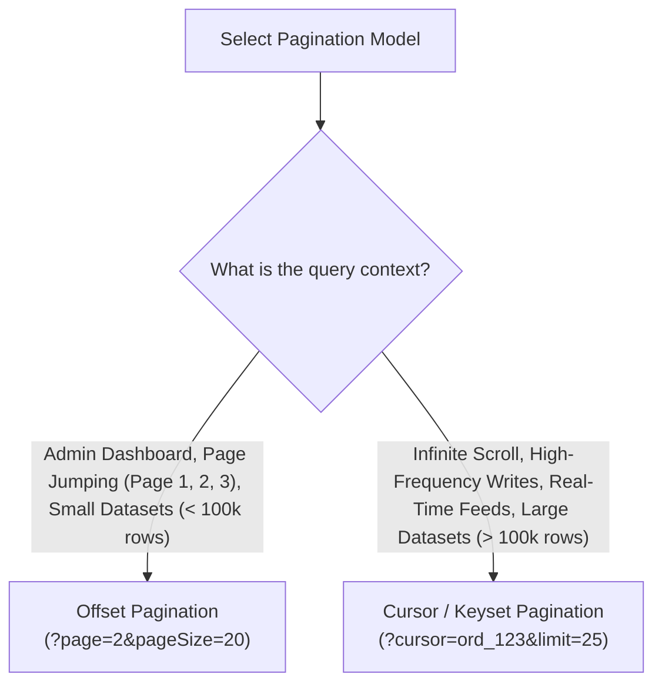

APIs must never return unbounded database collections. Unpaginated queries exhaust server memory, saturate network bandwidth, and crash client applications.

---

## 1. Offset vs. Cursor: Architectural Comparison



| Criterion | Offset-Based (`page` / `pageSize`) | Cursor-Based (`cursor` / `limit`) |
| :--- | :--- | :--- |
| **SQL Implementation** | `OFFSET 100000 LIMIT 20` | `WHERE id > 'cursor_val' ORDER BY id ASC LIMIT 20` |
| **Performance at Depth** | Degrades linearly ($O(N)$); DB must scan and discard all preceding offset rows. | Instantaneous ($O(\log N)$) leveraging indexed B-Tree lookups. |
| **Consistency under Writes**| Skips or duplicates rows if items are inserted/deleted concurrently. | Completely stable; cursor acts as an immutable anchor. |
| **Random Page Jump** | Yes (e.g. "Go to Page 14"). | No (only "Next" and "Previous" sequential navigation). |
| **Total Count Required?**| Yes (`totalRecords` and `totalPages` computed). | Optional / Omitted (usually provides `hasNextPage`). |

---

## 2. Node.js Implementation with Prisma

### Offset Pagination

```ts title="src/repositories/product.repository.ts"
export const listProductsOffset = async (page = 1, pageSize = 20) => {
  const skip = (page - 1) * pageSize;

  const [totalRecords, data] = await prisma.$transaction([
    prisma.product.count(),
    prisma.product.findMany({
      skip,
      take: pageSize,
      orderBy: { createdAt: 'desc' },
    }),
  ]);

  const totalPages = Math.ceil(totalRecords / pageSize);

  return {
    data,
    meta: {
      pagination: {
        page,
        pageSize,
        totalRecords,
        totalPages,
        hasNextPage: page < totalPages,
        hasPrevPage: page > 1,
      },
    },
  };
};
```

### Cursor-Based Pagination

```ts title="src/repositories/feed.repository.ts"
export const listFeedCursor = async (cursor?: string, limit = 20) => {
  const items = await prisma.post.findMany({
    take: limit + 1, // Fetch 1 extra to determine if next page exists
    ...(cursor && {
      skip: 1, // Skip the anchor item itself
      cursor: { id: cursor },
    }),
    orderBy: { id: 'asc' },
  });

  const hasNextPage = items.length > limit;
  const data = hasNextPage ? items.slice(0, limit) : items;
  const nextCursor = hasNextPage ? data[data.length - 1]?.id : null;

  return {
    data,
    meta: {
      cursor: {
        nextCursor,
        hasNextPage,
        limit,
      },
    },
  };
};
```

---

## 3. Python Implementation with SQLAlchemy 2.0

### Offset Pagination

```python title="app/repositories/user_repository.py"
from sqlalchemy import select, func
from sqlalchemy.ext.asyncio import AsyncSession
from app.models.user import UserModel

async def get_users_offset(session: AsyncSession, page: int = 1, page_size: int = 20):
    offset = (page - 1) * page_size

    # Total Count Query
    total_query = select(func.count(UserModel.id))
    total_records = (await session.execute(total_query)).scalar_one()

    # Data Fetch
    data_query = (
        select(UserModel)
        .order_by(UserModel.created_at.desc())
        .offset(offset)
        .limit(page_size)
    )
    result = await session.execute(data_query)
    users = result.scalars().all()

    total_pages = (total_records + page_size - 1) // page_size

    return {
        "items": users,
        "total": total_records,
        "page": page,
        "page_size": page_size,
        "total_pages": total_pages,
    }
```

### Keyset / Cursor Pagination

```python title="app/repositories/order_repository.py"
from typing import Optional
from uuid import UUID
from sqlalchemy import select
from sqlalchemy.ext.asyncio import AsyncSession
from app.models.order import OrderModel

async def get_orders_cursor(session: AsyncSession, cursor: Optional[UUID] = None, limit: int = 25):
    query = select(OrderModel).order_by(OrderModel.id.asc()).limit(limit + 1)

    if cursor:
        query = query.where(OrderModel.id > cursor)

    result = await session.execute(query)
    orders = list(result.scalars().all())

    has_next = len(orders) > limit
    data = orders[:limit] if has_next else orders
    next_cursor = str(data[-1].id) if (has_next and data) else None

    return {"data": data, "next_cursor": next_cursor, "has_next": has_next}
```

---

## 4. Total Count Performance on Large Tables

<Callout type="warning">
Running `SELECT COUNT(*)` on PostgreSQL tables with millions of rows requires a full sequential scan and is notoriously slow. For datasets exceeding 1,000,000 rows:
- Either switch to **cursor-based pagination** (omitting the exact total count).
- Or query PostgreSQL system statistics for an approximate row count:
```sql
SELECT reltuples::BIGINT AS estimate FROM pg_class WHERE relname = 'orders';
```
</Callout>

---

## Related

- [REST Conventions & Query Protocol](/docs/development/backend/api-development/rest-conventions)
- [Response Standards & Envelopes](/docs/development/backend/api-development/response-standards)
- [Database Query Optimization](/docs/development/backend/database/query-optimization)
