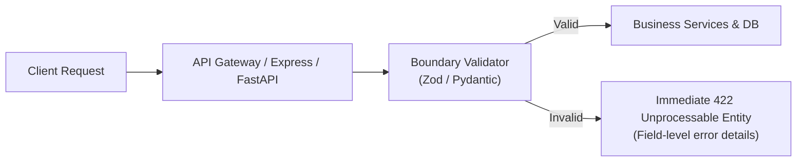

Validating input at the network boundary ensures that malformed data, malicious injection vectors, and missing parameters are rejected before executing business logic or reaching the database.

---

## 1. Validation at the Boundary



---

## 2. Node.js Implementation: Zod `validateRequest` Middleware

In Express, implement a composable `validateRequest` middleware that validates `body`, `query`, or `params`:

```ts title="src/middleware/validate.middleware.ts"
import { Request, Response, NextFunction } from 'express';
import { AnyZodObject, ZodError } from 'zod';

interface RequestValidationSchema {
  body?: AnyZodObject;
  query?: AnyZodObject;
  params?: AnyZodObject;
}

export const validateRequest = (schemas: RequestValidationSchema) => {
  return async (req: Request, _res: Response, next: NextFunction): Promise<void> => {
    try {
      if (schemas.params) {
        req.params = await schemas.params.parseAsync(req.params);
      }
      if (schemas.query) {
        req.query = await schemas.query.parseAsync(req.query);
      }
      if (schemas.body) {
        req.body = await schemas.body.parseAsync(req.body);
      }
      next();
    } catch (error) {
      if (error instanceof ZodError) {
        // Passes directly to global error handler
        return next(error);
      }
      next(error);
    }
  };
};
```

### Schema Example with Sanitization

```ts title="src/validators/auth.validator.ts"
import { z } from 'zod';

export const registerSchema = z
  .object({
    email: z
      .string()
      .email('Invalid email address')
      .trim()
      .toLowerCase(), // Sanitization: normalized email
    password: z
      .string()
      .min(8, 'Password must be at least 8 characters')
      .regex(/[A-Z]/, 'Must contain at least one uppercase letter')
      .regex(/[0-9]/, 'Must contain at least one number'),
    confirmPassword: z.string(),
    fullName: z
      .string()
      .min(2, 'Name must be at least 2 characters')
      .max(100)
      .trim(),
  })
  .refine((data) => data.password === data.confirmPassword, {
    message: 'Passwords do not match',
    path: ['confirmPassword'],
  });
```

---

## 3. Python Implementation: FastAPI & Pydantic v2

FastAPI validates request schemas natively via Pydantic model type annotations:

```python title="app/schemas/order.py"
from decimal import Decimal
from typing import List
from pydantic import BaseModel, Field, field_validator

class OrderItemSchema(BaseModel):
    product_id: str = Field(..., description="Target product ID")
    quantity: int = Field(..., gt=0, le=100, description="Quantity between 1 and 100")
    unit_price: Decimal = Field(..., gt=Decimal("0.00"), decimal_places=2)

class CreateOrderSchema(BaseModel):
    customer_email: str = Field(..., description="Customer notification email")
    items: List[OrderItemSchema] = Field(..., min_length=1, description="Order must contain at least 1 item")
    notes: str | None = Field(default=None, max_length=500)

    @field_validator("customer_email")
    @classmethod
    def normalize_email(cls, v: str) -> str:
        return v.strip().lower()
```

---

## 4. Standard 422 Validation Error Format

When validation fails, both Node.js and FastAPI services return the identical error envelope:

```json
{
  "error": {
    "code": "VALIDATION_FAILED",
    "message": "Request validation failed",
    "details": [
      {
        "field": "items.0.quantity",
        "message": "Input should be greater than 0",
        "code": "greater_than"
      },
      {
        "field": "customer_email",
        "message": "Invalid email format",
        "code": "value_error"
      }
    ]
  },
  "meta": {
    "requestId": "req_c92b81fa-2234",
    "timestamp": "2026-11-01T08:30:00.000Z"
  }
}
```

<Callout type="warning">
Reject unknown payload fields using `.strict()` in Zod schemas or `extra = 'forbid'` in Pydantic. Allowing undefined parameters enables **Mass Assignment vulnerabilities**, where clients maliciously overwrite administrative flags (such as `role` or `isVerified`).
</Callout>

---

## Related

- [Response Standards & Error Envelopes](/docs/development/backend/api-development/response-standards)
- [Input Validation & Security](/docs/development/backend/security/input-validation)
- [Pydantic v2 Models](/docs/development/backend/python-fastapi/pydantic-models)
