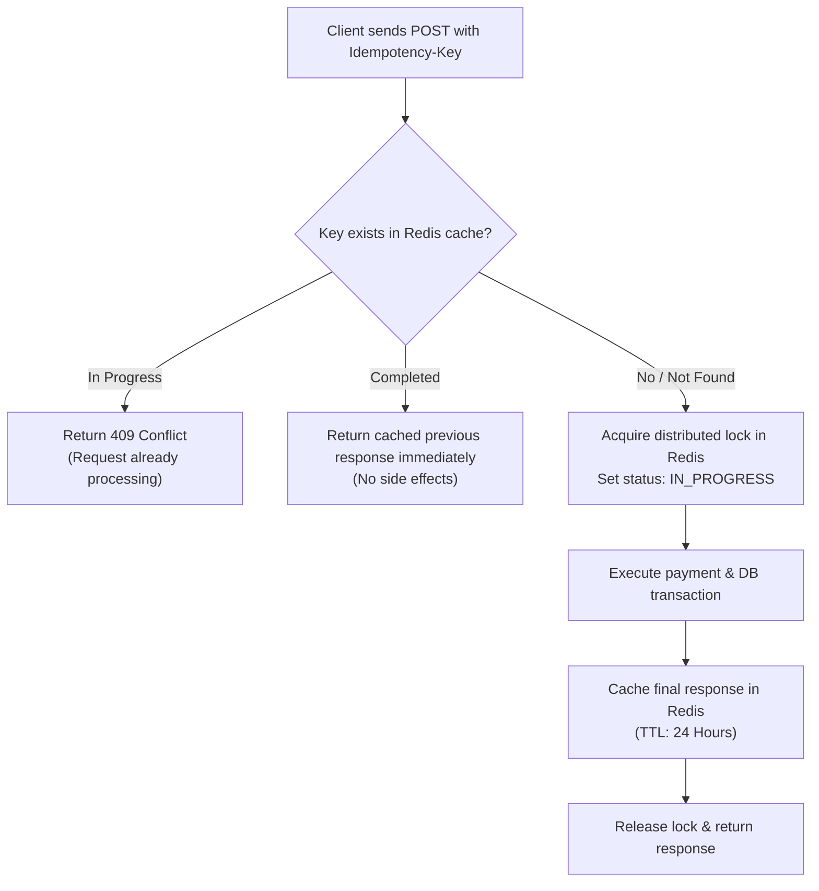

At Nexium Media, our public and internal APIs serve frontend single-page apps, mobile applications, external partner webhooks, and third-party integrations. This document defines our standard RESTful interface conventions.

---

## 1. Resource Naming & URI Taxonomy

We adhere to strict RESTful modeling standards:

1. **Use Plural Nouns for Resources**: Resources represent collections or individual instances of entities. Always use nouns, never verbs.
   - ✅ `/api/v1/users`
   - ✅ `/api/v1/orders/ORD-9821`
   - ❌ `/api/v1/getUsers`
   - ❌ `/api/v1/createUser`
2. **Kebab-Case Path Delimiters**: Path segments must use lower-case characters separated by hyphens.
   - ✅ `/api/v1/billing-accounts/acc_123/payment-methods`
   - ❌ `/api/v1/billingAccounts/acc_123/payment_methods`
3. **Explicit API Versioning**: Prefix all endpoints with the API major version (`/api/v1/...`). Never deploy unversioned endpoints.
4. **Shallow Nesting (Maximum 2 Levels)**: Deep hierarchical URLs become brittle and unmanageable. If a resource is globally identifiable, address it at the top level.
   - ✅ `/api/v1/authors/auth_1/books` (Collection sub-resource)
   - ✅ `/api/v1/books/bk_99` (Direct access via unique ID)
   - ❌ `/api/v1/authors/auth_1/books/bk_99/chapters/ch_3/paragraphs` (Over-nested anti-pattern)

---

## 2. HTTP Method Semantics

Each HTTP verb communicates exact intent and side-effect expectations:

| Verb | Semantics | Idempotent | Safe | Typical Response Code |
| :--- | :--- | :--- | :--- | :--- |
| **GET** | Retrieve a resource or collection | Yes | Yes | `200 OK` |
| **POST** | Create a new resource or execute an operation | No | No | `201 Created` or `200 OK` |
| **PUT** | Full replacement of an existing resource | Yes | No | `200 OK` or `204 No Content` |
| **PATCH** | Partial update of existing resource fields | No / Yes | No | `200 OK` |
| **DELETE** | Remove a resource | Yes | No | `204 No Content` |

<Callout type="note">
**PUT vs PATCH**: `PUT` requires the client to supply the complete state of the entity; omitted properties are set to null or defaults. `PATCH` allows partial mutations where only supplied fields are updated. At Nexium Media, **`PATCH` is preferred for updates**.
</Callout>

---

## 3. Standard Response Envelopes

Every response emitted by our APIs adheres to a consistent JSON envelope.

### Successful Response Format

```json
{
  "data": {
    "id": "usr_902f8a12",
    "email": "alex.chen@nexiummedia.com",
    "fullName": "Alex Chen",
    "role": "ADMIN",
    "createdAt": "2026-10-15T09:30:00.000Z"
  },
  "meta": {
    "requestId": "req_8b91a27e-3c22-48f5-93df-f4460d3d5f19",
    "timestamp": "2026-11-01T08:00:00.000Z"
  }
}
```

### Paginated Collection Response Format

```json
{
  "data": [
    { "id": "usr_1", "email": "dev1@nexiummedia.com" },
    { "id": "usr_2", "email": "dev2@nexiummedia.com" }
  ],
  "meta": {
    "requestId": "req_12345",
    "timestamp": "2026-11-01T08:00:00.000Z",
    "pagination": {
      "page": 1,
      "pageSize": 20,
      "totalRecords": 142,
      "totalPages": 8,
      "hasNextPage": true,
      "hasPrevPage": false
    }
  }
}
```

### Error Response Format

Errors must never return a plain string. Always supply a structured payload with an operational error code:

```json
{
  "error": {
    "code": "VALIDATION_FAILED",
    "message": "The request payload failed schema validation",
    "details": [
      {
        "field": "email",
        "message": "Must be a valid email address",
        "code": "invalid_string"
      },
      {
        "field": "password",
        "message": "Password must contain at least 8 characters",
        "code": "too_small"
      }
    ]
  },
  "meta": {
    "requestId": "req_8b91a27e-3c22-48f5-93df-f4460d3d5f19",
    "timestamp": "2026-11-01T08:00:00.000Z"
  }
}
```

---

## 4. HTTP Status Codes Matrix

Never return `200 OK` when an error has occurred. Always map outcomes to precise HTTP status codes:

| Code | Label | Usage Scenario |
| :--- | :--- | :--- |
| **200** | `OK` | Successful `GET`, `PATCH`, or non-creation `POST`. |
| **201** | `Created` | Successful `POST` creating a new resource. Returns resource payload. |
| **204** | `No Content` | Successful `DELETE` or empty update. No response body. |
| **400** | `Bad Request` | Malformed JSON syntax or unparseable headers. |
| **401** | `Unauthorized` | Missing, expired, or invalid JWT authentication token. |
| **403** | `Forbidden` | Authenticated, but lacks required role or ownership permissions. |
| **404** | `Not Found` | The requested URI resource does not exist. |
| **409** | `Conflict` | State conflict (e.g. duplicate email, version conflict). |
| **422** | `Unprocessable Entity` | Valid JSON, but fails schema validation rules (e.g. invalid email format). |
| **429** | `Too Many Requests` | Client has exceeded rate limit thresholds. |
| **500** | `Internal Server Error` | Uncaught exception or programmer fault. Logged internally, generic message to client. |

---

## 5. Idempotency Mechanisms

For mutation operations involving money, third-party state, or external side effects (e.g., checkout, funds transfer, charging a credit card), clients must submit an **`Idempotency-Key`** header:

```http
POST /api/v1/payments/charges HTTP/1.1
Host: api.nexiummedia.com
Authorization: Bearer <token>
Idempotency-Key: 9b2d9d1b-3660-4416-8968-3e4b330364c7
Content-Type: application/json

{
  "orderId": "ord_8829",
  "amountInCents": 4900
}
```

### Server-Side Idempotency Workflow



---

## 6. HATEOAS & Pagination Headers

For cursor or page navigation, backends must emit RFC 5988 standard `Link` headers alongside the JSON envelope:

```http
HTTP/1.1 200 OK
Content-Type: application/json
Link: </api/v1/users?page=3&pageSize=20>; rel="next",
      </api/v1/users?page=1&pageSize=20>; rel="prev",
      </api/v1/users?page=8&pageSize=20>; rel="last"
```

---

## Related

- [Request Validation Standards](/docs/development/backend/api-development/request-validation)
- [Response Standards & Error Codes](/docs/development/backend/api-development/response-standards)
- [Pagination Strategies (Offset vs Cursor)](/docs/development/backend/api-development/pagination)
- [Rate Limiting Patterns](/docs/development/backend/api-development/rate-limiting)
