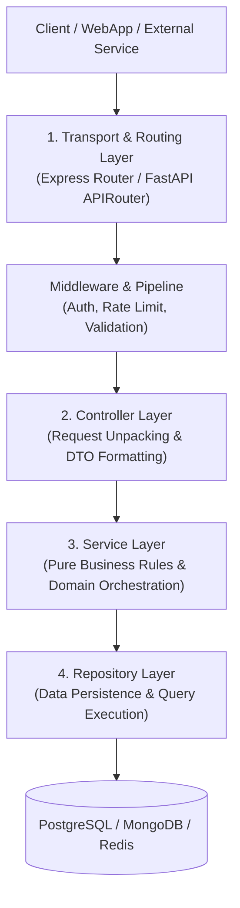

At Nexium Media, our backend systems power diverse business critical solutions: from high-volume ecommerce checkouts and enterprise resource planning engines to real-time notification hubs and asynchronous data pipelines.

To support this breadth with high velocity across 100+ developers, our backends adhere to strict, proven architectural models that maximize **modularity, testability, and operational stability**.

---

## Architectural Paradigm: The Layered Pattern

We reject monolithic "fat-controller" and "active-record-in-route" paradigms. Instead, all services in both Node.js and Python enforce a **Four-Layer Architecture**:

### Why Layered Architecture?

1. **Independent Testability**: Business logic inside the Service layer can be unit tested in isolation without spinning up mock HTTP servers or connecting to live databases.
2. **Persistence Agnosticism**: Data access details (SQL queries, Prisma methods, MongoDB aggregations) are isolated inside repositories. Changing an ORM or migrating from PostgreSQL to DynamoDB leaves the service layer completely untouched.
3. **Transport Agnosticism**: A domain service method (e.g., `processInvoice()`) can be invoked identically by an HTTP REST controller, a background job processor, a WebSocket handler, or a CLI command.
4. **Enforced Boundaries**: Code reviews become objective. If an engineer attempts to write an SQL query inside an Express route handler, the pull request is immediately flagged.

---

## Service-Oriented Boundaries

For large-scale client engagements, our systems are partitioned into bounded contexts following Domain-Driven Design (DDD) principles:

- **Identity & Access Management (IAM)**: Token issuance, OAuth2 provider integration, user authentication, and RBAC authorization.
- **Billing & Subscriptions**: Stripe/Razorpay integrations, webhook idempotency, invoices, and payment lifecycle management.
- **Core Domain Services**: Business-specific logic, resource management, and workflows.
- **Asynchronous Notification & Email**: Queue-backed delivery workers isolated from user-facing request latency.

---

## Architecture Track Overview

Explore the core architectural specifications:

<Cards>
  <Card
    title="Project Structure"
    href="/docs/development/backend/architecture/project-structure"
    description="Comprehensive directory blueprints for Node.js (src/) and Python (app/) with directory responsibilities."
  />
  <Card
    title="Layered Architecture"
    href="/docs/development/backend/architecture/layered-architecture"
    description="Deep dive into Router -> Controller -> Service -> Repository data flows and dependency inversion."
  />
  <Card
    title="API Design Conventions"
    href="/docs/development/backend/architecture/api-design"
    description="RESTful resource design, HTTP method semantics, status code standards, and idempotency."
  />
</Cards>

---

## Related

- [Node.js Controllers & Services](/docs/development/backend/node-express/controllers-services)
- [FastAPI Dependency Injection](/docs/development/backend/python-fastapi/dependency-injection)
- [Database Persistence & ORM](/docs/development/backend/database)
