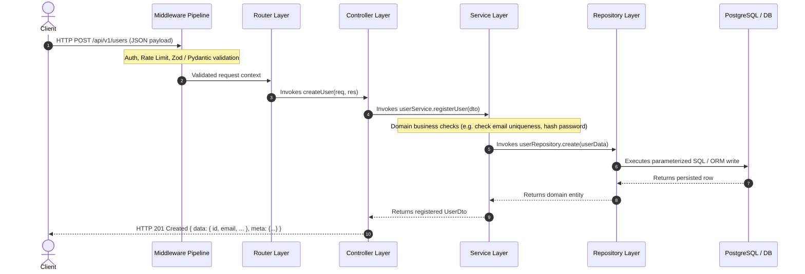
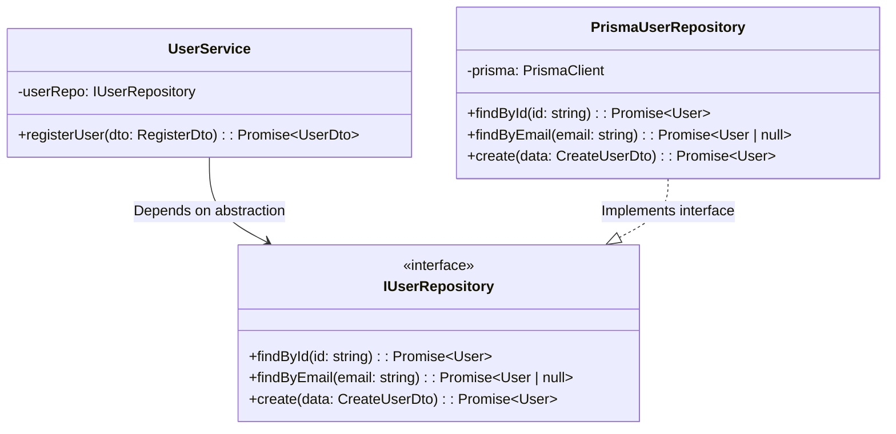

The core architectural pattern across all Nexium Media backend services is the **Four-Layer Clean Architecture**. This model establishes unambiguous boundaries between the HTTP transport layer, business logic orchestration, and data persistence mechanics.

---

## The Request-Response Data Flow

Every request entering the application traverses the exact sequence illustrated below:



---

## Why Enforce Layered Architecture?

1. **Deterministic Testability**: You can write unit tests for the entire `UserService` in milliseconds by passing a mock `IUserRepository` without running a real database or executing network calls.
2. **Persistence Independence**: If a project migrates from Prisma (PostgreSQL) to an external microservice or DynamoDB, only the repository layer changes. The service logic remains 100% unchanged.
3. **Transport Decoupling**: If you expose the same business capability via gRPC, a BullMQ background worker, or a WebSocket event handler, you reuse the exact same `UserService`.

---

## Dependency Inversion: Interfaces Over Concrete Implementations

High-level policy (Service) must never depend directly on low-level data access details (SQL/Prisma/SQLAlchemy). Both must depend on abstractions (interfaces).



---

## Node.js Implementation: TypeScript Interfaces & Constructor Injection

### 1. Repository Interface & Implementation

```ts title="src/repositories/user.repository.ts"
import { PrismaClient, User } from '@prisma/client';

export interface CreateUserData {
  email: string;
  passwordHash: string;
  fullName: string;
}

export interface IUserRepository {
  findById(id: string): Promise<User | null>;
  findByEmail(email: string): Promise<User | null>;
  create(data: CreateUserData): Promise<User>;
}

export class PrismaUserRepository implements IUserRepository {
  constructor(private readonly prisma: PrismaClient) {}

  async findById(id: string): Promise<User | null> {
    return this.prisma.user.findUnique({ where: { id } });
  }

  async findByEmail(email: string): Promise<User | null> {
    return this.prisma.user.findUnique({ where: { email } });
  }

  async create(data: CreateUserData): Promise<User> {
    return this.prisma.user.create({ data });
  }
}
```

### 2. Service Layer (Pure Business Logic)

```ts title="src/services/user.service.ts"
import { IUserRepository } from '../repositories/user.repository.js';
import { AppError } from '../utils/appError.js';
import bcrypt from 'bcrypt';

export interface RegisterUserDto {
  email: string;
  password: string;
  fullName: string;
}

export interface UserResponseDto {
  id: string;
  email: string;
  fullName: string;
  createdAt: Date;
}

export class UserService {
  constructor(private readonly userRepo: IUserRepository) {}

  async register(dto: RegisterUserDto): Promise<UserResponseDto> {
    // 1. Business domain check
    const existing = await this.userRepo.findByEmail(dto.email);
    if (existing) {
      throw new AppError('Email address already in use', 409, 'EMAIL_EXISTS');
    }

    // 2. Hash sensitive data
    const passwordHash = await bcrypt.hash(dto.password, 12);

    // 3. Persist entity
    const user = await this.userRepo.create({
      email: dto.email,
      passwordHash,
      fullName: dto.fullName,
    });

    // 4. Return clean DTO (never leak passwordHash)
    return {
      id: user.id,
      email: user.email,
      fullName: user.fullName,
      createdAt: user.createdAt,
    };
  }
}
```

### 3. Controller Layer (HTTP Transport)

```ts title="src/controllers/user.controller.ts"
import { Request, Response, NextFunction } from 'express';
import { UserService } from '../services/user.service.js';

export class UserController {
  constructor(private readonly userService: UserService) {}

  register = async (req: Request, res: Response, next: NextFunction): Promise<void> => {
    try {
      const result = await this.userService.register(req.body);
      res.status(201).json({
        data: result,
        meta: {
          requestId: req.headers['x-request-id'] ?? '',
          timestamp: new Date().toISOString(),
        },
      });
    } catch (error) {
      next(error);
    }
  };
}
```

---

## Python Implementation: FastAPI & Abstract Base Classes

### 1. Abstract Base Repository & SQLAlchemy Implementation

```python title="app/repositories/user_repository.py"
from abc import ABC, abstractmethod
from typing import Optional
from sqlalchemy import select
from sqlalchemy.ext.asyncio import AsyncSession
from app.models.user import UserModel
from app.schemas.user import UserCreateSchema

class IUserRepository(ABC):
    @abstractmethod
    async def get_by_id(self, user_id: str) -> Optional[UserModel]:
        ...

    @abstractmethod
    async def get_by_email(self, email: str) -> Optional[UserModel]:
        ...

    @abstractmethod
    async def create(self, user_in: UserCreateSchema, password_hash: str) -> UserModel:
        ...

class SqlAlchemyUserRepository(IUserRepository):
    def __init__(self, session: AsyncSession) -> None:
        self.session = session

    async def get_by_id(self, user_id: str) -> Optional[UserModel]:
        result = await self.session.execute(
            select(UserModel).where(UserModel.id == user_id)
        )
        return result.scalar_one_or_none()

    async def get_by_email(self, email: str) -> Optional[UserModel]:
        result = await self.session.execute(
            select(UserModel).where(UserModel.email == email)
        )
        return result.scalar_one_or_none()

    async def create(self, user_in: UserCreateSchema, password_hash: str) -> UserModel:
        user = UserModel(
            email=user_in.email,
            full_name=user_in.full_name,
            password_hash=password_hash,
        )
        self.session.add(user)
        await self.session.flush()
        await self.session.refresh(user)
        return user
```

### 2. Service Layer (Domain Logic)

```python title="app/services/user_service.py"
from passlib.context import CryptContext
from app.repositories.user_repository import IUserRepository
from app.schemas.user import UserCreateSchema, UserResponseSchema
from app.utils.exceptions import DomainException

pwd_context = CryptContext(schemes=["bcrypt"], deprecated="auto")

class UserService:
    def __init__(self, user_repo: IUserRepository) -> None:
        self.user_repo = user_repo

    async def register_user(self, payload: UserCreateSchema) -> UserResponseSchema:
        existing = await self.user_repo.get_by_email(payload.email)
        if existing:
            raise DomainException("Email is already registered", code="EMAIL_EXISTS", status_code=409)

        hashed = pwd_context.hash(payload.password)
        user = await self.user_repo.create(payload, hashed)
        return UserResponseSchema.model_validate(user)
```

### 3. FastAPI Router Using `Depends()`

```python title="app/routers/users.py"
from fastapi import APIRouter, Depends, status
from sqlalchemy.ext.asyncio import AsyncSession
from app.dependencies.database import get_db
from app.repositories.user_repository import SqlAlchemyUserRepository
from app.services.user_service import UserService
from app.schemas.user import UserCreateSchema, UserResponseSchema

router = APIRouter(prefix="/users", tags=["Users"])

def get_user_service(session: AsyncSession = Depends(get_db)) -> UserService:
    repo = SqlAlchemyUserRepository(session)
    return UserService(repo)

@router.post("/", response_model=UserResponseSchema, status_code=status.HTTP_201_CREATED)
async def create_user(
    payload: UserCreateSchema,
    service: UserService = Depends(get_user_service),
) -> UserResponseSchema:
    return await service.register_user(payload)
```

---

## Anti-Patterns to Avoid

<Callout type="error">
**Common Anti-Patterns in Layered Systems**:
1. **The Fat Controller**: Controllers executing business calculations, hashing passwords, or parsing complex objects. Keep controllers under 30 lines: parse input, call service, return response envelope.
2. **Business Logic in Routes**: Defining inline asynchronous anonymous functions with database queries inside `.get('/', async (req, res) => { ... })`.
3. **Repository Leaks**: Passing database connection objects (`prisma`, `session`) into the service layer. The service layer must have no direct reference to ORM primitives.
4. **Throwing HTTP Exceptions from Services**: Services throwing `new Error("404")` or `raise HTTPException(status_code=404)`. Services must raise typed domain errors (e.g. `UserNotFoundError`), which controllers or exception handlers map to HTTP status codes.
</Callout>

---

## Related

- [Project Structure Standards](/docs/development/backend/architecture/project-structure)
- [Node.js Controllers & Services](/docs/development/backend/node-express/controllers-services)
- [FastAPI Dependency Injection](/docs/development/backend/python-fastapi/dependency-injection)
- [Unit Testing Services](/docs/development/backend/testing/unit-testing-node)
