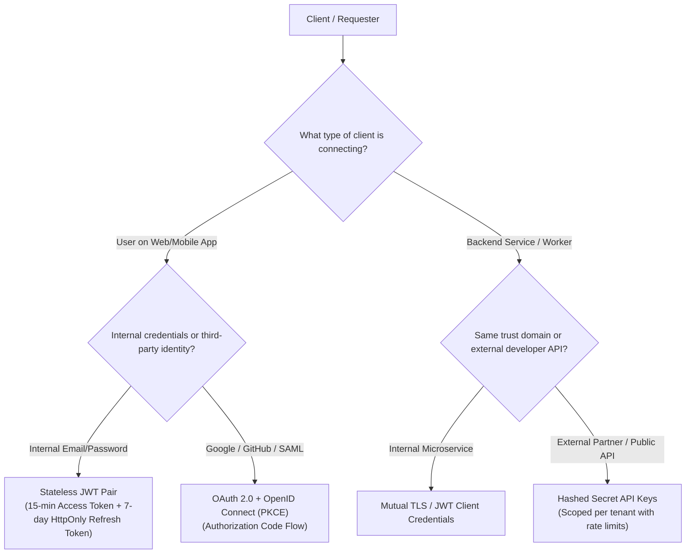

Security is built into the architecture of every Nexium Media backend service. We implement clear separation between **Authentication (AuthN)**—verifying who a client or user is—and **Authorization (AuthZ)**—determining what resources or actions an authenticated identity can access.

---

## The Identity & Access Decision Matrix

Select the appropriate security mechanism based on client type and integration boundary:

| Security Strategy | Target Use Case | Credential Transport | Lifespan / Expiry |
| :--- | :--- | :--- | :--- |
| **Stateless JWT Pair** | User-facing web SPAs and mobile applications | Bearer header or `HttpOnly` Secure Cookie | Access: 15 min; Refresh: 7 days |
| **OAuth 2.0 (OIDC)** | Third-party logins (Google, Microsoft 365, GitHub) | Auth code exchange via redirect URL | Scoped access token + Refresh token |
| **Hashed API Keys** | Machine-to-machine, partner integrations, webhook auth | `X-API-Key` or `Authorization: ApiKey` header | Persistent until explicitly rotated/revoked |
| **RBAC / ABAC** | Fine-grained internal resource access control | Validated claims in JWT payload + DB check | Enforced per-request at route handler |

---

## Core Security Invariants

All authentication implementations at Nexium Media must adhere to four baseline security requirements:

1. **Short-Lived Access Tokens**: Access tokens must never exceed 15 minutes of validity. Long-lived access tokens represent unacceptable exposure if intercepted.
2. **Refresh Token Rotation**: Every time a refresh token is used to issue a new access token, the old refresh token is invalidated and a fresh refresh token is returned. Attempting to reuse an old refresh token invalidates the entire token family (compromise detection).
3. **Passwords Always Hashed with Salt**: Never store plaintext passwords. Always use **Argon2id** (preferred) or **bcrypt (work factor >= 12)**.
4. **Secrets Kept Out of Code**: Private signing keys, symmetric secrets, and OAuth client credentials must be loaded exclusively via validated environment variables.

---

## Section Guides

Explore our detailed authentication specifications:

<Cards>
  <Card
    title="JSON Web Tokens (JWT)"
    href="/docs/development/backend/authentication/jwt-auth"
    description="Dual token architecture, asymmetric signing (RS256), token rotation, Redis blacklisting, and storage security."
  />
  <Card
    title="OAuth 2.0 & Social Login"
    href="/docs/development/backend/authentication/oauth2"
    description="Authorization Code Flow with PKCE, Google OAuth2 integration, token exchange, and user linking."
  />
  <Card
    title="API Key Management"
    href="/docs/development/backend/authentication/api-keys"
    description="Cryptographic key generation, one-way hash storage, rotation procedures, and scoped rate limiting."
  />
  <Card
    title="Role-Based Access Control (RBAC)"
    href="/docs/development/backend/authentication/rbac"
    description="Subject-Role-Permission models, route middleware, resource ownership verification, and ABAC extensions."
  />
</Cards>

---

## Related

- [API Security Standards](/docs/development/backend/security/api-security)
- [Secrets Management](/docs/development/backend/security/secrets-management)
- [Express Middleware Pipeline](/docs/development/backend/node-express/middleware)
- [FastAPI Dependency Injection](/docs/development/backend/python-fastapi/dependency-injection)
