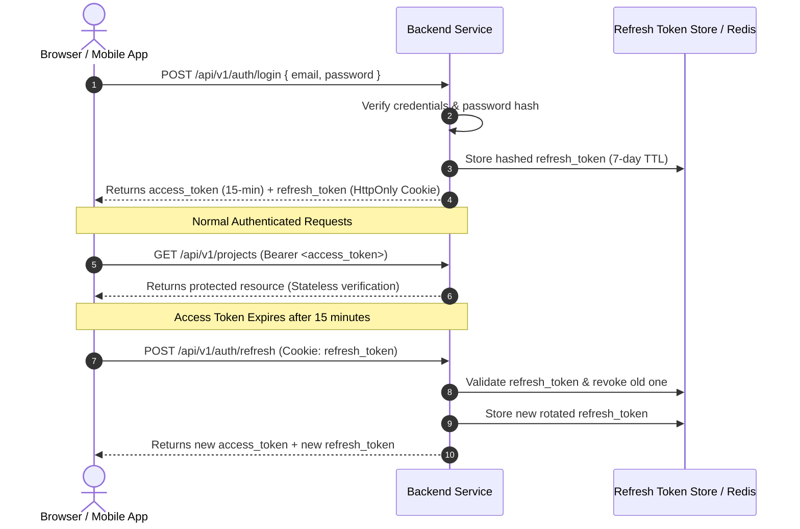

JSON Web Tokens (RFC 7519) provide compact, URL-safe means of asserting claims between distributed parties. Nexium Media enforces a strict dual-token pattern across all user-facing services.

---

## 1. The Dual-Token Architecture

To combine the scalability of stateless authentication with the security of instantaneous session revocation, we use two tokens:



---

## 2. Signing Algorithms: RS256 vs. HS256

| Algorithm | Type | Description | Where Enforced |
| :--- | :--- | :--- | :--- |
| **RS256** (Recommended) | Asymmetric (Public/Private Key Pair) | The authorization server signs tokens using a private RSA key. Downstream microservices verify tokens using only the public key. | Multi-service architectures, external partner verification, zero secret distribution risk. |
| **HS256** | Symmetric (Shared Secret) | Both token issuer and verifiers share the exact same secret key. | Simple standalone monolithic applications where no external services need verification. |

---

## 3. Node.js Implementation (`jsonwebtoken`)

### Token Generation & Verification Service

```ts title="src/services/token.service.ts"
import jwt from 'jsonwebtoken';
import { config } from '../config/index.js';
import { redisClient } from '../config/redis.js';

export interface TokenPayload {
  userId: string;
  email: string;
  role: string;
}

export class TokenService {
  generateTokenPair(payload: TokenPayload) {
    const accessToken = jwt.sign(payload, config.JWT_ACCESS_SECRET, {
      expiresIn: '15m',
      algorithm: 'HS256',
    });

    const refreshToken = jwt.sign({ userId: payload.userId }, config.JWT_REFRESH_SECRET, {
      expiresIn: '7d',
      algorithm: 'HS256',
    });

    return { accessToken, refreshToken };
  }

  verifyAccessToken(token: string): TokenPayload {
    return jwt.verify(token, config.JWT_ACCESS_SECRET) as TokenPayload;
  }

  // Blacklist access token in Redis upon logout
  async blacklistToken(token: string, expiresInSeconds: number): Promise<void> {
    await redisClient.set(`bl:${token}`, 'revoked', { EX: expiresInSeconds });
  }

  async isTokenBlacklisted(token: string): Promise<boolean> {
    const status = await redisClient.get(`bl:${token}`);
    return status === 'revoked';
  }
}
```

---

## 4. Python Implementation (`python-jose`)

### FastAPI Token Service & Verification

```python title="app/utils/security.py"
from datetime import datetime, timedelta, timezone
from typing import Dict, Any
from jose import jwt, JWTError
from app.config import settings

def create_access_token(data: Dict[str, Any], expires_delta: timedelta | None = None) -> str:
    to_encode = data.copy()
    expire = datetime.now(timezone.utc) + (expires_delta or timedelta(minutes=settings.ACCESS_TOKEN_EXPIRE_MINUTES))
    to_encode.update({"exp": expire, "iat": datetime.now(timezone.utc)})
    return jwt.encode(to_encode, settings.SECRET_KEY, algorithm=settings.ALGORITHM)

def decode_access_token(token: str) -> Dict[str, Any]:
    try:
        payload = jwt.decode(token, settings.SECRET_KEY, algorithms=[settings.ALGORITHM])
        return payload
    except JWTError as exc:
        raise ValueError("Invalid or expired token") from exc
```

---

## 5. Token Storage: Cookies vs. Authorization Header

| Storage Strategy | Pros | Cons | Recommendation |
| :--- | :--- | :--- | :--- |
| **`HttpOnly; Secure; SameSite=Strict` Cookie** | Immune to Cross-Site Scripting (XSS) attacks. JavaScript cannot read token. | Requires CSRF protection mechanisms. | **Mandatory for Web SPAs (Next.js/React frontend)**. |
| **`Authorization: Bearer <token>` Header** | Trivial for mobile apps, CLI tools, and microservice calls. Not subject to CSRF. | Vulnerable to theft via XSS if stored in `localStorage`. | **Mandatory for Native Mobile Apps & Public APIs**. |

<Callout type="warning">
Never store JWT refresh tokens in browser `localStorage` or `sessionStorage` in production web applications. Any third-party npm package compromise or XSS vulnerability can extract the token. Always store refresh tokens inside an `HttpOnly` cookie.
</Callout>

---

## 6. Refresh Token Rotation & Compromise Detection

When a refresh token is presented:
1. Verify token validity and find its session record in the database.
2. If the token was already revoked, a breach is assumed: **immediately invalidate all active refresh tokens for that user account**.
3. Issue a new access token and a new refresh token. Replace the database record atomically.

---

## Related

- [OAuth 2.0 Integration](/docs/development/backend/authentication/oauth2)
- [Role-Based Access Control (RBAC)](/docs/development/backend/authentication/rbac)
- [API Security Architecture](/docs/development/backend/security/api-security)
