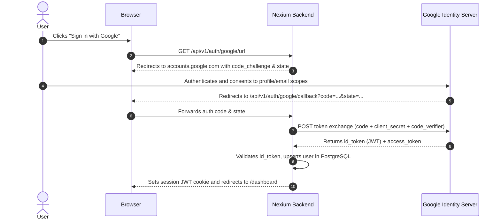

OAuth 2.0 (RFC 6749) and OpenID Connect (OIDC) allow applications to delegate authentication to trusted external identity providers (Google Workspace, Microsoft Entra ID, GitHub) without handling client passwords directly.

---

## 1. Supported OAuth 2.0 Flows

| Grant Type | Target Client | PKCE Enforced? | Use Case |
| :--- | :--- | :--- | :--- |
| **Authorization Code with PKCE** | Public Single-Page Apps (Next.js/React), Native Mobile Apps | Yes (Mandatory) | User logging in via Google, GitHub, or corporate SSO. |
| **Client Credentials** | Confidential server-to-server microservices | No | Machine-to-machine communications without human user context. |
| **Device Authorization Grant** | Smart TVs, CLI tools, IoT devices | Optional | Authorizing CLI tools via secondary browser login. |

<Callout type="error">
**Deprecated Flows**: The **Implicit Flow** and **Resource Owner Password Credentials Grant** are officially deprecated by OAuth 2.1 due to credential leakage risks. They must never be used in any new Nexium Media service.
</Callout>

---

## 2. Authorization Code with PKCE Flow



---

## 3. Google OAuth 2.0 Backend Implementation

### Node.js / Express Example

```ts title="src/controllers/oauth.controller.ts"
import { Request, Response } from 'express';
import axios from 'axios';
import { config } from '../config/index.js';
import { prisma } from '../config/database.js';
import { TokenService } from '../services/token.service.js';

const tokenService = new TokenService();

export const getGoogleAuthUrl = (_req: Request, res: Response) => {
  const rootUrl = 'https://accounts.google.com/o/oauth2/v2/auth';
  const options = {
    redirect_uri: `${config.APP_URL}/api/v1/auth/google/callback`,
    client_id: config.GOOGLE_CLIENT_ID,
    access_type: 'offline',
    response_type: 'code',
    prompt: 'consent',
    scope: [
      'https://www.googleapis.com/auth/userinfo.profile',
      'https://www.googleapis.com/auth/userinfo.email',
    ].join(' '),
  };

  const qs = new URLSearchParams(options).toString();
  res.redirect(`${rootUrl}?${qs}`);
};

export const googleCallback = async (req: Request, res: Response) => {
  const code = req.query.code as string;

  // 1. Exchange code for access & ID token
  const tokenResponse = await axios.post('https://oauth2.googleapis.com/token', {
    code,
    client_id: config.GOOGLE_CLIENT_ID,
    client_secret: config.GOOGLE_CLIENT_SECRET,
    redirect_uri: `${config.APP_URL}/api/v1/auth/google/callback`,
    grant_type: 'authorization_code',
  });

  const { id_token, access_token } = tokenResponse.data;

  // 2. Fetch authenticated profile from Google
  const profileResponse = await axios.get('https://www.googleapis.com/oauth2/v1/userinfo', {
    headers: { Authorization: `Bearer ${access_token}` },
  });

  const { email, name, picture, id: googleId } = profileResponse.data;

  // 3. Upsert user in local database
  const user = await prisma.user.upsert({
    where: { email },
    update: { fullName: name },
    create: {
      email,
      fullName: name,
      passwordHash: '', // Passwordless SSO account
      profile: { create: { avatarUrl: picture } },
    },
  });

  // 4. Issue standard Nexium Media JWT pair
  const { accessToken, refreshToken } = tokenService.generateTokenPair({
    userId: user.id,
    email: user.email,
    role: user.role,
  });

  res.cookie('refresh_token', refreshToken, { httpOnly: true, secure: true, sameSite: 'strict' });
  res.redirect(`${config.FRONTEND_URL}/auth/success?token=${accessToken}`);
};
```

---

## 4. FastAPI OAuth2 Password & Bearer Utilities

In FastAPI, use `OAuth2PasswordBearer` for Swagger UI authorization integration:

```python title="app/dependencies/oauth2.py"
from fastapi.security import OAuth2PasswordBearer, OAuth2PasswordRequestForm
from fastapi import APIRouter, Depends, HTTPException, status
from app.utils.security import create_access_token

oauth2_scheme = OAuth2PasswordBearer(tokenUrl="/api/v1/auth/token")

auth_router = APIRouter(prefix="/auth", tags=["Auth"])

@auth_router.post("/token")
async def login_for_access_token(form_data: OAuth2PasswordRequestForm = Depends()):
    # Matches Swagger UI authorize modal standard
    user = await authenticate_user(form_data.username, form_data.password)
    if not user:
        raise HTTPException(
            status_code=status.HTTP_401_UNAUTHORIZED,
            detail="Incorrect username or password",
        )
    access_token = create_access_token(data={"sub": str(user.id), "role": user.role})
    return {"access_token": access_token, "token_type": "bearer"}
```

---

## 5. Storing Third-Party OAuth Tokens

When an application requires continuous access to a user's Google Calendar or Slack API:
- **Encrypt at Rest**: Store external refresh tokens using AES-256-GCM in the database. Never store third-party tokens as plaintext strings.
- **Scope Minimization**: Only request the minimum scopes necessary for the integration.

---

## Related

- [JWT Authentication Implementation](/docs/development/backend/authentication/jwt-auth)
- [API Key Management](/docs/development/backend/authentication/api-keys)
- [Secrets Management & Encryption](/docs/development/backend/security/secrets-management)
