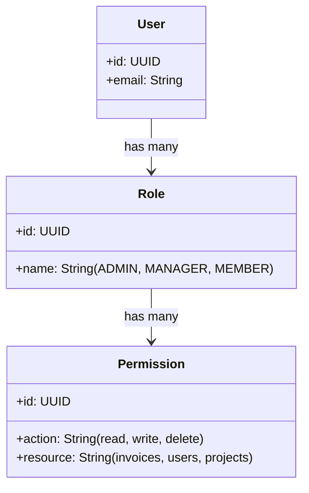

Authentication verifies identity; Authorization determines what actions that identity is permitted to perform. At Nexium Media, authorization is enforced via **Role-Based Access Control (RBAC)** supplemented by **Resource Ownership Verification**.

---

## 1. The RBAC Conceptual Model



- **Subjects (Who)**: The authenticated User or API Key.
- **Roles (What Group)**: Functional roles (e.g., `SUPER_ADMIN`, `ORG_ADMIN`, `EDITOR`, `VIEWER`).
- **Permissions (What Action)**: Explicit resource operations formatted as `resource:action` (e.g., `invoices:create`, `users:delete`).

---

## 2. Relational Database Schema for Granular RBAC

```sql
CREATE TABLE roles (
    id UUID PRIMARY KEY DEFAULT gen_random_uuid(),
    name TEXT NOT NULL UNIQUE, -- 'ADMIN', 'EDITOR', 'VIEWER'
    description TEXT
);

CREATE TABLE permissions (
    id UUID PRIMARY KEY DEFAULT gen_random_uuid(),
    slug TEXT NOT NULL UNIQUE, -- 'projects:create', 'projects:delete'
    description TEXT
);

CREATE TABLE role_permissions (
    role_id UUID NOT NULL REFERENCES roles(id) ON DELETE CASCADE,
    permission_id UUID NOT NULL REFERENCES permissions(id) ON DELETE CASCADE,
    PRIMARY KEY (role_id, permission_id)
);

CREATE TABLE user_roles (
    user_id UUID NOT NULL REFERENCES users(id) ON DELETE CASCADE,
    role_id UUID NOT NULL REFERENCES roles(id) ON DELETE CASCADE,
    PRIMARY KEY (user_id, role_id)
);
```

---

## 3. Node.js Authorization Middleware (`requireRole`)

Enforce role boundaries before controller execution:

```ts title="src/middleware/rbac.middleware.ts"
import { Request, Response, NextFunction } from 'express';
import { AppError } from '../utils/appError.js';

export const requireRole = (allowedRoles: string[]) => {
  return (req: Request, _res: Response, next: NextFunction): void => {
    if (!req.user) {
      return next(new AppError('Authentication required prior to role check', 401, 'UNAUTHORIZED'));
    }

    if (!allowedRoles.includes(req.user.role)) {
      return next(
        new AppError(
          `Forbidden: Role '${req.user.role}' lacks permission for this action`,
          403,
          'FORBIDDEN'
        )
      );
    }

    next();
  };
};
```

### Route Usage
```ts
router.delete(
  '/users/:userId',
  requireAuth,
  requireRole(['SUPER_ADMIN']),
  asyncHandler(userController.deleteUser)
);
```

---

## 4. Resource Ownership Verification: Beyond Simple Roles

<Callout type="error">
**The IDOR Vulnerability (OWASP API 1: BOLA)**: Having the role of `MEMBER` does not mean you can edit *any* member's documents! You must verify that the authenticated user actually owns the specific resource being modified.
</Callout>

```ts title="src/services/document.service.ts"
export class DocumentService {
  constructor(private readonly docRepo: IDocumentRepository) {}

  async updateDocument(docId: string, userId: string, userRole: string, updateData: UpdateDocDto) {
    const document = await this.docRepo.findById(docId);
    if (!document) {
      throw new AppError('Document not found', 404, 'NOT_FOUND');
    }

    // Ownership Guard: Allow if user is an ADMIN OR if user is the resource owner
    const isOwner = document.authorId === userId;
    const isAdmin = userRole === 'SUPER_ADMIN';

    if (!isOwner && !isAdmin) {
      throw new AppError('You do not have permission to modify this document', 403, 'FORBIDDEN');
    }

    return this.docRepo.update(docId, updateData);
  }
}
```

---

## 5. FastAPI Dependency Implementation

```python title="app/dependencies/rbac.py"
from typing import List
from fastapi import Depends, HTTPException, status
from app.dependencies.auth import get_current_user
from app.models.user import UserModel

def require_roles(allowed_roles: List[str]):
    async def role_guard(current_user: UserModel = Depends(get_current_user)) -> UserModel:
        if current_user.role not in allowed_roles:
            raise HTTPException(
                status_code=status.HTTP_403_FORBIDDEN,
                detail=f"Operation requires one of the following roles: {allowed_roles}",
            )
        return current_user
    return role_guard
```

---

## 6. Common Authorization Pitfalls

<Callout type="warning">
1. **Frontend-Only Authorization**: Hiding a "Delete" button in the React UI without enforcing the check on the `DELETE /api/v1/projects/:id` endpoint. Attackers easily bypass UI checks via cURL or Postman.
2. **Missing Re-Check on Resource Mutation**: Checking permissions at the collection level, but forgetting to verify individual resource tenant IDs on sub-resources.
3. **Privilege Escalation**: Allowing a user to update their own profile with `role: "ADMIN"` because the controller blindly accepts `req.body` without strict schema filtering.
</Callout>

---

## Related

- [JWT Authentication Standards](/docs/development/backend/authentication/jwt-auth)
- [API Security Invariants](/docs/development/backend/security/api-security)
- [Input Validation & Mass Assignment Prevention](/docs/development/backend/security/input-validation)
