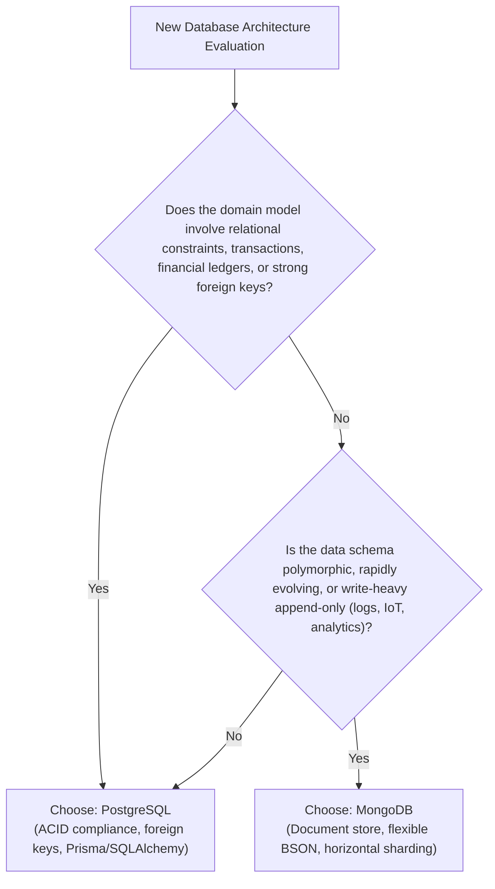

Data persistence is the foundation of application integrity and performance. At Nexium Media, our systems standardize on two primary storage engines:
1. **PostgreSQL 16+**: Our default relational database for transactional consistency (ACID), structured domain entities, complex relational schemas, and JSONB document capabilities.
2. **MongoDB 7+**: Our secondary document store for high-velocity polymorphic data, audit logs, un-normalized product catalogs, and telemetry streams.

---

## Decision Matrix: PostgreSQL vs. MongoDB

Choosing the correct database is an architectural decision made at project inception:

| Criterion | PostgreSQL (Default) | MongoDB (Specialized) |
| :--- | :--- | :--- |
| **Data Model** | Relational tables, typed columns, foreign keys, JSONB | BSON documents, collections, nested subdocuments |
| **Integrity & ACID** | Strict ACID guarantees across all tables and schemas | Multi-document ACID within single replica sets |
| **Node.js Integration** | Prisma ORM (Type-safe client & migrations) | Mongoose / MongoDB Native Node Driver |
| **Python Integration** | SQLAlchemy 2.0 (AsyncSession) + asyncpg | Motor (Async MongoDB driver) |
| **Migrations** | Strict, versioned schema migrations (`prisma migrate`, `alembic`) | Flexible schema; optional application-level migrations |
| **Best For** | SaaS platforms, multi-tenant billing, ERPs, ecommerce | Dynamic content CMS, audit trail logs, telemetry |

---

## Section Guides

Explore our detailed persistence guides:

<Cards>
  <Card
    title="PostgreSQL Architecture"
    href="/docs/development/backend/database/postgresql"
    description="Relational modeling, indexes (B-tree, GIN), JSONB, transactions, connection pooling, and backup procedures."
  />
  <Card
    title="MongoDB Document Store"
    href="/docs/development/backend/database/mongodb"
    description="Document schemas, embedding vs referencing, Mongoose, Motor, aggregation pipelines, and indexing."
  />
  <Card
    title="Prisma ORM for Node.js"
    href="/docs/development/backend/database/prisma-orm"
    description="Schema definition, type-safe queries, nested relations, cursor pagination, and transactions."
  />
  <Card
    title="Database Migrations"
    href="/docs/development/backend/database/migrations"
    description="Prisma Migrate and Alembic workflows, zero-downtime 3-phase migrations, and CI pipelines."
  />
  <Card
    title="Query Optimization"
    href="/docs/development/backend/database/query-optimization"
    description="EXPLAIN ANALYZE, eliminating N+1 queries, indexing strategies, PgBouncer, and Redis caching."
  />
</Cards>

---

## Related

- [Backend Architecture Overview](/docs/development/backend/architecture)
- [Node.js & Express Stack](/docs/development/backend/node-express)
- [Python & FastAPI Stack](/docs/development/backend/python-fastapi)
