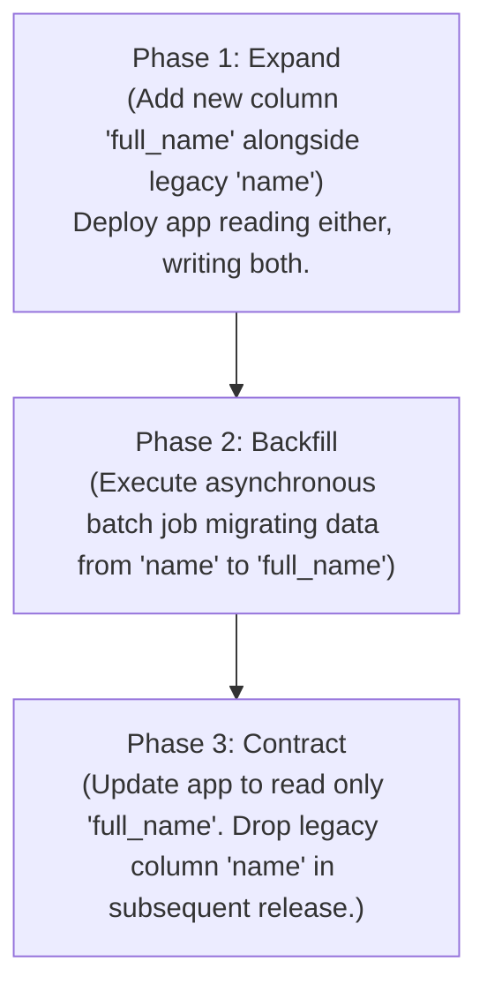

Database migrations track schema changes as version-controlled code. Direct manual alterations to staging or production databases are strictly prohibited at Nexium Media.

---

## 1. Zero-Downtime Migration Philosophy: The 3-Phase Rule

Production systems cannot pause traffic for schema migrations. Renaming or dropping a column immediately breaks running application containers.

We enforce **3-Phase Additive Migrations** for any breaking schema modification:



<Callout type="warning">
Never run `ALTER TABLE ... DROP COLUMN` or rename a column in the same release where application code updates. Always span destructive changes across two separate deployment cycles.
</Callout>

---

## 2. Node.js Migrations with Prisma Migrate

Prisma compares `schema.prisma` against previous migrations inside `prisma/migrations/` and generates deterministic SQL scripts.

### Development Workflow
```bash
# 1. Edit prisma/schema.prisma
# 2. Generate and apply migration locally
npx prisma migrate dev --name add_billing_address
```

### Production CI/CD Deployment
In production pipelines (Docker containers or GitHub Actions), never use `migrate dev`. Use:
```bash
npx prisma migrate deploy
```
`migrate deploy` applies pending migrations without prompting, generating new files, or seeding.

---

## 3. Python Migrations with Alembic

FastAPI projects manage PostgreSQL migrations using **Alembic**:

### Configuration (`alembic/env.py`)
Ensure `alembic/env.py` references your SQLAlchemy declarative `Base.metadata`:

```python title="alembic/env.py"
from logging.config import fileConfig
from sqlalchemy import pool
from alembic import context
from app.database import Base
from app.config import settings

# Bind Alembic target metadata to SQLAlchemy models
target_metadata = Base.metadata

def run_migrations_online() -> None:
    connectable = context.config.attributes.get("connection", None)

    if connectable is None:
        from sqlalchemy import create_engine
        connectable = create_engine(settings.DATABASE_URL.replace("+asyncpg", ""))

    with connectable.connect() as connection:
        context.configure(
            connection=connection,
            target_metadata=target_metadata,
            compare_type=True, # Detect column type mutations
        )
        with context.begin_transaction():
            context.run_migrations()
```

### Alembic CLI Workflow
```bash
# 1. Autogenerate migration by inspecting SQLAlchemy models
alembic revision --autogenerate -m "create_organizations_table"

# 2. Inspect generated script in alembic/versions/

# 3. Apply migration to local database
alembic upgrade head

# 4. Rollback last migration if needed
alembic downgrade -1
```

---

## 4. Migration Naming Conventions

Migration names must be lowercase, snake_case, and begin with an action verb:
- ✅ `20261101_add_user_phone_number`
- ✅ `20261102_create_invoices_table`
- ✅ `20261103_index_orders_on_created_at`
- ❌ `changes`
- ❌ `update1`
- ❌ `fix_db`

---

## 5. Automated Database Seeding

Provide reproducible seeds for local testing:

### Node.js (`prisma/seed.ts`)
```ts title="prisma/seed.ts"
import { PrismaClient } from '@prisma/client';
import bcrypt from 'bcrypt';

const prisma = new PrismaClient();

async function main() {
  const adminPassword = await bcrypt.hash('AdminSecret123!', 12);

  await prisma.user.upsert({
    where: { email: 'admin@nexiummedia.com' },
    update: {},
    create: {
      email: 'admin@nexiummedia.com',
      fullName: 'System Administrator',
      passwordHash: adminPassword,
      role: 'ADMIN',
    },
  });

  console.info('Database seed executed successfully.');
}

main()
  .catch((e) => {
    console.error(e);
    process.exit(1);
  })
  .finally(async () => {
    await prisma.$disconnect();
  });
```
Add to `package.json`:
```json
"prisma": {
  "seed": "ts-node prisma/seed.ts"
}
```

---

## Related

- [PostgreSQL Architecture](/docs/development/backend/database/postgresql)
- [Prisma ORM Standards](/docs/development/backend/database/prisma-orm)
- [Deployment & CI/CD Pipelines](/docs/development/backend/deployment/ci-cd)
