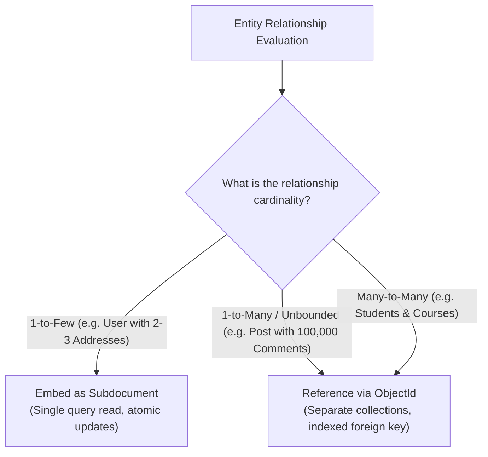

MongoDB is a document-oriented NoSQL database that stores data in flexible, JSON-like BSON (Binary JSON) documents. At Nexium Media, MongoDB is used selectively for domains with high write volume, polymorphic schemas, or hierarchical document trees.

---

## 1. Schema Design: Embedding vs. Referencing

The central architectural decision in MongoDB schema design is choosing between **denormalized embedding** and **normalized referencing**.



### The Unbounded Array Anti-Pattern
<Callout type="error">
**Fatal Mistake**: Never embed an array that can grow without limit (such as user comments, activity logs, or event streams) inside a single document. MongoDB enforces a strict **16 MB maximum document size limit**. Unbounded arrays will eventually exceed this limit and cause writes to crash permanently.
</Callout>

---

## 2. Node.js Implementation with Mongoose

Define strict schemas with Mongoose to prevent schema drift:

```ts title="src/models/auditLog.model.ts"
import mongoose, { Schema, Document } from 'mongoose';

export interface IAuditLog extends Document {
  actorId: string;
  action: string;
  resource: string;
  resourceId: string;
  metadata: Record<string, unknown>;
  ipAddress: string;
  createdAt: Date;
}

const auditLogSchema = new Schema<IAuditLog>(
  {
    actorId: { type: String, required: true, index: true },
    action: { type: String, required: true },
    resource: { type: String, required: true, index: true },
    resourceId: { type: String, required: true },
    metadata: { type: Schema.Types.Mixed, default: {} },
    ipAddress: { type: String, required: true },
  },
  {
    timestamps: { createdAt: true, updatedAt: false }, // Append-only immutable log
  }
);

// Compound index for time-series search
auditLogSchema.index({ resource: 1, createdAt: -1 });

export const AuditLogModel = mongoose.model<IAuditLog>('AuditLog', auditLogSchema);
```

---

## 3. Python Async Implementation with Motor

For FastAPI services, connect to MongoDB using **Motor** (the official asynchronous driver):

```python title="app/database_mongo.py"
from motor.motor_asyncio import AsyncIOMotorClient
from app.config import settings

client = AsyncIOMotorClient(settings.MONGODB_URI, maxPoolSize=50, minPoolSize=10)
mongo_db = client[settings.MONGODB_DATABASE]

async def get_mongo():
    return mongo_db
```

### Async CRUD Operations with Motor

```python title="app/services/activity_service.py"
from typing import List, Dict, Any
from app.database_mongo import mongo_db

async def log_activity(event_data: Dict[str, Any]) -> str:
    collection = mongo_db["activities"]
    result = await collection.insert_one(event_data)
    return str(result.inserted_id)

async def get_user_activities(user_id: str, limit: int = 20) -> List[Dict[str, Any]]:
    collection = mongo_db["activities"]
    cursor = collection.find({"userId": user_id}).sort("timestamp", -1).limit(limit)
    return await cursor.to_list(length=limit)
```

---

## 4. The Aggregation Pipeline

For analytical queries, joins, and data transformations, use the multi-stage aggregation pipeline:

```ts title="src/repositories/analytics.repository.ts"
import { OrderModel } from '../models/order.model.js';

export const getDailyRevenueByCountry = async (startDate: Date, endDate: Date) => {
  return OrderModel.aggregate([
    // Stage 1: Filter date range and completed orders
    {
      $match: {
        status: 'COMPLETED',
        createdAt: { $gte: startDate, $lte: endDate },
      },
    },
    // Stage 2: Group by country and calculate total sum
    {
      $group: {
        _id: '$billingAddress.country',
        totalRevenue: { $sum: '$totalAmount' },
        orderCount: { $sum: 1 },
      },
    },
    // Stage 3: Sort by revenue descending
    {
      $sort: { totalRevenue: -1 },
    },
    // Stage 4: Reshape output
    {
      $project: {
        _id: 0,
        country: '$_id',
        totalRevenue: 1,
        orderCount: 1,
      },
    },
  ]);
};
```

---

## 5. Multi-Document ACID Transactions

Since MongoDB 4.0, multi-document transactions are supported on replica sets:

```ts
import mongoose from 'mongoose';

export const transferCredits = async (fromUserId: string, toUserId: string, amount: number) => {
  const session = await mongoose.startSession();
  session.startTransaction();

  try {
    await AccountModel.updateOne(
      { userId: fromUserId, balance: { $gte: amount } },
      { $inc: { balance: -amount } },
      { session }
    );

    await AccountModel.updateOne(
      { userId: toUserId },
      { $inc: { balance: amount } },
      { session }
    );

    await session.commitTransaction();
  } catch (error) {
    await session.abortTransaction();
    throw error;
  } finally {
    session.endSession();
  }
};
```

---

## Related

- [PostgreSQL Architecture](/docs/development/backend/database/postgresql)
- [Query Optimization Techniques](/docs/development/backend/database/query-optimization)
- [Integration Testing with Testcontainers](/docs/development/backend/testing/integration-testing)
