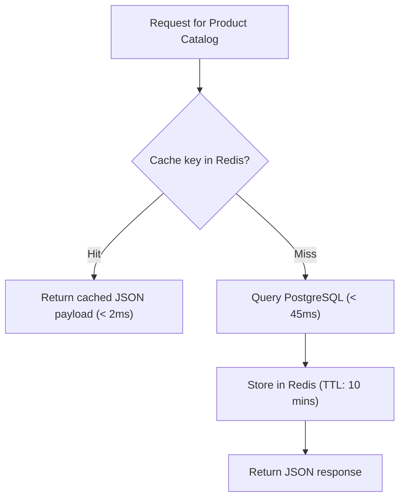

Slow queries are the primary cause of latency spikes, connection starvation, and high compute bills in production backend services. This guide outlines standard optimization procedures at Nexium Media.

---

## 1. Profiling with `EXPLAIN (ANALYZE, BUFFERS)`

Before modifying code or adding indexes, analyze how PostgreSQL executes the query:

```sql
EXPLAIN (ANALYZE, BUFFERS, FORMAT JSON)
SELECT o.id, o.total_cents, u.email
FROM orders o
JOIN users u ON o.user_id = u.id
WHERE o.status = 'PENDING'
ORDER BY o.created_at DESC
LIMIT 50;
```

### What to Look For:
- **`Seq Scan` (Sequential Scan)**: The database is reading every single page on disk. For tables with >10,000 rows, this should almost always be replaced with an `Index Scan` or `Bitmap Index Scan`.
- **`Buffers: shared hit vs read`**: High disk reads indicate missing cache hits in shared buffers.
- **`Execution Time`**: Identifies whether the bottleneck is row filtering, join coordination, or sorting.

---

## 2. Eliminating the N+1 Query Problem

The N+1 problem occurs when fetching a collection of $N$ parent items executes 1 query for the parents, followed by $N$ separate queries for each parent's children.

### Express & Prisma Resolution
```ts
// ❌ WRONG: Triggers N+1 queries in a loop!
const users = await prisma.user.findMany({ take: 50 });
for (const user of users) {
  const posts = await prisma.post.findMany({ where: { authorId: user.id } }); // N queries!
}

// ✅ CORRECT: Single batch query with JOIN or subselect
const usersWithPosts = await prisma.user.findMany({
  take: 50,
  include: {
    posts: {
      select: { id: true, title: true, status: true },
    },
  },
});
```

### FastAPI & SQLAlchemy Resolution
In SQLAlchemy, use `selectinload` or `joinedload` to eagerly load relations:

```python
from sqlalchemy import select
from sqlalchemy.orm import selectinload
from app.models.user import UserModel

# ✅ CORRECT: Eager load relations in a single subquery
statement = (
    select(UserModel)
    .options(selectinload(UserModel.posts))
    .where(UserModel.is_active == True)
)
result = await session.execute(statement)
users = result.scalars().all()
```

---

## 3. Avoiding `SELECT *` Projection Bloat

Fetching unnecessary columns degrades performance, wastes network bandwidth, and prevents index-only scans.

```ts
// ❌ WRONG: Fetches large text bodies and password hashes
const users = await prisma.user.findMany();

// ✅ CORRECT: Sparse selection of required attributes only
const users = await prisma.user.findMany({
  select: {
    id: true,
    email: true,
    fullName: true,
  },
});
```

---

## 4. Bulk Operations: Replacing Loops

Never execute individual inserts or updates inside loops:

```ts
// ❌ WRONG: 1,000 round-trips to the database!
for (const item of items) {
  await prisma.auditLog.create({ data: item });
}

// ✅ CORRECT: Single batched multi-row INSERT statement
await prisma.auditLog.createMany({
  data: items,
  skipDuplicates: true,
});
```

---

## 5. Query Result Caching with Redis

Cache read-heavy, low-churn endpoints using Redis with Cache-Aside:



```ts title="src/services/catalog.service.ts"
import { redisClient } from '../config/redis.js';
import { prisma } from '../config/database.js';

export const getFeaturedProducts = async () => {
  const cacheKey = 'cache:catalog:featured';

  // 1. Check Redis
  const cached = await redisClient.get(cacheKey);
  if (cached) {
    return JSON.parse(cached);
  }

  // 2. Query PostgreSQL
  const products = await prisma.product.findMany({
    where: { isFeatured: true },
    select: { id: true, name: true, priceCents: true, slug: true },
  });

  // 3. Populate Redis with 15-minute TTL
  await redisClient.set(cacheKey, JSON.stringify(products), { EX: 900 });

  return products;
};
```

---

## 6. Identifying Slow Queries in Production

Enable `pg_stat_statements` on your PostgreSQL server:

```sql
SELECT
    query,
    calls,
    total_exec_time / 1000 AS total_seconds,
    mean_exec_time AS avg_ms,
    rows
FROM pg_stat_statements
ORDER BY mean_exec_time DESC
LIMIT 10;
```

<Callout type="tip">
Any query exhibiting an average execution time greater than **100ms** must be ticketed for indexing or caching refactoring during sprint cycles.
</Callout>

---

## Related

- [PostgreSQL Architecture](/docs/development/backend/database/postgresql)
- [Prisma ORM Standards](/docs/development/backend/database/prisma-orm)
- [Rate Limiting with Redis](/docs/development/backend/api-development/rate-limiting)
