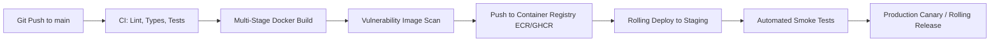

# Deployment & DevOps Overview

Deploying backend systems in an enterprise environment requires reproducibility, deterministic builds, strict isolation of environment configurations, and zero-downtime rolling releases.

At Nexium Media, our deployment strategy is rooted in **12-Factor App principles**, containerization with **Docker**, orchestration via **Kubernetes/ECS**, and automated **GitHub Actions** CI/CD pipelines.

---

## Core Operational Tenets

1. **Immutable Container Artifacts**: The exact same Docker image built and tested in CI is promoted across Staging and Production. Never rebuild code specifically for production.
2. **Configuration Injected via Environment**: Environment variables and external secrets dictate runtime behavior. Images never contain baked-in configuration files or secrets.
3. **Stateless Service Processes**: Backend API processes are completely stateless and share-nothing. State is persisted in managed databases (PostgreSQL, MongoDB) or distributed caches (Redis).
4. **Graceful Shutdown**: All services listen for `SIGTERM` and `SIGINT` signals, reject incoming new requests with a 503 drain notice, finish processing in-flight requests within a 30-second window, and safely terminate open database connections before exiting.
5. **Automated Health Probes**: Kubernetes or ECS orchestrators utilize decoupled `/health/live` (Liveness) and `/health/ready` (Readiness) probes to determine container health and routing eligibility.

---

## Architecture Lifecycle

---

## Subsections in this Guide

<Cards>
  <Card 
    title="Environment Configuration" 
    href="/docs/development/backend/deployment/environment-config" 
    description="Environment tiering (dev/stage/prod), naming standards, and runtime validation patterns in Node.js and Python." 
  />
  <Card 
    title="Docker Containerization" 
    href="/docs/development/backend/deployment/docker" 
    description="Production-optimized multi-stage Dockerfiles, non-root user security, and docker-compose orchestration." 
  />
  <Card 
    title="CI/CD Pipelines" 
    href="/docs/development/backend/deployment/ci-cd" 
    description="GitHub Actions workflows, automated testing gates, container registry publishing, and zero-downtime deployments." 
  />
</Cards>

---

## Related

- [Backend Engineering Architecture](/docs/development/backend/architecture)
- [Secrets Management](/docs/development/backend/security/secrets-management)
- [API Security Standards](/docs/development/backend/security/api-security)
- [Integration Testing in CI](/docs/development/backend/testing/integration-testing)

