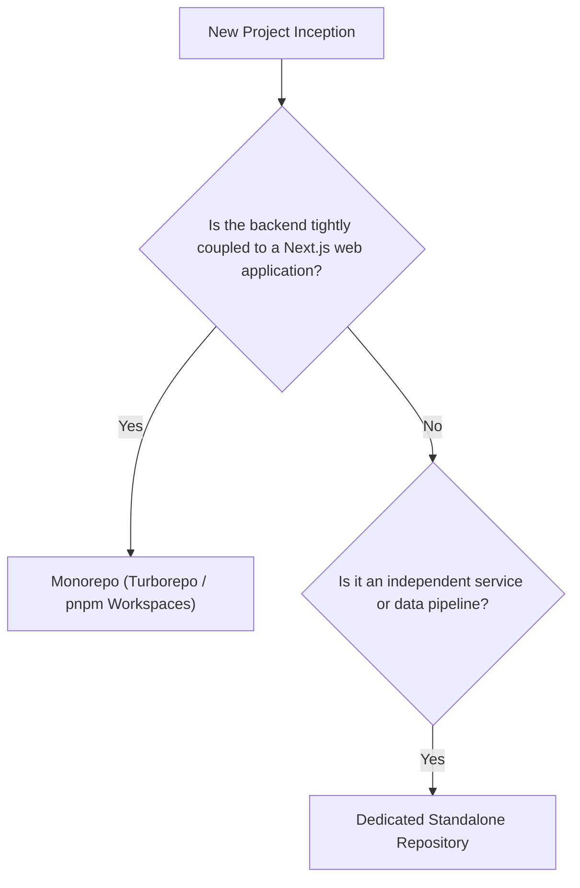

Standardizing directory topology across 100+ engineers ensures that any developer can navigate, debug, or contribute to any backend service across the agency without cognitive friction.

This guide outlines our production scaffolding standards for both **Node.js + Express** and **Python + FastAPI**, along with architectural mappings and initialization checklists.

---

## 1. Node.js + Express Production Directory Layout

For TypeScript Express applications, all application code resides inside `src/`:

```text
nm-express-service/
├── .husky/                   # Git hooks (pre-commit, commit-msg)
├── .vscode/                  # Shared IDE extensions and workspace settings
├── dist/                     # Compiled JavaScript output (generated)
├── node_modules/             # Installed dependencies (gitignored)
├── prisma/                   # Database schema, migrations, and seeds
│   ├── migrations/           # Automated SQL migration history
│   ├── schema.prisma         # Declarative data models and relations
│   └── seed.ts               # Local development seed script
├── src/
│   ├── config/               # Typed environment variables validated with Zod
│   │   ├── index.ts          # Validated config export
│   │   └── env.schema.ts     # Zod schema for environment variables
│   ├── routes/               # Express router definitions (thin HTTP endpoints)
│   │   ├── index.ts          # Aggregate router registering all domain routes
│   │   ├── auth.routes.ts    # Authentication routes (/api/v1/auth)
│   │   └── user.routes.ts    # User management routes (/api/v1/users)
│   ├── controllers/          # HTTP request unpackers & response formatters
│   │   ├── auth.controller.ts
│   │   └── user.controller.ts
│   ├── services/             # Pure domain logic (no req/res HTTP awareness)
│   │   ├── auth.service.ts
│   │   └── user.service.ts
│   ├── repositories/         # Direct database access layer (Prisma queries)
│   │   ├── user.repository.ts
│   │   └── token.repository.ts
│   ├── middleware/           # Reusable Express request pipelines
│   │   ├── auth.middleware.ts        # JWT validation & user attachment
│   │   ├── error.middleware.ts       # Global error handling pipeline
│   │   ├── rateLimiter.middleware.ts # IP/token rate limiter
│   │   ├── requestLogger.middleware.ts # Structured request logging
│   │   └── validate.middleware.ts    # Zod schema validation interceptor
│   ├── validators/           # Zod schemas for bodies, queries, and params
│   │   ├── auth.validator.ts
│   │   └── user.validator.ts
│   ├── types/                # Global TypeScript interfaces, declaration merging
│   │   ├── express.d.ts      # Merging req.user into Express.Request
│   │   └── api.types.ts      # Standard ApiResponse and PaginatedResult types
│   ├── utils/                # Pure helper functions (crypto, token generators)
│   │   ├── appError.ts       # Custom operational error class
│   │   └── response.ts       # Response helper utilities
│   ├── app.ts                # Express app creation & global middleware mounting
│   └── index.ts              # Server entry point (binds to port, starts HTTP server)
├── tests/
│   ├── fixtures/             # Reusable mock datasets and payloads
│   ├── integration/          # API tests with Supertest against test DB
│   └── unit/                 # Isolated unit tests with mocked repositories
├── .env.example              # Documented environment variables template
├── .eslintrc.cjs             # ESLint rules
├── .gitignore                # Ignored files
├── .nvmrc                    # Node.js version pin (20)
├── .prettierrc               # Prettier styling rules
├── package.json              # Project scripts and dependencies
├── README.md                 # Project architecture and setup docs
└── tsconfig.json             # TypeScript compiler configuration
```

---

## 2. Python + FastAPI Production Directory Layout

FastAPI applications structure domain code inside the root `app/` package:

```text
nm-fastapi-service/
├── .vscode/                  # Workspace settings and extensions
├── alembic/                  # Database migration scripts
│   ├── versions/             # Autogenerated migration revisions
│   ├── env.py                # Alembic runtime configuration
│   └── script.py.mako        # Migration template
├── app/
│   ├── config.py             # Pydantic Settings class parsing .env
│   ├── database.py           # SQLAlchemy async engine, sessionmaker, Base model
│   ├── main.py               # FastAPI app instance, lifespan handler, router mounts
│   ├── routers/              # APIRouter definitions by domain
│   │   ├── __init__.py       # Router aggregator
│   │   ├── auth.py           # /api/v1/auth routes
│   │   └── users.py          # /api/v1/users routes
│   ├── controllers/          # Optional coordination layer for complex endpoints
│   ├── services/             # Core business logic (framework-agnostic)
│   │   ├── __init__.py
│   │   ├── auth_service.py
│   │   └── user_service.py
│   ├── repositories/         # Database query execution (SQLAlchemy async sessions)
│   │   ├── __init__.py
│   │   ├── base_repository.py
│   │   └── user_repository.py
│   ├── models/               # SQLAlchemy ORM declarative models
│   │   ├── __init__.py
│   │   └── user.py
│   ├── schemas/              # Pydantic v2 request & response models
│   │   ├── __init__.py
│   │   ├── auth.py
│   │   └── user.py
│   ├── dependencies/         # FastAPI Depends() providers
│   │   ├── __init__.py
│   │   ├── auth.py           # get_current_user, require_role
│   │   └── database.py       # get_db session provider
│   ├── middleware/           # Custom Starlette / ASGI middlewares
│   │   ├── __init__.py
│   │   ├── request_id.py     # Request ID injection
│   │   └── timing.py         # Response time tracking header
│   └── utils/                # Pure utility helpers (hashing, pagination)
│       ├── __init__.py
│       └── security.py       # Password hashing & JWT generation
├── tests/
│   ├── conftest.py           # Global Pytest fixtures, test client, test DB engine
│   ├── integration/          # Endpoint tests using httpx.AsyncClient
│   └── unit/                 # Unit tests for services with mocked repositories
├── .env.example              # Documented environment template
├── .gitignore                # Ignored files
├── .python-version           # Python version pin (3.12.3)
├── alembic.ini               # Alembic configuration file
├── Dockerfile                # Multi-stage production container build
├── pyproject.toml            # Dependencies, packaging, and tool configs (Ruff, Mypy)
└── README.md                 # Service architecture documentation
```

---

## 3. Cross-Stack Architectural Concepts Mapping

Both stacks follow the identical **Clean Layered Architecture** philosophy. The table below details how concepts translate between them:

| Architectural Responsibility | Node.js + Express | Python + FastAPI |
| :--- | :--- | :--- |
| **HTTP Entry Point** | `express.Router()` mounted in `app.ts` | `APIRouter()` mounted in `app/main.py` |
| **Request Interceptors** | Express Middleware `(req, res, next)` | Starlette Middleware / `Depends()` |
| **Input Validation** | Zod schemas with `validateRequest` middleware | Pydantic v2 `BaseModel` in path function arguments |
| **Controller Logic** | Express controller functions `(req, res)` | FastAPI path operation functions (`async def`) |
| **Business Logic** | Service classes (`UserService`) | Service classes or pure service functions |
| **Data Layer** | Repository classes with Prisma Client | Repository classes with SQLAlchemy `AsyncSession` |
| **ORM Data Models** | `schema.prisma` declarations | SQLAlchemy `DeclarativeBase` models (`models/`) |
| **Response Serialization** | Custom JSON serialization / DTO mappers | Pydantic response models (`response_model=...`) |
| **Dependency Injection** | Constructor injection / manual factories | Native `Depends(...)` system |
| **Error Handling** | Global Express error middleware `(err, req, res, next)` | `@app.exception_handler()` handlers |

---

## 4. Repository Strategy: Monorepo vs Multi-Repo

Nexium Media evaluates repository strategy based on team topology and coupling requirements:



- **Monorepo (`pnpm` + Turborepo)**: Standard for web products where Next.js web applications, Express API services, and shared TypeScript type packages reside in a single repository. Guarantees end-to-end type safety with zero package publishing latency.
- **Dedicated Standalone Repository**: Mandatory for independent microservices, high-throughput asynchronous services, Python FastAPI data pipelines, and third-party webhook ingestion processors.

---

## 5. New Service Initialization Checklist

Before deploying any new service to staging, complete this verification checklist:

- [ ] Repository created under GitHub `nexium-media` organization.
- [ ] Version pinned via `.nvmrc` (Node.js) or `.python-version` (Python).
- [ ] Environment schema strictly validated at bootstrap (Zod or Pydantic Settings).
- [ ] Strict compiler settings enforced (`strict: true` in tsconfig or `strict = true` in mypy).
- [ ] Formatter and linter configured (`eslint` + `prettier` or `ruff`).
- [ ] Multi-stage `Dockerfile` with non-root user tested locally.
- [ ] Health probe endpoint implemented at `GET /health`.
- [ ] Standardized structured JSON logging implemented with `requestId` correlation.
- [ ] Database migrations configured and tested in forward and backward directions.
- [ ] Pre-commit hooks installed and verified via Husky or standard git hooks.

---

## Related

- [Layered Architecture Deep Dive](/docs/development/backend/architecture/layered-architecture)
- [Node.js & Express Setup](/docs/development/backend/getting-started/node-setup)
- [Python & FastAPI Setup](/docs/development/backend/getting-started/python-setup)
- [API Design Conventions](/docs/development/backend/architecture/api-design)
