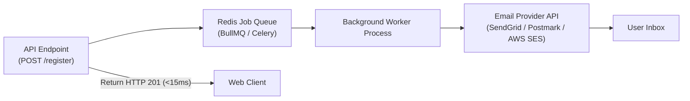

Transactional emails deliver critical operational updates: email verification links, password resets, payment receipts, and security alerts. Because email delivery involves third-party SMTP and API latency, it must never be executed synchronously inside web request handlers.

---

## 1. Asynchronous Queue Architecture



---

## 2. Node.js Implementation: BullMQ + SendGrid / Nodemailer

### 1. Enqueueing Email Job from Controller

```ts title="src/services/auth.service.ts"
import { emailQueue } from '../queues/email.queue.js';

export const registerUser = async (data: RegisterDto) => {
  const user = await userRepository.create(data);

  // Fast: Enqueue background job in Redis (< 2ms)
  await emailQueue.add('sendWelcomeEmail', {
    to: user.email,
    name: user.fullName,
    verificationToken: 'token_123',
  });

  return user;
};
```

### 2. Processing Jobs in Background Worker (`src/workers/email.worker.ts`)

```ts title="src/workers/email.worker.ts"
import { Worker, Job } from 'bullmq';
import nodemailer from 'nodemailer';
import { config } from '../config/index.js';
import { redisConnection } from '../config/redis.js';
import { logger } from '../utils/logger.js';

const transporter = nodemailer.createTransport({
  host: config.SMTP_HOST,
  port: config.SMTP_PORT,
  secure: config.SMTP_PORT === 465,
  auth: {
    user: config.SMTP_USER,
    pass: config.SMTP_PASS,
  },
});

export const emailWorker = new Worker(
  'email-queue',
  async (job: Job) => {
    logger.info(`Processing email job ${job.id} of type ${job.name}`);

    switch (job.name) {
      case 'sendWelcomeEmail': {
        const { to, name, verificationToken } = job.data;
        await transporter.sendMail({
          from: `"Nexium Media" <${config.EMAIL_FROM}>`,
          to,
          subject: 'Welcome to Nexium Media! Please verify your email',
          text: `Hi ${name},\n\nPlease verify your email by clicking: ${config.APP_URL}/verify?token=${verificationToken}`,
          html: `<p>Hi <b>${name}</b>,</p><p>Please verify your email by <a href="${config.APP_URL}/verify?token=${verificationToken}">clicking here</a>.</p>`,
        });
        break;
      }
    }
  },
  { connection: redisConnection, concurrency: 5 }
);

emailWorker.on('completed', (job) => logger.info(`Email job ${job.id} completed.`));
emailWorker.on('failed', (job, err) => logger.error({ err }, `Email job ${job?.id} failed.`));
```

---

## 3. Python Implementation: Celery + SendGrid

In FastAPI architectures, define email tasks via Celery:

```python title="app/tasks/email_tasks.py"
from celery import Celery
from sendgrid import SendGridAPIClient
from sendgrid.helpers.mail import Mail
from app.config import settings

celery_app = Celery("tasks", broker=settings.REDIS_URL)

@celery_app.task(bind=True, max_retries=3, default_retry_delay=60)
def send_transactional_email(self, to_email: str, subject: str, html_content: str):
    message = Mail(
        from_email=settings.DEFAULT_FROM_EMAIL,
        to_emails=to_email,
        subject=subject,
        html_content=html_content,
    )
    try:
        sg = SendGridAPIClient(settings.SENDGRID_API_KEY)
        response = sg.send(message)
        return response.status_code
    except Exception as exc:
        raise self.retry(exc=exc)
```

---

## 4. Local Development Email Testing with Mailpit

Never send real emails to customer or developer mailboxes during development. Use **Mailpit** (a local SMTP server and webmail UI) via Docker Compose:

```yaml title="docker-compose.yml"
services:
  mailpit:
    image: axllent/mailpit:latest
    ports:
      - "1025:1025" # SMTP port
      - "8025:8025" # Webmail UI
```

In `.env.development`:
```bash
SMTP_HOST=localhost
SMTP_PORT=1025
SMTP_USER=""
SMTP_PASS=""
```
Open `http://localhost:8025` to inspect generated HTML emails, headers, and attachments in your browser.

---

## Related

- [Third-Party Integrations Overview](/docs/development/backend/integrations)
- [Background Tasks in FastAPI](/docs/development/backend/python-fastapi/fastapi-fundamentals)
- [Environment Configuration](/docs/development/backend/deployment/environment-config)
