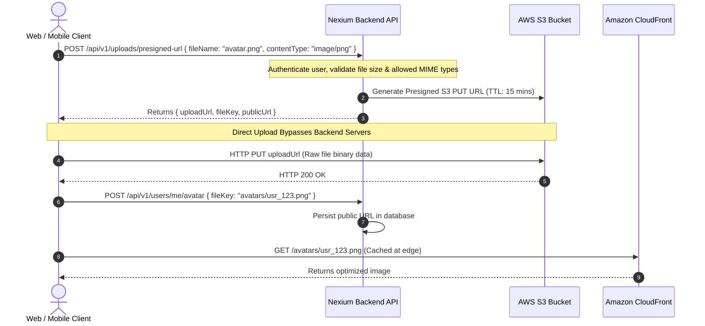

Uploading files directly through API servers consumes server memory, ties up web sockets, and bottlenecks backend processes. At Nexium Media, we enforce **Direct-to-S3 Presigned URL Workflows** for all file storage operations.

---

## 1. Direct Presigned URL Upload Architecture



---

## 2. Node.js Implementation: AWS SDK v3 (`@aws-sdk/client-s3`)

```ts title="src/services/storage.service.ts"
import { S3Client, PutObjectCommand, DeleteObjectCommand } from '@aws-sdk/client-s3';
import { getSignedUrl } from '@aws-sdk/s3-request-presigner';
import { randomUUID } from 'node:crypto';
import { config } from '../config/index.js';
import { AppError } from '../utils/appError.js';

const s3Client = new S3Client({
  region: config.AWS_REGION,
  credentials: {
    accessKeyId: config.AWS_ACCESS_KEY_ID,
    secretAccessKey: config.AWS_SECRET_ACCESS_KEY,
  },
});

const ALLOWED_MIME_TYPES = ['image/jpeg', 'image/png', 'image/webp', 'application/pdf'];
const MAX_FILE_SIZE = 10 * 1024 * 1024; // 10MB

export const generatePresignedUploadUrl = async (
  userId: string,
  fileName: string,
  contentType: string,
  fileSizeBytes: number
) => {
  if (!ALLOWED_MIME_TYPES.includes(contentType)) {
    throw new AppError(`File type ${contentType} is not permitted`, 400, 'INVALID_FILE_TYPE');
  }

  if (fileSizeBytes > MAX_FILE_SIZE) {
    throw new AppError('File size exceeds the 10MB maximum limit', 400, 'FILE_TOO_LARGE');
  }

  const extension = fileName.split('.').pop();
  const fileKey = `uploads/${userId}/${randomUUID()}.${extension}`;

  const command = new PutObjectCommand({
    Bucket: config.AWS_S3_BUCKET,
    Key: fileKey,
    ContentType: contentType,
  });

  // URL expires in 15 minutes
  const uploadUrl = await getSignedUrl(s3Client, command, { expiresIn: 900 });
  const publicUrl = `${config.CDN_BASE_URL}/${fileKey}`;

  return { uploadUrl, fileKey, publicUrl };
};

export const deleteFileFromS3 = async (fileKey: string): Promise<void> => {
  const command = new DeleteObjectCommand({
    Bucket: config.AWS_S3_BUCKET,
    Key: fileKey,
  });
  await s3Client.send(command);
};
```

---

## 3. Python Implementation with `boto3`

In FastAPI services:

```python title="app/services/storage_service.py"
import boto3
from botocore.exceptions import ClientError
from uuid import uuid4
from app.config import settings
from app.utils.exceptions import DomainException

s3_client = boto3.client(
    "s3",
    region_name=settings.AWS_REGION,
    aws_access_key_id=settings.AWS_ACCESS_KEY_ID,
    aws_secret_access_key=settings.AWS_SECRET_ACCESS_KEY,
)

def create_presigned_post(file_name: str, file_type: str, user_id: str) -> dict:
    extension = file_name.split(".")[-1]
    file_key = f"documents/{user_id}/{uuid4()}.{extension}"

    try:
        response = s3_client.generate_presigned_post(
            Bucket=settings.AWS_S3_BUCKET,
            Key=file_key,
            Fields={"Content-Type": file_type},
            Conditions=[
                {"Content-Type": file_type},
                ["content-length-range", 1024, 10 * 1024 * 1024], # 1KB to 10MB
            ],
            ExpiresIn=900,
        )
        response["public_url"] = f"{settings.CDN_BASE_URL}/{file_key}"
        return response
    except ClientError as e:
        raise DomainException("Failed to generate storage upload token") from e
```

---

## 4. Bucket Security & IAM Policies

<Callout type="warning">
**Security Mandate**: Never mark your AWS S3 bucket as publicly readable (`BlockPublicAcls = true` and `BlockPublicPolicy = true`). Public access must be routed exclusively through an **Amazon CloudFront Origin Access Control (OAC)** distribution, ensuring that S3 direct URLs are forbidden.
</Callout>

---

## Related

- [Third-Party Integrations Overview](/docs/development/backend/integrations)
- [Input Validation & File Sanitization](/docs/development/backend/security/input-validation)
- [Environment Configuration](/docs/development/backend/deployment/environment-config)
