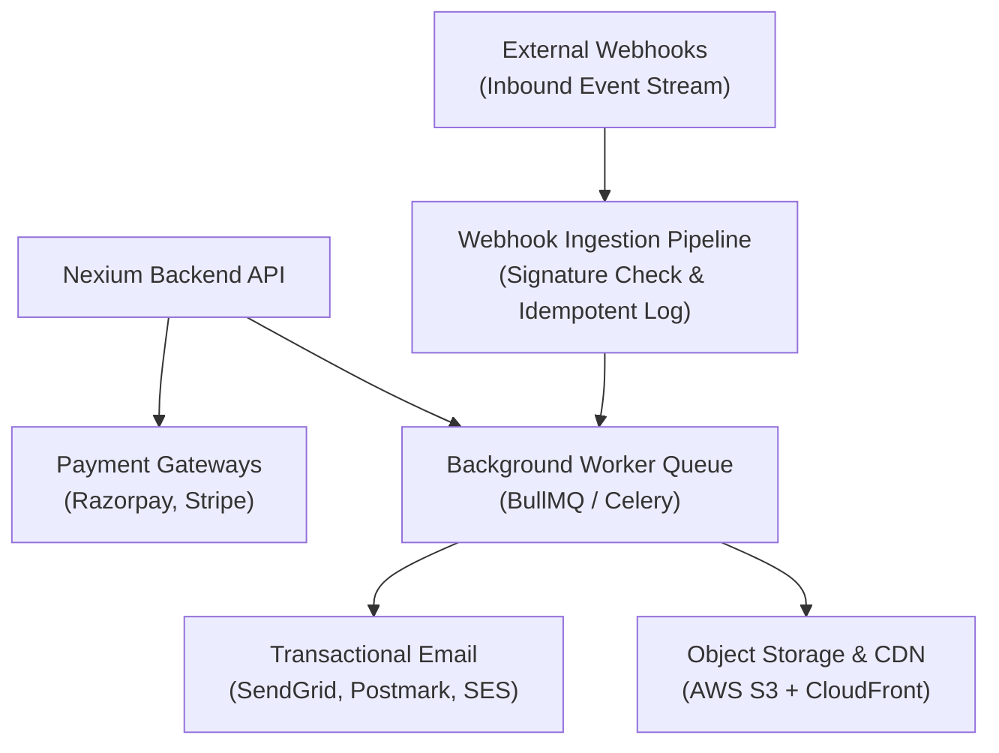

Modern enterprise backends rely extensively on external SaaS providers. However, external networks introduce latency, outages, rate limits, and asynchronous states.

At Nexium Media, third-party integrations are built with defensive engineering: **idempotency guarantees, cryptographic signature verification, background queue decoupling, and circuit breakers**.

---

## Integration Ecosystem

---

## Golden Rules for External Integrations

1. **Never Block on Outbound Network Calls**: External services can hang or experience latency spikes. Transactional emails, SMS alerts, and analytical pings must **always** be dispatched through an asynchronous background queue (BullMQ in Node.js or Celery in Python), never awaited in synchronous HTTP request threads.
2. **Cryptographically Verify All Inbound Webhooks**: Never trust incoming HTTP requests based on IP address or headers alone. Verify HMAC-SHA256 signatures using raw request buffers.
3. **Guarantee Idempotency**: Payment processing and webhook delivery are at-least-once systems. Handlers must track external event IDs (`event.id`, `razorpay_payment_id`) and prevent duplicate mutations.

---

## Section Guides

Explore our comprehensive integration modules:

<Cards>
  <Card
    title="Payment Gateways"
    href="/docs/development/backend/integrations/payment-gateways"
    description="Razorpay (India) and Stripe (Global) checkout orders, HMAC-SHA256 signature verification, and refund flows."
  />
  <Card
    title="Email Services"
    href="/docs/development/backend/integrations/email-services"
    description="Transactional email with SendGrid and Nodemailer, queue decoupling, templating, and local Mailpit testing."
  />
  <Card
    title="File & Object Storage"
    href="/docs/development/backend/integrations/file-storage"
    description="AWS S3 presigned URL workflows, direct client uploads, CloudFront CDN, and server-side MIME inspection."
  />
  <Card
    title="Webhooks Engineering"
    href="/docs/development/backend/integrations/webhooks"
    description="Building resilient inbound webhook listeners and outbound signature-signed webhook dispatchers."
  />
</Cards>

---

## Related

- [Backend Architecture Overview](/docs/development/backend/architecture)
- [API Security Standards](/docs/development/backend/security/api-security)
- [Rate Limiting Protocols](/docs/development/backend/api-development/rate-limiting)
