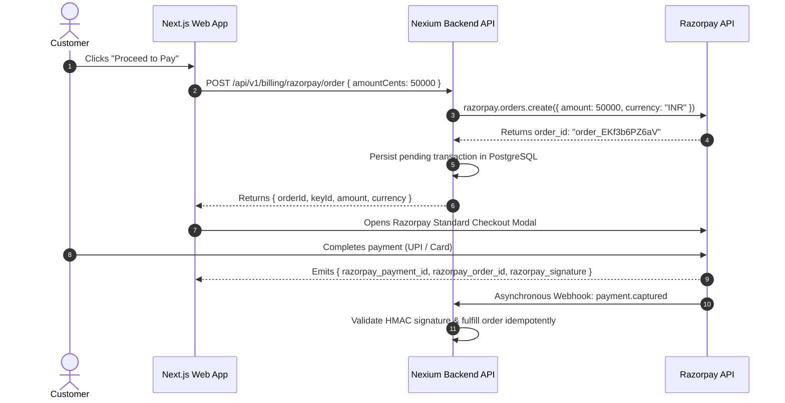

Financial transactions require zero room for error. At Nexium Media, we support two primary payment platforms:
1. **Razorpay**: Primary gateway for Indian clients (UPI, NetBanking, Domestic Cards, RuPay, EMI).
2. **Stripe**: Primary gateway for international enterprise clients (Credit Cards, SEPA, Apple Pay, Multi-Currency).

---

## 1. Razorpay Integration Architecture

### The Order Lifecycle
Razorpay requires server-side **Order Creation** before initiating checkout on the client:



---

### Node.js: Razorpay Order Creation & Webhook Verification

```ts title="src/services/razorpay.service.ts"
import Razorpay from 'razorpay';
import crypto from 'node:crypto';
import { config } from '../config/index.js';
import { prisma } from '../config/database.js';
import { AppError } from '../utils/appError.js';

const razorpay = new Razorpay({
  key_id: config.RAZORPAY_KEY_ID,
  key_secret: config.RAZORPAY_KEY_SECRET,
});

export const createRazorpayOrder = async (userId: string, amountInPaise: number) => {
  const options = {
    amount: amountInPaise, // 100 INR = 10000 paise
    currency: 'INR',
    receipt: `rcpt_${Date.now()}`,
    notes: { userId },
  };

  const order = await razorpay.orders.create(options);

  // Persist pending payment record
  await prisma.payment.create({
    data: {
      userId,
      gateway: 'RAZORPAY',
      gatewayOrderId: order.id,
      amountPaise: amountInPaise,
      currency: 'INR',
      status: 'PENDING',
    },
  });

  return order;
};

export const verifyRazorpayWebhook = (rawPayload: string, signature: string): boolean => {
  const expectedSignature = crypto
    .createHmac('sha256', config.RAZORPAY_WEBHOOK_SECRET)
    .update(rawPayload)
    .digest('hex');

  return crypto.timingSafeEqual(
    Buffer.from(signature, 'utf8'),
    Buffer.from(expectedSignature, 'utf8')
  );
};
```

---

### Python: Razorpay Webhook Verification

```python title="app/services/razorpay_service.py"
import hmac
import hashlib
from app.config import settings

def verify_razorpay_webhook(raw_body: bytes, signature: str) -> bool:
    expected = hmac.new(
        key=settings.RAZORPAY_WEBHOOK_SECRET.encode("utf-8"),
        msg=raw_body,
        digestmod=hashlib.sha256,
    ).hexdigest()

    return hmac.compare_digest(expected, signature)
```

---

## 2. Stripe Integration Architecture

### Node.js: PaymentIntent Creation & Webhook Handling

```ts title="src/controllers/stripe.controller.ts"
import { Request, Response } from 'express';
import Stripe from 'stripe';
import { config } from '../config/index.js';
import { prisma } from '../config/database.js';

const stripe = new Stripe(config.STRIPE_SECRET_KEY, {
  apiVersion: '2024-06-20',
});

// Endpoint: POST /api/v1/billing/stripe/create-intent
export const createPaymentIntent = async (req: Request, res: Response) => {
  const { amountCents, currency = 'usd' } = req.body;

  const paymentIntent = await stripe.paymentIntents.create({
    amount: amountCents,
    currency,
    automatic_payment_methods: { enabled: true },
    metadata: { userId: req.user!.userId },
  });

  res.status(200).json({ clientSecret: paymentIntent.client_secret });
};

// Endpoint: POST /api/v1/billing/stripe/webhook
export const handleStripeWebhook = async (req: Request, res: Response) => {
  const signature = req.headers['stripe-signature'] as string;
  let event: Stripe.Event;

  try {
    // Crucial: Must use raw req.body Buffer to reconstruct event
    event = stripe.webhooks.constructEvent(
      req.body,
      signature,
      config.STRIPE_WEBHOOK_SECRET
    );
  } catch (err: unknown) {
    const msg = err instanceof Error ? err.message : 'Invalid signature';
    return res.status(400).send(`Webhook Signature Verification Error: ${msg}`);
  }

  // Idempotent Processing
  switch (event.type) {
    case 'payment_intent.succeeded': {
      const intent = event.data.object as Stripe.PaymentIntent;

      // Check if event was already fulfilled
      const existing = await prisma.payment.findUnique({
        where: { gatewayPaymentId: intent.id },
      });

      if (existing && existing.status === 'SUCCEEDED') {
        return res.status(200).json({ received: true, status: 'already_processed' });
      }

      await prisma.payment.upsert({
        where: { gatewayPaymentId: intent.id },
        update: { status: 'SUCCEEDED' },
        create: {
          gateway: 'STRIPE',
          gatewayPaymentId: intent.id,
          amountPaise: intent.amount,
          currency: intent.currency.toUpperCase(),
          status: 'SUCCEEDED',
          userId: intent.metadata.userId,
        },
      });
      break;
    }
  }

  res.status(200).json({ received: true });
};
```

---

## 3. Critical Webhook Invariants

<Callout type="error">
**Webhook Implementation Traps**:
1. **Raw Body Parsing**: Stripe and Razorpay HMAC verification requires the exact, un-parsed raw byte buffer of the request body. If `express.json()` parses the body before verification, subtle whitespace or formatting differences will cause signature verification to fail permanently. Mount raw body parsers specifically for webhook routes:
```ts
app.post('/api/v1/billing/stripe/webhook', express.raw({ type: 'application/json' }), handleStripeWebhook);
```
2. **Missing Timing Safe Comparison**: Always verify signatures with `crypto.timingSafeEqual()` or `hmac.compare_digest()` to eliminate timing attack vectors.
</Callout>

---

## Related

- [Webhook Architecture & Ingestion](/docs/development/backend/integrations/webhooks)
- [API Security Standards](/docs/development/backend/security/api-security)
- [Database Transactions](/docs/development/backend/database/prisma-orm)
