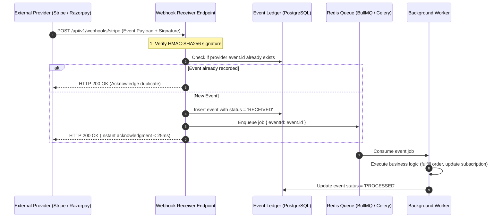

Webhooks enable event-driven architectures between decoupled platforms. At Nexium Media, we engineer both:
1. **Inbound Webhook Consumers**: Receiving and safely processing events from external platforms (Stripe, Razorpay, GitHub, Shopify).
2. **Outbound Webhook Dispatchers**: Publishing signed, verified domain events to third-party client endpoints.

---

## 1. Inbound Webhook Ingestion Pipeline

External webhook providers expect fast responses (typically within 3 to 5 seconds). If your handler performs heavy database writes or network calls synchronously, the connection may time out and trigger aggressive provider retries.



---

## 2. Inbound Webhook Handler Implementation

```ts title="src/controllers/webhook.controller.ts"
import { Request, Response } from 'express';
import { prisma } from '../config/database.js';
import { webhookQueue } from '../queues/webhook.queue.js';
import { verifyStripeSignature } from '../services/stripe.service.js';

export const handleInboundStripeWebhook = async (req: Request, res: Response) => {
  const signature = req.headers['stripe-signature'] as string;

  // 1. Verify Signature on Raw Body Buffer
  const event = verifyStripeSignature(req.body, signature);
  if (!event) {
    return res.status(400).send('Invalid webhook signature');
  }

  // 2. Idempotency Check via Event Ledger
  const existingEvent = await prisma.webhookEvent.findUnique({
    where: { externalEventId: event.id },
  });

  if (existingEvent) {
    // Return 200 immediately to acknowledge duplicate event
    return res.status(200).json({ received: true, status: 'already_recorded' });
  }

  // 3. Persist Event Audit Record
  await prisma.webhookEvent.create({
    data: {
      provider: 'STRIPE',
      externalEventId: event.id,
      eventType: event.type,
      payload: event as any,
      status: 'PENDING',
    },
  });

  // 4. Offload processing to background queue
  await webhookQueue.add('processStripeEvent', { eventId: event.id });

  // 5. Acknowledge delivery to provider
  res.status(200).json({ received: true });
};
```

---

## 3. Outbound Webhooks: Publishing Events to Clients

When building developer platforms or webhook APIs for our clients, sign outbound payloads using HMAC-SHA256 and transmit a cryptographic signature in the headers:

```ts title="src/services/outboundWebhook.service.ts"
import crypto from 'node:crypto';
import axios from 'axios';
import { logger } from '../utils/logger.js';

export interface OutboundPayload {
  id: string;
  event: string;
  timestamp: string;
  data: Record<string, unknown>;
}

export const dispatchWebhook = async (
  targetUrl: string,
  clientSecret: string,
  eventType: string,
  data: Record<string, unknown>
): Promise<void> => {
  const payload: OutboundPayload = {
    id: `evt_${crypto.randomUUID()}`,
    event: eventType,
    timestamp: new Date().toISOString(),
    data,
  };

  const payloadString = JSON.stringify(payload);

  // Compute HMAC-SHA256 signature with the client's webhook secret
  const signature = crypto
    .createHmac('sha256', clientSecret)
    .update(payloadString)
    .digest('hex');

  try {
    await axios.post(targetUrl, payloadString, {
      headers: {
        'Content-Type': 'application/json',
        'X-Nexium-Signature': signature,
        'X-Nexium-Event': eventType,
        'User-Agent': 'Nexium-Webhook-Dispatcher/1.0',
      },
      timeout: 5000, // 5 second strict delivery timeout
    });
    logger.info(`Webhook ${payload.id} successfully dispatched to ${targetUrl}`);
  } catch (error) {
    logger.error({ error, targetUrl }, `Failed to deliver webhook ${payload.id}. Scheduling retry.`);
    // Enqueue in exponential backoff retry queue (1m, 5m, 15m, 1h, 6h)
    throw error;
  }
};
```

---

## 4. Local Webhook Testing via Cloudflare Tunnel or ngrok

During local development, external webhook providers cannot reach `http://localhost:4000`. Expose your local port securely using Cloudflare Tunnels:

```bash
# Run Cloudflare quick tunnel to your local Express port
cloudflared tunnel --url http://localhost:4000

# Or via ngrok
ngrok http 4000
```
Copy the generated public HTTPS URL (e.g. `https://random-subdomain.trycloudflare.com/api/v1/billing/razorpay/webhook`) into the provider's developer dashboard.

---

## Related

- [Payment Gateway Webhooks](/docs/development/backend/integrations/payment-gateways)
- [Transactional Email Systems](/docs/development/backend/integrations/email-services)
- [API Security Standards](/docs/development/backend/security/api-security)
