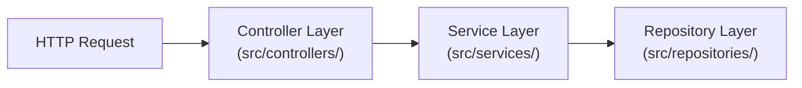

The separation between Controllers and Services is the most critical boundary in maintaining clean, testable Express applications.

---

## 1. Clear Division of Responsibilities



### Controller Rules
- **Responsible for**: Extracting request parameters, invoking services, mapping domain results to HTTP response envelopes, returning status codes.
- **Never does**: Database queries, raw SQL, business rule validation, hashing passwords, or sending emails.

### Service Rules
- **Responsible for**: Pure domain logic, entity calculations, transaction orchestration, throwing typed domain exceptions.
- **Never does**: Inspecting `req`, `res`, `next`, sending HTTP status codes, or formatting HTTP headers.

---

## 2. Production Example: User Domain

### The Repository Interface & Prisma Implementation

```ts title="src/repositories/user.repository.ts"
import { PrismaClient, User } from '@prisma/client';

export interface CreateUserData {
  email: string;
  passwordHash: string;
  fullName: string;
}

export interface IUserRepository {
  findById(id: string): Promise<User | null>;
  findByEmail(email: string): Promise<User | null>;
  create(data: CreateUserData): Promise<User>;
  updateStatus(id: string, isActive: boolean): Promise<User>;
}

export class PrismaUserRepository implements IUserRepository {
  constructor(private readonly prisma: PrismaClient) {}

  async findById(id: string): Promise<User | null> {
    return this.prisma.user.findUnique({ where: { id } });
  }

  async findByEmail(email: string): Promise<User | null> {
    return this.prisma.user.findUnique({ where: { email } });
  }

  async create(data: CreateUserData): Promise<User> {
    return this.prisma.user.create({ data });
  }

  async updateStatus(id: string, isActive: boolean): Promise<User> {
    return this.prisma.user.update({
      where: { id },
      data: { isActive },
    });
  }
}
```

---

### The Service Class (Domain Logic)

```ts title="src/services/user.service.ts"
import { IUserRepository } from '../repositories/user.repository.js';
import { AppError } from '../utils/appError.js';
import bcrypt from 'bcrypt';

export interface CreateUserDto {
  email: string;
  password: string;
  fullName: string;
}

export interface UserResponseDto {
  id: string;
  email: string;
  fullName: string;
  isActive: boolean;
  createdAt: Date;
}

export class UserService {
  constructor(private readonly userRepo: IUserRepository) {}

  async registerUser(dto: CreateUserDto): Promise<UserResponseDto> {
    // 1. Domain Check: Unique email constraint
    const existing = await this.userRepo.findByEmail(dto.email);
    if (existing) {
      throw new AppError('An account with this email already exists', 409, 'EMAIL_EXISTS');
    }

    // 2. Hash password securely
    const passwordHash = await bcrypt.hash(dto.password, 12);

    // 3. Persist entity
    const user = await this.userRepo.create({
      email: dto.email,
      passwordHash,
      fullName: dto.fullName,
    });

    // 4. Return sanitized DTO
    return {
      id: user.id,
      email: user.email,
      fullName: user.fullName,
      isActive: user.isActive,
      createdAt: user.createdAt,
    };
  }

  async getUserProfile(userId: string): Promise<UserResponseDto> {
    const user = await this.userRepo.findById(userId);
    if (!user) {
      throw new AppError('User not found', 404, 'USER_NOT_FOUND');
    }

    return {
      id: user.id,
      email: user.email,
      fullName: user.fullName,
      isActive: user.isActive,
      createdAt: user.createdAt,
    };
  }
}
```

---

### The Controller Class (HTTP Transport)

```ts title="src/controllers/user.controller.ts"
import { Request, Response } from 'express';
import { UserService, CreateUserDto } from '../services/user.service.js';
import { sendSuccess } from '../utils/response.js';

export class UserController {
  constructor(private readonly userService: UserService) {}

  createUser = async (req: Request<unknown, unknown, CreateUserDto>, res: Response): Promise<void> => {
    // Input is pre-validated by Zod middleware; req.body is fully typed
    const newUser = await this.userService.registerUser(req.body);
    sendSuccess(res, newUser, 201);
  };

  getUserById = async (req: Request<{ userId: string }>, res: Response): Promise<void> => {
    const user = await this.userService.getUserProfile(req.params.userId);
    sendSuccess(res, user, 200);
  };
}
```

---

## 3. Testing Services via Repository Mocking

Because `UserService` depends upon `IUserRepository` via constructor injection, unit testing requires zero live database connections:

```ts title="tests/unit/user.service.test.ts"
import { UserService } from '../../src/services/user.service.js';
import { IUserRepository } from '../../src/repositories/user.repository.js';
import { AppError } from '../../src/utils/appError.js';

describe('UserService', () => {
  let mockUserRepo: jest.Mocked<IUserRepository>;
  let userService: UserService;

  beforeEach(() => {
    mockUserRepo = {
      findById: jest.fn(),
      findByEmail: jest.fn(),
      create: jest.fn(),
      updateStatus: jest.fn(),
    };
    userService = new UserService(mockUserRepo);
  });

  it('throws AppError(409) if user email already exists', async () => {
    mockUserRepo.findByEmail.mockResolvedValueOnce({
      id: 'existing-123',
      email: 'test@nexiummedia.com',
      passwordHash: 'hashed',
      fullName: 'Test User',
      isActive: true,
      createdAt: new Date(),
      updatedAt: new Date(),
    });

    await expect(
      userService.registerUser({
        email: 'test@nexiummedia.com',
        password: 'password123',
        fullName: 'Test User',
      })
    ).rejects.toThrow(AppError);
  });
});
```

---

## Related

- [Layered Architecture Principles](/docs/development/backend/architecture/layered-architecture)
- [Unit Testing with Jest](/docs/development/backend/testing/unit-testing-node)
- [Error Handling Standards](/docs/development/backend/node-express/error-handling)
