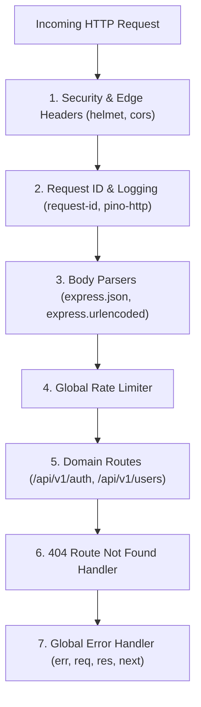

Express is an unopinionated, minimalist web framework that routes incoming HTTP requests through a linear pipeline of middleware functions. Mastering its core primitives is essential to building stable, performant backend services.

---

## 1. Creating the Express Instance & Lifespan

We split Express server bootstrapping into two distinct files:
- **`src/app.ts`**: Pure configuration of the Express application instance, middleware mounting, and route registration. Exports `app` for testing without opening network sockets.
- **`src/index.ts`**: The process entry point that binds `app` to an HTTP port and handles OS process signals (`SIGTERM`, `SIGINT`).

```ts title="src/index.ts"
import { app } from './app.js';
import { config } from './config/index.js';
import { logger } from './utils/logger.js';

const server = app.listen(config.PORT, config.HOST, () => {
  logger.info(`Service ${config.APP_NAME} started on http://${config.HOST}:${config.PORT} [${config.NODE_ENV}]`);
});

// Graceful Shutdown
const shutdown = (signal: string) => {
  logger.warn(`Received ${signal}. Closing HTTP server gracefully...`);
  server.close(() => {
    logger.info('HTTP server closed. Exiting process.');
    process.exit(0);
  });

  // Force close if lingering requests take more than 10 seconds
  setTimeout(() => {
    logger.error('Forced shutdown after timeout.');
    process.exit(1);
  }, 10000).unref();
};

process.on('SIGTERM', () => shutdown('SIGTERM'));
process.on('SIGINT', () => shutdown('SIGINT'));
```

---

## 2. The Request Object (`req`)

The Express `Request` object encapsulates all incoming client data:

```ts
app.get('/api/v1/workspaces/:workspaceId/projects', (req: Request, res: Response) => {
  // 1. Path Parameters: defined via :parameterName
  const { workspaceId } = req.params; // string

  // 2. Query Parameters: URL search strings (?page=2&status=active)
  const { page = '1', status = 'active' } = req.query;

  // 3. Request Body: parsed JSON payload (available after express.json())
  const payload = req.body;

  // 4. Headers: incoming HTTP headers (all lowercase keys)
  const authorization = req.headers['authorization'];
  const requestId = req.headers['x-request-id'];

  // 5. Client Metadata: IP address and protocol
  const clientIp = req.ip;
  const isSecure = req.secure; // true if HTTPS

  res.json({ workspaceId, page, status, clientIp });
});
```

---

## 3. The Response Object (`res`)

The `Response` object manages output headers, HTTP status codes, and payload delivery:

```ts
// JSON response with explicit status code
res.status(200).json({ data: user });

// Created resource (201) with Location header
res.status(201).location(`/api/v1/users/${user.id}`).json({ data: user });

// Empty successful response (204)
res.status(204).send();

// Setting explicit headers
res.setHeader('Cache-Control', 'no-store');

// Client redirect
res.redirect(301, 'https://docs.nexiummedia.com');
```

---

## 4. Middleware Execution Order

Middleware functions execute sequentially in the exact order they are registered with `app.use()`. Misordering middleware is the #1 cause of bugs in Express applications.



<Callout type="warning">
**Crucial Middleware Invariant**:
- `express.json()` **must** be mounted before any route that inspects `req.body`.
- Authentication middleware **must** be mounted before protected routes.
- The 4-argument error handler `(err, req, res, next)` **must** be the very last middleware mounted in `app.ts`.
</Callout>

---

## 5. Complete Production `app.ts` Example

Below is the canonical `src/app.ts` template required for all Nexium Media Node.js services:

```ts title="src/app.ts"
import express, { Application, Request, Response, NextFunction } from 'express';
import helmet from 'helmet';
import cors from 'cors';
import { config } from './config/index.js';
import { requestLogger } from './middleware/requestLogger.middleware.js';
import { globalErrorHandler } from './middleware/error.middleware.js';
import { appRouter } from './routes/index.js';
import { AppError } from './utils/appError.js';

export const app: Application = express();

// 1. Edge Security Headers
app.use(helmet());

// 2. Cross-Origin Resource Sharing
app.use(
  cors({
    origin: config.CORS_ORIGIN.split(','),
    credentials: true,
    methods: ['GET', 'POST', 'PUT', 'PATCH', 'DELETE', 'OPTIONS'],
    allowedHeaders: ['Content-Type', 'Authorization', 'X-Request-Id', 'Idempotency-Key'],
  })
);

// 3. Body Parsers
app.use(express.json({ limit: '10mb' }));
app.use(express.urlencoded({ extended: true, limit: '10mb' }));

// 4. Request Logging & Correlation ID
app.use(requestLogger);

// 5. System Health Check Endpoint (Bypasses Auth)
app.get('/health', (_req: Request, res: Response) => {
  res.status(200).json({
    status: 'ok',
    service: config.APP_NAME,
    timestamp: new Date().toISOString(),
    uptime: process.uptime(),
  });
});

// 6. Mount Domain API Routes
app.use('/api/v1', appRouter);

// 7. Fallback 404 Handler for Unmatched Routes
app.use((req: Request, _res: Response, next: NextFunction) => {
  next(new AppError(`Cannot find ${req.method} ${req.originalUrl} on this server`, 404, 'ROUTE_NOT_FOUND'));
});

// 8. Global Error Pipeline (Always Last)
app.use(globalErrorHandler);
```

---

## Related

- [Routing Architecture](/docs/development/backend/node-express/routing)
- [Middleware Implementation Patterns](/docs/development/backend/node-express/middleware)
- [Error Handling Standards](/docs/development/backend/node-express/error-handling)
