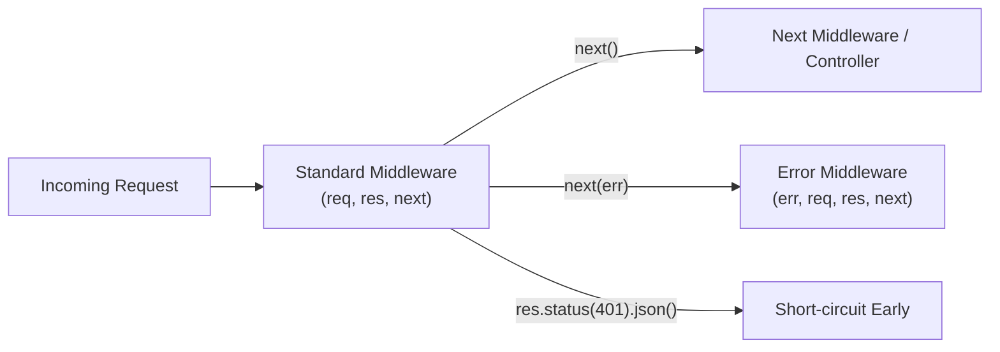

Middleware functions are composable interceptors that sit between client network requests and controller execution. They can inspect incoming data, mutate the request context (e.g., attach authenticated identity), abort execution early, or pass control down the chain.

---

## 1. Middleware Anatomies & Types

Express recognizes two signatures:

1. **Standard Middleware**: Accepts three arguments `(req, res, next)`.
2. **Error-Handling Middleware**: Accepts four arguments `(err, req, res, next)`. Express specifically identifies error handlers by checking `fn.length === 4`.



---

## 2. Request Correlation ID Middleware

Every incoming request must be stamped with a unique `X-Request-Id` for distributed tracing:

```ts title="src/middleware/requestId.middleware.ts"
import { Request, Response, NextFunction } from 'express';
import { randomUUID } from 'node:crypto';

export const requestIdMiddleware = (req: Request, res: Response, next: NextFunction): void => {
  const incomingId = req.headers['x-request-id'] as string | undefined;
  const requestId = incomingId && incomingId.trim() !== '' ? incomingId : randomUUID();

  // Attach to request object and echo back in response headers
  req.id = requestId;
  res.setHeader('X-Request-Id', requestId);

  next();
};
```

---

## 3. Extending Express `Request` Interface in TypeScript

To safely access `req.id` and `req.user` without compiler errors or typing as `any`, use TypeScript Declaration Merging:

```ts title="src/types/express.d.ts"
import { JwtPayload } from './auth.types.js';

declare global {
  namespace Express {
    interface Request {
      id: string;
      user?: JwtPayload;
    }
  }
}

export {};
```

---

## 4. Authentication Middleware (`requireAuth`)

The authentication middleware extracts the Bearer token from the `Authorization` header, validates its cryptographic signature, checks expiration, and mounts the decoded payload on `req.user`:

```ts title="src/middleware/auth.middleware.ts"
import { Request, Response, NextFunction } from 'express';
import jwt from 'jsonwebtoken';
import { config } from '../config/index.js';
import { AppError } from '../utils/appError.js';
import { JwtPayload } from '../types/auth.types.js';

export const requireAuth = (req: Request, _res: Response, next: NextFunction): void => {
  const authHeader = req.headers.authorization;

  if (!authHeader || !authHeader.startsWith('Bearer ')) {
    return next(new AppError('Authentication token missing or malformed', 401, 'UNAUTHORIZED'));
  }

  const token = authHeader.split(' ')[1];

  try {
    const decoded = jwt.verify(token, config.JWT_ACCESS_SECRET) as JwtPayload;
    req.user = decoded;
    next();
  } catch (error) {
    if (error instanceof jwt.TokenExpiredError) {
      return next(new AppError('Authentication token has expired', 401, 'TOKEN_EXPIRED'));
    }
    return next(new AppError('Invalid authentication token', 401, 'INVALID_TOKEN'));
  }
};
```

---

## 5. Rate Limiting Middleware with Redis

Protect APIs from abuse using `express-rate-limit` backed by Redis:

```ts title="src/middleware/rateLimiter.middleware.ts"
import rateLimit from 'express-rate-limit';
import RedisStore from 'rate-limit-redis';
import { redisClient } from '../config/redis.js';
import { AppError } from '../utils/appError.js';

// General API Rate Limiter: 100 requests per minute
export const apiLimiter = rateLimit({
  windowMs: 60 * 1000,
  max: 100,
  standardHeaders: true, // Return standard RateLimit-* headers
  legacyHeaders: false,
  store: new RedisStore({
    sendCommand: (...args: string[]) => redisClient.sendCommand(args),
    prefix: 'rl:api:',
  }),
  handler: (_req, _res, next) => {
    next(new AppError('Too many requests, please try again later.', 429, 'RATE_LIMIT_EXCEEDED'));
  },
});

// Strict Limiter for Auth Routes: 5 requests per 15 minutes
export const authLimiter = rateLimit({
  windowMs: 15 * 60 * 1000,
  max: 5,
  standardHeaders: true,
  legacyHeaders: false,
  store: new RedisStore({
    sendCommand: (...args: string[]) => redisClient.sendCommand(args),
    prefix: 'rl:auth:',
  }),
  handler: (_req, _res, next) => {
    next(new AppError('Too many authentication attempts. Try again in 15 minutes.', 429, 'AUTH_RATE_LIMIT'));
  },
});
```

---

## 6. Global Error-Handling Middleware

The terminal error middleware maps unhandled domain errors to standardized JSON envelopes:

```ts title="src/middleware/error.middleware.ts"
import { Request, Response, NextFunction } from 'express';
import { AppError } from '../utils/appError.js';
import { config } from '../config/index.js';
import { logger } from '../utils/logger.js';

export const globalErrorHandler = (
  err: Error | AppError,
  req: Request,
  res: Response,
  _next: NextFunction
): void => {
  const isOperational = err instanceof AppError && err.isOperational;
  const statusCode = err instanceof AppError ? err.statusCode : 500;
  const errorCode = err instanceof AppError ? err.errorCode : 'INTERNAL_SERVER_ERROR';
  const message = isOperational ? err.message : 'An unexpected internal error occurred';

  logger.error({
    err,
    requestId: req.id,
    url: req.originalUrl,
    method: req.method,
  }, `[ErrorHandler] ${err.message}`);

  res.status(statusCode).json({
    error: {
      code: errorCode,
      message,
      ...(config.NODE_ENV === 'development' && { stack: err.stack }),
    },
    meta: {
      requestId: req.id ?? '',
      timestamp: new Date().toISOString(),
    },
  });
};
```

---

## Related

- [Error Handling Standards](/docs/development/backend/node-express/error-handling)
- [JWT Authentication Implementation](/docs/development/backend/authentication/jwt-auth)
- [Rate Limiting Patterns](/docs/development/backend/api-development/rate-limiting)
