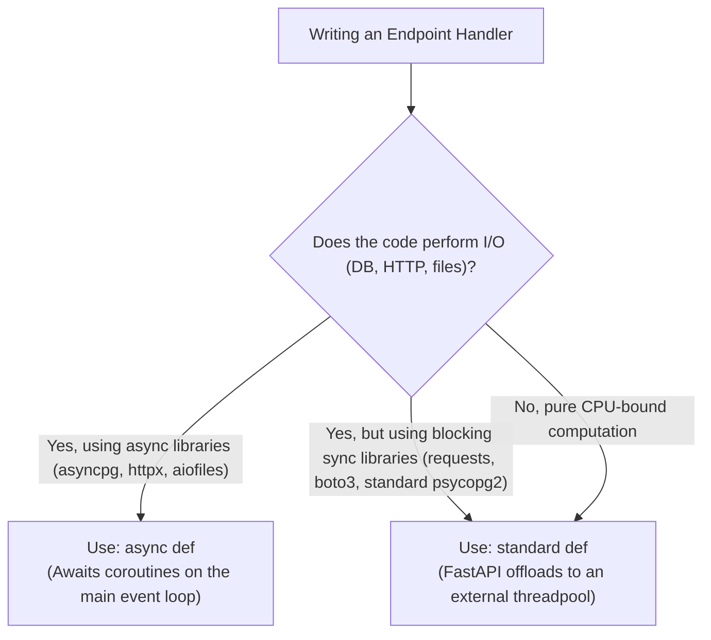

FastAPI is built on Starlette and AnyIO, allowing high-performance concurrent request processing. However, writing asynchronous Python requires strict adherence to event-loop safety rules.

---

## 1. `async def` vs `def`: The Golden Rule

Understanding when to write `async def` vs standard `def` is the most critical distinction in FastAPI:



<Callout type="error">
**The Worst Mistake in FastAPI**: Putting blocking code (e.g. `time.sleep(5)` or `requests.get(...)`) inside an `async def` function blocks the single-threaded event loop! All other concurrent requests across all users will freeze until that blocking call completes.
</Callout>

### Comparison Table

| Handler Declaration | How FastAPI Executes It | Use Case |
| :--- | :--- | :--- |
| `async def handler()` | Runs directly on the main event loop. Must use non-blocking `await`. | Asynchronous DB queries (`SQLAlchemy + asyncpg`), outbound HTTP (`httpx.AsyncClient`), Redis (`redis.asyncio`). |
| `def handler()` | Offloaded automatically to an internal Starlette worker threadpool (`anyio.to_thread`). | Synchronous operations, legacy sync libraries (`requests`, standard file I/O, CPU-heavy data parsing). |

---

## 2. Asynchronous Database Queries with `asyncpg`

Use modern SQLAlchemy 2.0 async syntax with `await`:

```python
from sqlalchemy import select
from sqlalchemy.ext.asyncio import AsyncSession
from app.models.user import UserModel

async def get_active_users(session: AsyncSession) -> list[UserModel]:
    statement = select(UserModel).where(UserModel.is_active == True)
    # Correct: Await database query execution
    result = await session.execute(statement)
    return list(result.scalars().all())
```

---

## 3. Parallel I/O with `asyncio.gather()`

When an endpoint needs to fetch data from multiple independent services (e.g., user profile, billing tier, and notifications), execute them concurrently rather than sequentially:

```python
import asyncio
import httpx
from fastapi import APIRouter

router = APIRouter()

async def fetch_user_profile(client: httpx.AsyncClient, user_id: str) -> dict:
    resp = await client.get(f"https://users.internal/api/{user_id}")
    return resp.json()

async def fetch_billing_status(client: httpx.AsyncClient, user_id: str) -> dict:
    resp = await client.get(f"https://billing.internal/api/{user_id}")
    return resp.json()

@router.get("/aggregated-dashboard/{user_id}")
async def get_dashboard(user_id: str):
    async with httpx.AsyncClient(timeout=5.0) as client:
        # Runs both network calls simultaneously!
        profile, billing = await asyncio.gather(
            fetch_user_profile(client, user_id),
            fetch_billing_status(client, user_id),
        )
    return {"profile": profile, "billing": billing}
```

---

## 4. Offloading Blocking CPU-Bound Code

If an endpoint must run heavy cryptographic operations, image manipulation, or pandas calculations, use `asyncio.to_thread`:

```python
import asyncio
from fastapi import APIRouter
from PIL import Image

router = APIRouter()

def process_heavy_image(file_path: str) -> str:
    # CPU-bound synchronous image manipulation
    img = Image.open(file_path)
    img = img.resize((400, 400))
    img.save(file_path, "JPEG", quality=85)
    return file_path

@router.post("/process-avatar")
async def process_avatar(path: str):
    # Safely offloads CPU task to worker thread without blocking the event loop
    processed_path = await asyncio.to_thread(process_heavy_image, path)
    return {"status": "complete", "path": processed_path}
```

---

## 5. Common Async Anti-Patterns

<Callout type="warning">
1. **Calling Async Functions without `await`**: Writing `result = session.execute(...)` without `await` returns an unresolved coroutine object `<coroutine object ...>` instead of the query result.
2. **Creating Unmanaged Tasks**: Calling `asyncio.create_task()` without storing a reference or handling exceptions. If the task fails, it produces unhandled warnings and orphan execution.
3. **Using Global Shared State**: Asynchronous routines share the same process memory space. Avoid mutating global variables across concurrent requests without `asyncio.Lock()`.
</Callout>

---

## Related

- [FastAPI Fundamentals](/docs/development/backend/python-fastapi/fastapi-fundamentals)
- [PostgreSQL with SQLAlchemy 2.0](/docs/development/backend/database/postgresql)
- [Integration Testing with HTTPX](/docs/development/backend/testing/integration-testing)
