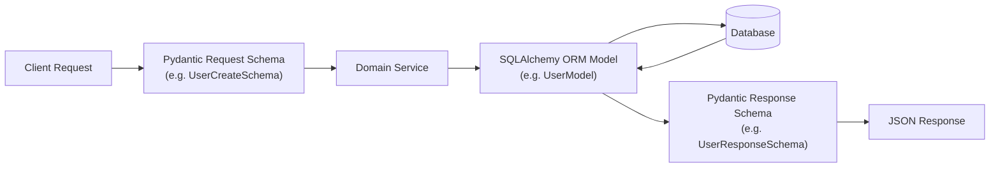

Pydantic v2 powers data parsing, type validation, and serialization in FastAPI. Rewritten in Rust (`pydantic-core`), v2 delivers 5-50x faster validation than v1 while introducing cleaner decorator APIs and configuration dictionaries.

---

## 1. Schema Hierarchy: Request vs Response vs ORM

At Nexium Media, we strictly separate **Domain ORM Models** from **API Schemas (DTOs)**:



<Callout type="error">
**Zero Tolerance Rule**: Never return a raw SQLAlchemy ORM model directly to the client. Always serialize via a dedicated Pydantic response schema (`response_model=UserResponseSchema`) with `from_attributes=True`. This prevents accidental leakage of password hashes, API tokens, and internal database keys.
</Callout>

---

## 2. Schema Inheritance Pattern

Leverage inheritance to eliminate field duplication between base, creation, update, and response models:

```python title="app/schemas/user.py"
from datetime import datetime
from uuid import UUID
from typing import Optional
from pydantic import BaseModel, ConfigDict, EmailStr, Field

# 1. Base Schema: Shared fields common to all schemas
class UserBase(BaseModel):
    email: EmailStr = Field(..., description="User's unique primary email address")
    full_name: str = Field(..., min_length=2, max_length=100, description="Full legal name")
    is_active: bool = Field(default=True, description="Account active status")

    model_config = ConfigDict(
        str_strip_whitespace=True, # Automatically strips leading/trailing whitespace
        populate_by_name=True,
    )

# 2. Create Schema: Requires plaintext password
class UserCreate(UserBase):
    password: str = Field(..., min_length=8, max_length=128, description="Plaintext password")

# 3. Update Schema: All fields optional for PATCH requests
class UserUpdate(BaseModel):
    email: Optional[EmailStr] = None
    full_name: Optional[str] = Field(default=None, min_length=2, max_length=100)
    is_active: Optional[bool] = None

# 4. Response Schema: Exposes database IDs and timestamps; NO password
class UserResponse(UserBase):
    id: UUID
    created_at: datetime
    updated_at: datetime

    # Enable reading attributes from SQLAlchemy ORM objects
    model_config = ConfigDict(from_attributes=True)
```

---

## 3. Advanced Field Constraints & Specialized Types

Pydantic provides specialized types that automatically enforce RFC specifications:

```python
from pydantic import BaseModel, Field, HttpUrl, SecretStr, PositiveInt

class CompanyProfileSchema(BaseModel):
    name: str = Field(..., min_length=1, max_length=150)
    website: HttpUrl = Field(..., description="Valid HTTP or HTTPS URL")
    employee_count: PositiveInt = Field(..., description="Must be an integer > 0")
    api_key: SecretStr = Field(..., description="Hidden from repr and logging")
    tax_rate: float = Field(..., ge=0.0, le=1.0, description="Percentage between 0.0 and 1.0")
```

When logging `CompanyProfileSchema`, `api_key` automatically masks its content: `SecretStr('**********')`.

---

## 4. Custom Field & Model Validators in v2

### Field Validators (`@field_validator`)

Validate or normalize a single property:

```python
from pydantic import BaseModel, field_validator

class UserRegistration(BaseModel):
    username: str

    @field_validator("username")
    @classmethod
    def validate_username(cls, value: str) -> str:
        if not value.isalnum():
            raise ValueError("Username must contain only alphanumeric characters")
        return value.lower()
```

### Model Validators (`@model_validator`)

Validate relationships between multiple properties (e.g. password confirmation):

```python
from pydantic import BaseModel, model_validator
from typing_extensions import Self

class PasswordResetSchema(BaseModel):
    password: str
    confirm_password: str

    @model_validator(mode="after")
    def verify_passwords_match(self) -> Self:
        if self.password != self.confirm_password:
            raise ValueError("Passwords do not match")
        return self
```

---

## 5. Serialization (`model_dump` & `model_dump_json`)

In Pydantic v2, `.dict()` and `.json()` are replaced with `.model_dump()` and `.model_dump_json()`:

```python
user_response = UserResponse.model_validate(db_user)

# Convert to native Python dictionary
data_dict = user_response.model_dump(exclude={"is_active"})

# Convert to JSON string
json_str = user_response.model_dump_json(indent=2)
```

---

## Common Mistakes

<Callout type="warning">
- **Using Pydantic v1 Syntax**: Using `class Config:` instead of `model_config = ConfigDict(...)` or using `@validator` instead of `@field_validator`.
- **Forgetting `from_attributes=True`**: When mapping from a SQLAlchemy model to a Pydantic response schema, omitting this will trigger an `AttributeError` or validation failure.
</Callout>

---

## Related

- [FastAPI Fundamentals](/docs/development/backend/python-fastapi/fastapi-fundamentals)
- [PostgreSQL & SQLAlchemy 2.0](/docs/development/backend/database/postgresql)
- [Request Validation Standards](/docs/development/backend/api-development/request-validation)
