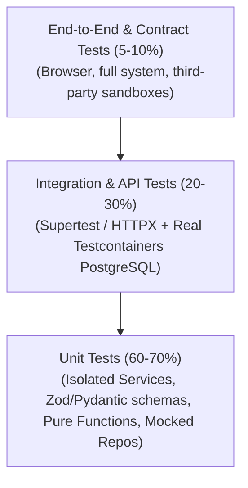

Automated testing is our principal defense against software regression, security vulnerabilities, and deployment failures. In an agency delivering mission-critical applications across 100+ engineers, "it works on my machine" is unacceptable.

---

## The Testing Pyramid

Our automated test strategy balances execution speed, cost, and confidence across three distinct tiers:

| Test Level | Scope | Execution Speed | Mocking Strategy | Target Coverage |
| :--- | :--- | :--- | :--- | :--- |
| **Unit Tests** | Individual functions, domain services, validation schemas. | Milliseconds (~50ms) | Repositories & external APIs mocked. | >= 85% branch coverage on `src/services` |
| **Integration Tests** | Real HTTP requests against Express / FastAPI endpoints with PostgreSQL. | Seconds (~2-5s) | External third-party networks mocked; DB real. | Critical revenue & auth workflows |
| **End-to-End** | Full user journeys spanning frontend web apps, API, and worker jobs. | Minutes (~1-3m) | Zero mocking in staging environments. | Core transactional flows |

---

## Mandatory Pull Request Checklist

Before submitting any backend pull request at Nexium Media, verify the following:

- [ ] **Unit Tests Added**: All new service methods, validators, and domain calculations have corresponding unit tests.
- [ ] **Negative & Error Paths Tested**: Tests cover not only the "happy path", but also 400 validation failures, 401 unauthorized errors, and 404/409 exceptions.
- [ ] **Zero Flakiness**: Tests run deterministically in random order without shared global state mutations.
- [ ] **Fast Execution**: Entire unit test suite runs in under 30 seconds locally.
- [ ] **Static Analysis Passed**: `npm run lint && npm run type-check` (Node.js) or `ruff check . && mypy .` (Python) pass with zero warnings.

---

## Section Guides

Explore our specialized testing manuals:

<Cards>
  <Card
    title="Node.js Unit Testing with Jest"
    href="/docs/development/backend/testing/unit-testing-node"
    description="Jest configuration, TypeScript setup, mocking repository interfaces, and Zod validator testing."
  />
  <Card
    title="Python Unit Testing with Pytest"
    href="/docs/development/backend/testing/unit-testing-python"
    description="Pytest fixtures, parametrized testing, mocking repository dependencies, and Pydantic validator checks."
  />
  <Card
    title="API Integration Testing"
    href="/docs/development/backend/testing/integration-testing"
    description="End-to-end API testing with Supertest (Node.js) and HTTPX (FastAPI) against containerized databases."
  />
</Cards>

---

## Related

- [Node.js Controllers & Services](/docs/development/backend/node-express/controllers-services)
- [FastAPI Dependency Injection](/docs/development/backend/python-fastapi/dependency-injection)
- [CI/CD Automation Pipelines](/docs/development/backend/deployment/ci-cd)
