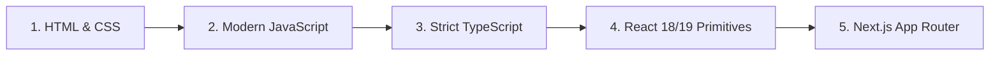

High-velocity engineering in a 100+ developer organization depends upon a solid grasp of foundational web primitives. High-level frameworks, state libraries, and CSS abstractions are constantly evolving, but the bedrock layers—semantic markup, styling cascades, modern JavaScript engines, type calculus, declarative rendering, and hybrid server runtimes—remain invariant.

This section provides the canonical engineering reference for the core technologies comprising our frontend stack.

## Why Fundamentals Matter

Modern frontends fail at scale not because of complex framework features, but because of foundational anti-patterns: inaccessible div-soup markup that fails screen readers, unoptimized JavaScript bundles that block the browser main thread, loose TypeScript types that propagate runtime exceptions, and state mutations that trigger recursive re-renders.

Mastering these fundamentals ensures that every engineer at Nexium Media delivers code that is:

- **Accessible & Resilient**: Built on semantic HTML and standard CSS capabilities.
- **Performant**: Free of execution bottlenecks, memory leaks, and excessive hydration overhead.
- **Predictable**: Type-safe end-to-end, catching errors during compilation rather than in production.
- **Maintainable**: Transparent component boundaries and explicit unidirectional data flows.

## Recommended Learning Sequence

For engineers onboarding to the Nexium Media frontend stack, we recommend progressing through these core modules in sequence:

## Curriculum Overview

The fundamentals track is divided into five dedicated reference guides:

| Section | Scope & Core Topics | Target Proficiency |
| :--- | :--- | :--- |
| [HTML & Modern CSS](/docs/development/frontend/fundamentals/html-css) | Semantic landmarks, accessible forms, ARIA roles, Flexbox/Grid layouts, CSS custom properties, cascade layers (`@layer`), and container queries. | Full WCAG 2.1 AA compliance and fluid, responsive layouts without unnecessary JavaScript. |
| [Modern JavaScript (ES2022+)](/docs/development/frontend/fundamentals/javascript) | Optional chaining, nullish coalescing, Promise combinators, `AbortController`, Map/Set patterns, event loop mechanics, and closure management. | Safe asynchronous programming, immutability, and zero main-thread blocking. |
| [Strict TypeScript](/docs/development/frontend/fundamentals/typescript) | Strict compiler flags, discriminated unions, generic constraints, utility types, custom type guards, and runtime schema parsing via Zod. | Complete type safety without `any`, eliminating runtime type crashes. |
| [React Architecture](/docs/development/frontend/fundamentals/react) | Component mental model, reconciliation, hook rules, functional state transitions, `useMemo`/`useCallback` guidelines, refs, and Concurrent features. | Predictable lifecycle management and elimination of stale closures and render loops. |
| [Next.js App Router](/docs/development/frontend/fundamentals/nextjs) | Server vs Client Components, nested layouts, streaming with Suspense, Server Actions, Route Handlers, metadata generation, and image optimization. | Hybrid full-stack development with optimal Core Web Vitals (LCP, INP, CLS). |

<Callout type="tip">
Even seasoned engineers should review the [Strict TypeScript](/docs/development/frontend/fundamentals/typescript) and [Next.js App Router](/docs/development/frontend/fundamentals/nextjs) specifications to align on company-specific patterns, such as discriminated union state machines and Server Component boundaries.
</Callout>

## Related

- [HTML & CSS Architecture](/docs/development/frontend/fundamentals/html-css)
- [Modern JavaScript Deep Dive](/docs/development/frontend/fundamentals/javascript)
- [Strict TypeScript Standards](/docs/development/frontend/fundamentals/typescript)
- [React Architecture & Hooks](/docs/development/frontend/fundamentals/react)
- [Next.js App Router Guide](/docs/development/frontend/fundamentals/nextjs)
