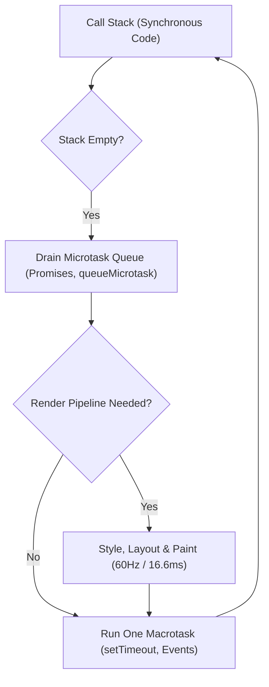

JavaScript execution mechanics directly dictate frontend performance and stability. While TypeScript adds a static type layer at authoring time, the browser and Node.js runtimes execute raw JavaScript. Understanding closures, the event loop task queue, async cancellation, and immutability is essential for avoiding memory leaks, race conditions, and unresponsive user interfaces.

This guide details modern ES2022+ specifications, asynchronous control flows, and defensive runtime patterns across the Nexium Media codebase.

## Modern ES2022+ Language Features

Modern ECMAScript enhancements simplify null-safety, array manipulations, and logical assignments:

### 1. Optional Chaining (`?.`) & Nullish Coalescing (`??`)

Optional chaining safely navigates nested object structures without explicit null/undefined guards. The nullish coalescing operator (`??`) falls back only when an expression evaluates to `null` or `undefined`, preventing accidental falsy overrides of `0`, `""`, or `false`.

```javascript
// Safely extract client metadata with fallback
const clientTimeout = config.network?.client?.timeoutMs ?? 5000;

// Incorrect: Falsy check overrides intentional 0 or empty string
const retryCount = options.retries || 3; // If options.retries === 0, returns 3!
// Correct: Nullish check preserves valid zero values
const safeRetryCount = options.retries ?? 3;
```

### 2. Logical Assignment (`&&=`, `||=`, `??=`)

Logical assignment operators combine logical tests with assignment in a concise statement:

```javascript
const userSession = {
  token: "jwt-token-string",
  preferences: null,
};

// Assign only if currently null or undefined
userSession.preferences ??= { theme: "dark", compactView: true };

// Assign only if currently truthy
userSession.token &&= sanitizeToken(userSession.token);
```

### 3. Modern Array Methods (`at()`, `findLast()`, `toSorted()`)

```javascript
const revisions = ["v1.0", "v1.1", "v2.0-rc", "v2.0"];

// Negative indexing with .at()
const latestRelease = revisions.at(-1); // "v2.0"
const penultimate = revisions.at(-2);    // "v2.0-rc"

// Reverse search without cloning or mutating arrays
const lastRc = revisions.findLast((tag) => tag.includes("-rc")); // "v2.0-rc"

// Pure immutability: .toSorted() does not mutate original array
const unsortedScores = [45, 12, 89, 3];
const sortedScores = unsortedScores.toSorted((a, b) => a - b);
// unsortedScores remains [45, 12, 89, 3]
```

## Closures & Scope Management

A closure is the combination of a function bundled together with references to its surrounding lexical state (lexical environment). Closures allow inner functions to access outer variables even after the outer function has completed execution.

```javascript
function createRateLimiter(maxCalls, intervalMs) {
  let callCount = 0;
  let resetTime = Date.now() + intervalMs;

  return function checkLimit() {
    const now = Date.now();
    if (now > resetTime) {
      callCount = 0;
      resetTime = now + intervalMs;
    }

    if (callCount >= maxCalls) {
      return { allowed: false, retryAfterMs: resetTime - now };
    }

    callCount += 1;
    return { allowed: true, remaining: maxCalls - callCount };
  };
}

const apiLimiter = createRateLimiter(10, 60000);
console.log(apiLimiter()); // { allowed: true, remaining: 9 }
```

<Callout type="warning">
Closures that hold onto large data structures (DOM nodes, large JSON payloads) inside long-lived event listeners or intervals will cause memory leaks. Always release references or deregister listeners during component unmount.
</Callout>

## Asynchronous Architecture & Cancellation

Modern frontends must coordinate complex, non-blocking asynchronous operations.

### `Promise.all` vs. `Promise.allSettled`

- Use **`Promise.all`** when all requests are mandatory dependencies. If any request rejects, the entire batch fails immediately (fail-fast).
- Use **`Promise.allSettled`** when tasks are independent, such as loading optional dashboard widgets.

```javascript
// Fetch dashboard panels independently with Promise.allSettled
async function loadDashboardPanels(userId) {
  const panelRequests = [
    fetch(`/api/users/${userId}/metrics`),
    fetch(`/api/users/${userId}/recent-logs`),
    fetch(`/api/notifications`),
  ];

  const results = await Promise.allSettled(panelRequests);

  return results.map((result, index) => {
    if (result.status === "fulfilled") {
      return { panelId: index, data: result.value, error: null };
    }
    return { panelId: index, data: null, error: result.reason };
  });
}
```

### Network Request Cancellation with `AbortController`

Race conditions occur when a subsequent request resolves before an earlier, slower request. The `AbortController` API cancels ongoing HTTP requests or DOM event listeners:

```javascript
let searchController = null;

async function executeSearch(query) {
  // Abort any in-flight previous search request
  if (searchController) {
    searchController.abort();
  }

  // Create fresh controller for new execution
  searchController = new AbortController();
  const { signal } = searchController;

  try {
    const response = await fetch(`/api/search?q=${encodeURIComponent(query)}`, {
      signal,
    });
    return await response.json();
  } catch (error) {
    if (error.name === "AbortError") {
      console.info("Search request safely cancelled by user typing.");
      return null;
    }
    throw error;
  }
}
```

## ESM Modules & Dynamic Imports

All Nexium codebases use standard ECMAScript Modules (ESM). Avoid CommonJS (`require` / `module.exports`) in client-side code.

```javascript
// Named exports for explicit imports and tree-shaking
export function formatCurrency(amount, currency = "USD") {
  return new Intl.NumberFormat("en-US", { style: "currency", currency }).format(amount);
}

// Dynamic import for code-splitting heavy libraries
export async function generateClientReport(reportData) {
  // PDF generator bundle only downloads when this function is invoked
  const { generatePdf } = await import("@lib/pdf-generator");
  return generatePdf(reportData);
}
```

## High-Performance Collections: `Map` and `Set`

Plain JavaScript objects (`{}`) are suited for structured records, but `Map` and `Set` are superior for high-frequency keyed lookups and uniqueness checks:

```javascript
// Set for O(1) deduplication and membership checks
const uniqueTags = new Set(["react", "nextjs", "typescript", "react"]);
console.log(uniqueTags.has("react")); // true (O(1) lookup vs O(n) Array.includes)

// Map for arbitrary keys and frequent insertions/deletions
const cache = new Map();

function getCachedComputation(key, computeFn) {
  if (cache.has(key)) {
    return cache.get(key);
  }
  const result = computeFn(key);
  cache.set(key, result);
  return result;
}
```

## The Event Loop & React Scheduling

The JavaScript runtime operates on a single-threaded event loop consisting of:

1. **Call Stack**: Executes synchronous frames.
2. **Microtask Queue**: Handled immediately after the current call stack clears (`Promise` callbacks, `queueMicrotask`, `MutationObserver`).
3. **Macrotask Queue**: Scheduled between render updates (`setTimeout`, `setInterval`, I/O, event listeners).
4. **Render Pipeline**: Style recalculations, layout reflow, and paint cycles.



<Callout type="note">
React 18's concurrent scheduler runs between microtask sweeps and browser paint boundaries. Long-running synchronous loops block both microtasks and UI painting, causing page freezes and failing Google's **Interaction to Next Paint (INP)** Web Vital.
</Callout>

## Common JavaScript Mistakes & Anti-Patterns

### 1. In-Place Object and Array Mutation
Mutating objects or arrays breaks React state change detection (`Object.is` reference equality):

```javascript
// Incorrect: In-place mutation
state.items.push(newItem); // Mutation! React will not detect state update

// Correct: Pure immutability with spread
const updatedItems = [...state.items, newItem];
```

### 2. Loose Equality (`==`) vs. Strict Equality (`===`)
Loose equality invokes type coercion rules that produce counter-intuitive behavior:

```javascript
// Loose coercion hazards
"" == 0;           // true
0 == "0";          // true
false == [];       // true
null == undefined; // true

// Always use strict equality
"" === 0;          // false
```

### 3. Loss of `this` Context
Passing class methods or object methods without binding leads to detached `this`:

```javascript
const service = {
  prefix: "LOG: ",
  log(message) {
    console.log(this.prefix + message);
  },
};

const detachedLog = service.log;
// detachedLog("hello"); // TypeError: Cannot read property 'prefix' of undefined

// Correct: Arrow function wrapper
const safeLog = (msg) => service.log(msg);
```

## Related

- [Fundamentals Overview](/docs/development/frontend/fundamentals)
- [Strict TypeScript Standards](/docs/development/frontend/fundamentals/typescript)
- [React Architecture & Hooks](/docs/development/frontend/fundamentals/react)
- [Performance Optimization](/docs/development/frontend/quality/performance)
