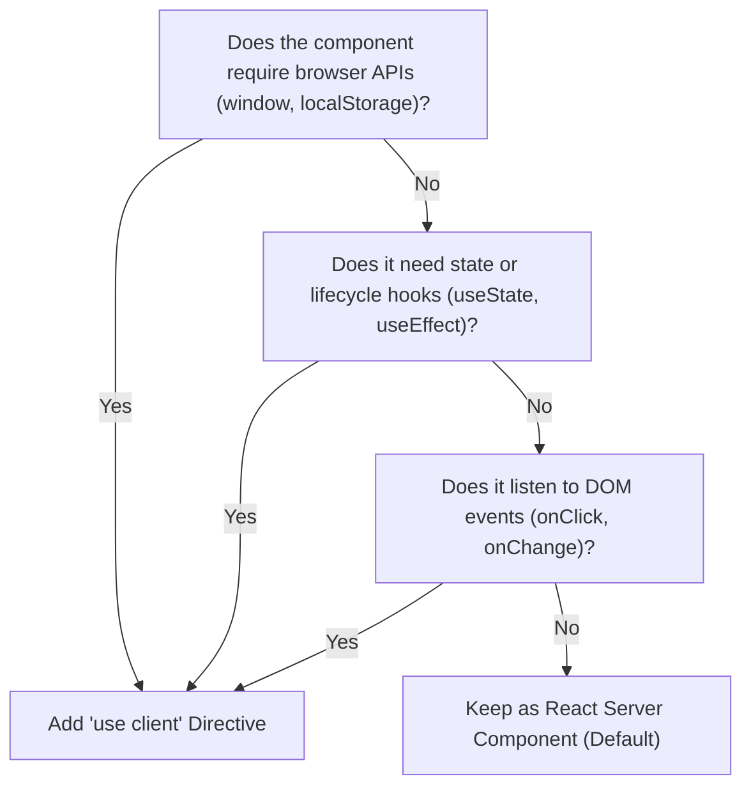

Next.js App Router is the unified application framework standard for all web projects developed at Nexium Media. Built atop React Server Components (RSC), App Router fundamentally transforms client-server boundaries, eliminating unnecessary JavaScript bundles, colocating data queries with markup, and streaming HTML directly from the edge.

This guide details App Router filesystem conventions, server-vs-client component boundaries, caching strategies, and Server Action workflows.

## App Router Filesystem Conventions

In App Router, folders define URL segments, while special nested files declare the UI hierarchy for that segment:

| Special File | Role & Behavior | Execution Context |
| :--- | :--- | :--- |
| `page.tsx` | Unique UI rendered for a route segment. Makes the segment publicly accessible. | Server Component by default. |
| `layout.tsx` | Shared UI shell across sub-routes. Preserves state and avoids remounting during navigation. | Server Component by default. |
| `template.tsx` | Similar to layout, but instantiates a new component instance on every navigation. | Server or Client. |
| `loading.tsx` | Automatic Suspense boundary fallback rendered while `page.tsx` or data resolves. | Server Component. |
| `error.tsx` | Client-side error boundary catching unhandled exceptions in the route segment. | **Must be Client Component (`"use client"`).** |
| `not-found.tsx`| Fallback UI displayed when `notFound()` is invoked within the segment. | Server Component. |
| `route.ts` | Backend API HTTP endpoint handler (GET, POST, PUT, DELETE, PATCH). | Server only (Node/Edge). |

```text
app/
├── layout.tsx         # Root layout: html, body, and global theme provider
├── page.tsx           # Home page ("/")
├── loading.tsx        # Root streaming spinner
├── error.tsx          # Root client error boundary
├── not-found.tsx      # Root 404 handler
├── (dashboard)/       # Route Group (parentheses do not affect URL)
│   ├── layout.tsx     # Dashboard shell with sidebar
│   ├── analytics/
│   │   └── page.tsx   # Evaluates to "/analytics"
│   └── settings/
│       └── page.tsx   # Evaluates to "/settings"
└── api/
    └── webhooks/
        └── route.ts   # Evaluates to "/api/webhooks"
```

## Server vs. Client Components: Architectural Decision Tree

All components in the `app/` directory are **React Server Components (RSC)** by default. RSCs execute exclusively on the server, producing zero client JavaScript.



### Component Boundary Composition Pattern

Keep `"use client"` directives as leaves of the component tree to minimize client bundle sizes:

```tsx
// app/campaigns/[id]/page.tsx (Server Component)
import { db } from "@/lib/db";
import { CampaignHeader } from "@/components/campaigns/CampaignHeader"; // Server
import { CampaignBudgetSlider } from "@/components/campaigns/CampaignBudgetSlider"; // Client Component

export default async function CampaignPage({ params }: { params: Promise<{ id: string }> }) {
  const { id } = await params;
  const campaign = await db.campaign.findUnique({ where: { id } });

  if (!campaign) {
    return <div>Campaign not found</div>;
  }

  return (
    <main className="p-8">
      {/* Heavy server-rendered component with direct DB access */}
      <CampaignHeader data={campaign} />

      {/* Leaf client component handling user slider interaction */}
      <CampaignBudgetSlider initialBudget={campaign.budget} campaignId={campaign.id} />
    </main>
  );
}
```

## Data Fetching & Caching Strategies

Next.js extends native `fetch` with caching and revalidation controls:

```tsx
// 1. Static Data Fetching (Cached indefinitely until manual purge)
const staticData = await fetch("https://api.nexiummedia.com/catalog", {
  cache: "force-cache", // Default behavior
});

// 2. Dynamic Fetching (Bypasses cache on every incoming request)
const dynamicData = await fetch("https://api.nexiummedia.com/user/profile", {
  cache: "no-store",
});

// 3. Time-Based Revalidation (ISR - Incremental Static Regeneration)
const isrData = await fetch("https://api.nexiummedia.com/metrics", {
  next: { revalidate: 3600 }, // Cached for 1 hour
});

// 4. On-Demand Tagged Invalidation
const taggedData = await fetch("https://api.nexiummedia.com/products", {
  next: { tags: ["product-list"] },
});
```

To purge tagged caches inside a Server Action or Route Handler:
```typescript
import { revalidateTag } from "next/cache";

export async function updateProductAction() {
  // Database mutation...
  revalidateTag("product-list");
}
```

## Streaming with React Suspense

Streaming splits page HTML into chunks and streams them progressively from the server, improving Time to First Byte (TTFB) and First Contentful Paint (FCP):

```tsx
import { Suspense } from "react";
import { FinancialMetrics } from "@/components/analytics/FinancialMetrics";
import { MetricsSkeleton } from "@/components/ui/Skeletons";

export default function AnalyticsPage() {
  return (
    <section>
      <h1>Executive Analytics Overview</h1>
      {/* Fast static shell loads instantly */}
      <p>Data updated live every 60 seconds.</p>

      {/* Slow async component streams in when ready */}
      <Suspense fallback={<MetricsSkeleton />}>
        <FinancialMetrics />
      </Suspense>
    </section>
  );
}
```

## Server Actions & Mutation Workflows

Server Actions allow client forms and event handlers to execute secure server-side mutations without manually authoring API route endpoints:

```tsx
// app/actions/auth-actions.ts
"use server";

import { z } from "zod";
import { revalidatePath } from "next/cache";

const InviteUserSchema = z.object({
  email: z.string().email(),
  role: z.enum(["admin", "member"]),
});

export async function inviteTeamMember(prevState: unknown, formData: FormData) {
  const rawData = {
    email: formData.get("email"),
    role: formData.get("role"),
  };

  const validation = InviteUserSchema.safeParse(rawData);
  if (!validation.success) {
    return { error: "Invalid form fields", details: validation.error.flatten() };
  }

  // Execute database insert safely on server
  await db.invitation.create({ data: validation.data });

  revalidatePath("/team");
  return { success: true };
}
```

## Metadata API & SEO

Define static or dynamic document metadata using the Next.js Metadata API:

```tsx
// app/articles/[slug]/page.tsx
import type { Metadata } from "next";

export async function generateMetadata({
  params,
}: {
  params: Promise<{ slug: string }>;
}): Promise<Metadata> {
  const { slug } = await params;
  const article = await getArticle(slug);

  return {
    title: `${article.title} | Nexium Media Insights`,
    description: article.excerpt,
    openGraph: {
      title: article.title,
      description: article.excerpt,
      url: `https://nexiummedia.com/articles/${slug}`,
      images: [{ url: article.ogImageUrl, width: 1200, height: 630 }],
    },
    twitter: {
      card: "summary_large_image",
      creator: "@NexiumMedia",
    },
  };
}
```

## Built-In Next.js Components

### 1. `next/image`
Prevents Cumulative Layout Shift (CLS) through enforced aspect ratios and serves AVIF/WebP formats:

```tsx
import Image from "next/image";

export function HeroBanner() {
  return (
    <div className="relative h-96 w-full">
      <Image
        src="/assets/hero.jpg"
        alt="Nexium Media headquarters collaborative workspace"
        fill
        priority // Preloads image for Largest Contentful Paint (LCP)
        sizes="(max-width: 768px) 100vw, (max-width: 1200px) 50vw, 33vw"
        className="object-cover"
        placeholder="blur"
        blurDataURL="data:image/png;base64,iVBORw0KGgoAAAANSUhEUgAAAAEAAAABCAYAAAAfFcSJAAAADUlEQVR42mNk+M9QDwADhgGAWjR9awAAAABJRU5ErkJggg=="
      />
    </div>
  );
}
```

### 2. `next/font`
Eliminates layout shifts by inlining font definitions at build time with zero external network requests:

```typescript
// app/layout.tsx
import { Inter } from "next/font/google";

const inter = Inter({
  subsets: ["latin"],
  display: "swap",
  variable: "--font-inter",
});

export default function RootLayout({ children }: { children: React.ReactNode }) {
  return (
    <html lang="en" className={inter.variable}>
      <body className="font-sans antialiased">{children}</body>
    </html>
  );
}
```

## Common App Router Anti-Patterns

1. **Marking Top-Level Layouts as `"use client"`**: This forces the entire route subtree to be bundled into client JavaScript. Keep layouts as Server Components.
2. **Accessing `window` or `document` in Server Components**: Server components execute in a Node/Edge runtime where browser globals do not exist.
3. **Waterfall Server Fetches**: Awaiting three sequential server calls slows down the initial response. Run independent fetches in parallel using `Promise.all`.
4. **Forgetting `await params` in Next.js 15+**: In recent Next.js versions, dynamic route `params` and `searchParams` are asynchronous Promises and must be awaited.

## Related

- [Fundamentals Overview](/docs/development/frontend/fundamentals)
- [React Architecture & Hooks](/docs/development/frontend/fundamentals/react)
- [Data Fetching & Server State](/docs/development/frontend/state-and-data/data-fetching)
- [Performance Optimization](/docs/development/frontend/quality/performance)
