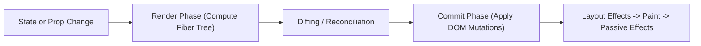

React forms the interactive core of the Nexium Media frontend stack. Building performant, resilient client applications requires understanding React's declarative rendering model, fiber reconciliation, hook dependency tracking, and React 18 concurrent features.

This guide provides an exhaustive reference for component design, hook lifecycles, state batching, and error boundaries.

## The React Mental Model: Declarative Rendering & Reconciliation

React models user interfaces as pure projections of state: `UI = f(State)`. When state transitions occur, React does not mutate the DOM in-place. Instead, it computes a new Virtual DOM tree (the render phase) and diffs it against the previous fiber tree (reconciliation). It then flushes only the minimal required mutations to the host DOM (the commit phase).



### Component Rules
- **Function Components Only**: Class components are legacy and deprecated across Nexium projects.
- **Purity**: A component's render function must be a pure function of its props and state. Side effects (network requests, DOM mutations, timers) belong exclusively inside event handlers or `useEffect`.
- **Keys**: Every item in a dynamic list requires a stable, unique key. Never use array indices as keys if the list can be filtered, reordered, or mutated.

```tsx
// Anti-Pattern: Index as key causes input focus and animation glitches
{items.map((item, index) => <ListItem key={index} data={item} />)}

// Best Practice: Stable domain ID
{items.map((item) => <ListItem key={item.id} data={item} />)}
```

## Props Architecture & Controlled Spreading

Props represent immutable input data passed from parent to child:

```tsx
interface CardProps {
  title: string;
  subtitle?: string; // Optional prop
  status?: "active" | "archived";
  onAction?: (actionId: string) => void;
  children: React.ReactNode;
}

export function Card({
  title,
  subtitle,
  status = "active", // Default parameter
  onAction,
  children,
}: CardProps) {
  return (
    <article className="rounded-lg border border-slate-200 p-6 shadow-sm">
      <header className="mb-4">
        <h3 className="text-lg font-semibold">{title}</h3>
        {subtitle && <p className="text-sm text-slate-500">{subtitle}</p>}
        <span className="inline-block px-2 py-0.5 text-xs font-medium uppercase">{status}</span>
      </header>
      <div className="card-body">{children}</div>
      {onAction && (
        <button
          type="button"
          onClick={() => onAction("primary_click")}
          className="mt-4 rounded bg-blue-600 px-3 py-1.5 text-sm text-white hover:bg-blue-700"
        >
          Execute Action
        </button>
      )}
    </article>
  );
}
```

<Callout type="warning">
Avoid arbitrary prop spreading (`<Child {...props} />`). Indiscriminate spreading passes unexpected attributes down to DOM nodes (violating HTML validation) and obscures component contracts.
</Callout>

## State Management with `useState` & React 18 Batching

In React 18, state updates are automatically batched across all execution contexts (microtasks, timeouts, and native event handlers). Multiple setState calls inside a single tick trigger exactly one reconciliation cycle.

### Functional Updater Form

When the new state depends on previous state, always use the functional updater form to prevent stale closure traps:

```tsx
export function Counter() {
  const [count, setCount] = useState(0);

  const incrementBatch = () => {
    // Incorrect: Evaluates stale closure reference 3 times, results in +1
    // setCount(count + 1);
    // setCount(count + 1);
    // setCount(count + 1);

    // Correct: Queues functional updates, correctly results in +3
    setCount((prev) => prev + 1);
    setCount((prev) => prev + 1);
    setCount((prev) => prev + 1);
  };

  return <button onClick={incrementBatch}>Count: {count}</button>;
}
```

## Complex Local State with `useReducer`

When state transitions involve multiple interdependent fields or complex business rules, use `useReducer`:

```tsx
type CartItem = { id: string; name: string; price: number; quantity: number };

type CartState = {
  items: CartItem[];
  discountCode: string | null;
};

type CartAction =
  | { type: "ADD_ITEM"; payload: CartItem }
  | { type: "REMOVE_ITEM"; payload: { id: string } }
  | { type: "APPLY_DISCOUNT"; payload: { code: string } }
  | { type: "CLEAR_CART" };

function cartReducer(state: CartState, action: CartAction): CartState {
  switch (action.type) {
    case "ADD_ITEM": {
      const existing = state.items.find((i) => i.id === action.payload.id);
      if (existing) {
        return {
          ...state,
          items: state.items.map((i) =>
            i.id === action.payload.id ? { ...i, quantity: i.quantity + action.payload.quantity } : i
          ),
        };
      }
      return { ...state, items: [...state.items, action.payload] };
    }
    case "REMOVE_ITEM":
      return { ...state, items: state.items.filter((i) => i.id !== action.payload.id) };
    case "APPLY_DISCOUNT":
      return { ...state, discountCode: action.payload.code };
    case "CLEAR_CART":
      return { items: [], discountCode: null };
    default:
      return state;
  }
}
```

## `useEffect` Rules & Cleanup Mechanics

Effects synchronize the component with external systems (network, DOM subscriptions, timers).

```tsx
import { useEffect, useState } from "react";

export function WindowResizeMonitor() {
  const [dimensions, setDimensions] = useState({ width: 0, height: 0 });

  useEffect(() => {
    // 1. Establish subscription
    const handleResize = () => {
      setDimensions({ width: window.innerWidth, height: window.innerHeight });
    };

    handleResize(); // Initial read
    window.addEventListener("resize", handleResize);

    // 2. Cleanup function: runs on unmount or before effect re-runs
    return () => {
      window.removeEventListener("resize", handleResize);
    };
  }, []); // Empty array indicates effect runs only on mount

  return <p>Window Size: {dimensions.width} x {dimensions.height}</p>;
}
```

### When NOT to Use `useEffect`

1. **Transforming data for rendering**: Compute derived state during render.
2. **Handling user interactions**: Perform actions inside event handlers (`onClick`, `onSubmit`), not in effects triggered by state changes.
3. **Resetting state on prop change**: Use React keys (`<Profile key={userId} />`) to unmount and remount fresh component instances.

<Callout type="warning">
Never suppress the `react-hooks/exhaustive-deps` ESLint rule. Missing dependencies cause stale closures where functions retain outdated state references from previous render frames.
</Callout>

## Performance Hooks: `useMemo` & `useCallback`

Premature memoization introduces unnecessary complexity and memory overhead. Apply them only when justified by profiling or specific architectural constraints:

```tsx
import React, { useMemo, useCallback, useState } from "react";

export function AnalyticsTable({ rawLogs }: { rawLogs: LogEntry[] }) {
  const [filter, setFilter] = useState("");

  // Justified useMemo: Expensive filtering of thousands of rows
  const filteredLogs = useMemo(() => {
    return rawLogs.filter((log) => log.message.toLowerCase().includes(filter.toLowerCase()));
  }, [rawLogs, filter]);

  // Justified useCallback: Passing handler to a memoized child component
  const handleExport = useCallback((format: "csv" | "json") => {
    exportData(filteredLogs, format);
  }, [filteredLogs]);

  return (
    <div>
      <input value={filter} onChange={(e) => setFilter(e.target.value)} />
      <MemoizedTable rows={filteredLogs} onExport={handleExport} />
    </div>
  );
}
```

## `useRef` for Mutable Values & DOM Elements

`useRef` creates a mutable container whose `.current` property persists across renders without triggering a re-render when mutated:

```tsx
import { useRef, useEffect } from "react";

export function AutoFocusSearch() {
  const inputRef = useRef<HTMLInputElement>(null);
  const renderCount = useRef(0);

  renderCount.current += 1; // Tracking metrics without causing re-renders

  useEffect(() => {
    inputRef.current?.focus();
  }, []);

  return <input ref={inputRef} placeholder="Search records..." />;
}
```

## Accessible Label Pairing with `useId`

React 18 introduced `useId` to generate unique, hydration-safe IDs for linking form inputs with labels and ARIA descriptions:

```tsx
import { useId } from "react";

export function FormField({ label, error }: { label: string; error?: string }) {
  const id = useId();
  const errorId = `${id}-error`;

  return (
    <div>
      <label htmlFor={id}>{label}</label>
      <input
        id={id}
        aria-describedby={error ? errorId : undefined}
        aria-invalid={!!error}
      />
      {error && <p id={errorId} role="alert" className="text-red-500">{error}</p>}
    </div>
  );
}
```

## Custom Hooks Architecture

Custom hooks encapsulate stateful logic and subscriptions without duplicating component code:

```tsx
import { useState, useEffect } from "react";

export function useDebounce<T>(value: T, delayMs: number): T {
  const [debouncedValue, setDebouncedValue] = useState<T>(value);

  useEffect(() => {
    const timer = setTimeout(() => {
      setDebouncedValue(value);
    }, delayMs);

    return () => clearTimeout(timer);
  }, [value, delayMs]);

  return debouncedValue;
}
```

## React 18 Concurrent Features

Concurrent React enables interruptible rendering, allowing high-priority user interactions (typing, clicking) to jump ahead of slow background re-renders:

### `startTransition`
Marks non-urgent state updates so the UI remains responsive during heavy computations:

```tsx
import { useState, useTransition } from "react";

export function TabContainer() {
  const [tab, setTab] = useState("overview");
  const [isPending, startTransition] = useTransition();

  const handleTabSwitch = (nextTab: string) => {
    startTransition(() => {
      // Background priority: does not freeze input or click animations
      setTab(nextTab);
    });
  };

  return (
    <div>
      <button onClick={() => handleTabSwitch("analytics")}>Analytics</button>
      {isPending && <span className="spinner">Switching tab...</span>}
      <TabContent tab={tab} />
    </div>
  );
}
```

## Error Boundaries

Error boundaries are components that catch JavaScript runtime errors anywhere in their child component tree, log the error, and display a fallback UI:

```tsx
"use client";

import React, { Component, ErrorInfo, ReactNode } from "react";

interface Props {
  fallback: ReactNode;
  children: ReactNode;
}

interface State {
  hasError: boolean;
}

export class ErrorBoundary extends Component<Props, State> {
  public state: State = { hasError: false };

  public static getDerivedStateFromError(_: Error): State {
    return { hasError: true };
  }

  public componentDidCatch(error: Error, errorInfo: ErrorInfo) {
    console.error("Uncaught runtime component error:", error, errorInfo);
  }

  public render() {
    if (this.state.hasError) {
      return this.props.fallback;
    }
    return this.props.children;
  }
}
```

## Related

- [Fundamentals Overview](/docs/development/frontend/fundamentals)
- [Strict TypeScript Standards](/docs/development/frontend/fundamentals/typescript)
- [Next.js App Router Guide](/docs/development/frontend/fundamentals/nextjs)
- [State Management Architecture](/docs/development/frontend/state-and-data/state-management)
