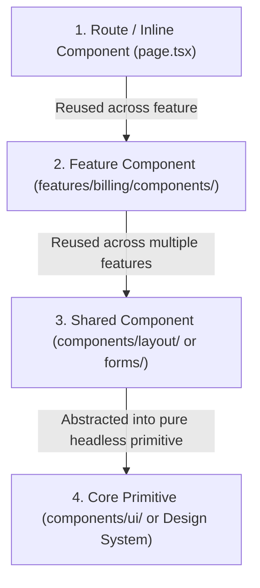

A standardized folder structure eliminates guesswork when organizing code. In large codebases, predictability of file location directly accelerates code reviews, debugging, and onboarding.

This guide provides the complete, annotated directory specification for Nexium Media Next.js enterprise projects, along with rules governing colocation and component graduation.

## Full Annotated Project Tree

```text
nexium-enterprise-web/
├── .github/                      # GitHub Actions workflows, issue templates
│   └── workflows/
│       ├── ci.yml                # Lint, typecheck, unit tests
│       └── e2e.yml               # Playwright CI pipeline
├── app/                          # Next.js App Router (Routing & Shells)
│   ├── (auth)/                   # Unauthenticated route group
│   │   ├── login/
│   │   │   └── page.tsx
│   │   └── register/
│   │       └── page.tsx
│   ├── (dashboard)/              # Authenticated application shell
│   │   ├── layout.tsx            # Persistent layout with sidebar & header
│   │   ├── campaigns/
│   │   │   ├── [id]/
│   │   │   │   ├── loading.tsx
│   │   │   │   └── page.tsx
│   │   │   └── page.tsx
│   │   └── settings/
│   │       └── page.tsx
│   ├── api/                      # Backend Route Handlers
│   │   └── webhooks/
│   │       └── stripe/
│   │           └── route.ts
│   ├── globals.css               # Global theme tokens and Tailwind imports
│   ├── layout.tsx                # Root HTML document shell
│   └── not-found.tsx             # Global 404 handler
├── components/                   # Shared UI Layer (Cross-Feature)
│   ├── ui/                       # Design system primitives (shadcn / Radix)
│   │   ├── Button.tsx
│   │   ├── Button.test.tsx       # Colocated unit tests
│   │   ├── Dialog.tsx
│   │   ├── Input.tsx
│   │   └── Select.tsx
│   ├── layout/                   # Global application chrome
│   │   ├── Header.tsx
│   │   ├── Sidebar.tsx
│   │   └── UserDropdown.tsx
│   └── forms/                    # Generic form field primitives
│       ├── FormField.tsx
│       └── PasswordInput.tsx
├── features/                     # Feature Modules (Vertical Slices)
│   ├── campaigns/                # Example: Campaign Domain Module
│   │   ├── actions/              # Server Actions for campaigns
│   │   │   └── campaign-actions.ts
│   │   ├── components/           # Feature-private components
│   │   │   ├── CampaignCard.tsx
│   │   │   ├── CampaignCard.test.tsx
│   │   │   └── CampaignMetricsChart.tsx
│   │   ├── hooks/                # Feature-private hooks
│   │   │   └── useCampaignFilter.ts
│   │   ├── schemas/              # Zod validation schemas
│   │   │   └── campaign-schema.ts
│   │   ├── services/             # Domain API client calls
│   │   │   └── campaign-service.ts
│   │   ├── types/                # Domain types & interfaces
│   │   │   └── campaign-types.ts
│   │   └── index.ts              # Public API surface of feature
│   └── billing/                  # Example: Billing Domain Module
├── hooks/                        # Generic Shared Hooks (Zero Domain Logic)
│   ├── use-debounce.ts
│   ├── use-intersection-observer.ts
│   └── use-media-query.ts
├── lib/                          # Third-Party Wrapper Initializers
│   ├── auth.ts                   # Auth.js / NextAuth configuration
│   ├── db.ts                     # Prisma or Drizzle ORM client instance
│   ├── logger.ts                 # Structured JSON logger
│   └── utils.ts                  # Shared cn() class merger
├── services/                     # Cross-Cutting Data Fetching Services
│   ├── api-client.ts             # Typed fetch client with auth interceptors
│   └── analytics.ts              # Segment or Google Analytics wrapper
├── types/                        # Ambient Global Types
│   ├── common.ts                 # PaginatedResponse, ApiError
│   └── next.d.ts                 # Environment variable type extensions
├── utils/                        # Pure Deterministic Utilities
│   ├── format-currency.ts
│   ├── format-currency.test.ts
│   └── date-helpers.ts
├── styles/                       # Supplementary Global Styles & Fonts
├── public/                       # Static Assets (Images, Icons, Favicon)
└── __tests__/                    # End-to-End & Cross-Feature Integration Tests
    ├── integration/
    │   └── checkout-flow.test.tsx
    └── e2e/
        └── auth.spec.ts
```

## Colocation Rules: Keep Code Close to Where It Is Used

We enforce strict colocation rules:

1. **Unit Tests Colocated**: Unit tests (`*.test.tsx`) must sit directly adjacent to the component or utility under test in the same folder.
2. **Feature Scoping**: If a component is used by only one route or domain, place it in `features/<feature-name>/components/`, not in the global `/components` directory.
3. **Zod Schema Colocation**: Schemas backing a feature's mutations must reside inside that feature's `schemas/` folder.

```
features/billing/
├── components/
│   ├── InvoiceTable.tsx
│   └── InvoiceTable.test.tsx   <-- Colocated unit test
├── schemas/
│   └── billing-schema.ts       <-- Colocated validation
```

## When to Create a New Feature Folder

Create a new directory under `features/` when a set of components, hooks, and schemas represents an identifiable business domain.

### Checklist for a New Feature Folder
- Does this domain have distinct business terminology (e.g., `invoices`, `analytics`, `campaigns`)?
- Does it encompass multiple dedicated views or state interactions?
- Would removing or refactoring this domain leave the rest of the application intact?

If yes to all three, it belongs in `features/<domain-name>/`.

## Component Graduation Lifecycle

Components evolve through a structured lifecycle from single-use implementations to universal primitives:



### Graduation Criteria
- **From Route to Feature**: Extract into `features/<feature-name>/components/` as soon as the component exceeds 100 lines or is referenced by a second component in that feature.
- **From Feature to Global Shared**: Move to `/components/` only when a second, unrelated feature requires the exact same component.
- **From Global Shared to Core Primitive (`components/ui/`)**: A component graduates to a primitive only when all domain-specific logic, API hooks, and feature strings are removed, leaving a purely stylistic, accessible atom controlled strictly via props.

<Callout type="warning">
Do not prematurely graduate components to `/components/ui/`. Abstracting a component before its requirements across multiple features are proven leads to bloated, multi-flag components that are difficult to maintain.
</Callout>

## Related

- [Project Structure Overview](/docs/development/frontend/project-structure)
- [Naming Conventions](/docs/development/frontend/project-structure/naming-conventions)
- [Module Organization & Imports](/docs/development/frontend/project-structure/module-organization)
- [Component Design Principles](/docs/development/frontend/ui-components/component-design)

