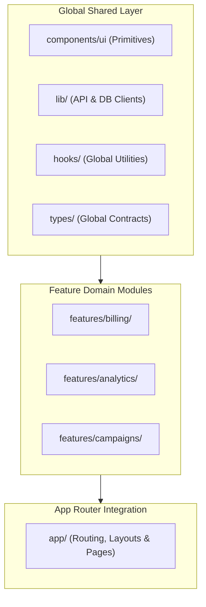

As engineering teams scale past 100 developers, the internal organization of codebases becomes the primary driver of development velocity, codebase navigability, and refactoring safety. An unprincipled project structure produces sprawling barrel files, cyclical dependency graphs, and confusion over where new code belongs.

This section defines the structural architecture, folder conventions, and naming systems mandated across all Nexium Media frontend applications.

## Architectural Philosophy: Hybrid Feature-Driven Design

Nexium Media organizes frontend codebases using a **hybrid feature-driven architecture**. This model balances generic design system reuse with isolated, domain-specific feature modules.



### Feature-Based vs. Type-Based Organization

| Organization Pattern | How It Works | When Nexium Permits It |
| :--- | :--- | :--- |
| **Type-Based** (Horizontal) | Files grouped strictly by technical type (`/components`, `/hooks`, `/services`, `/types`). | Approved only for small utility packages or standalone design system component libraries. |
| **Feature-Based** (Vertical) | Files colocated by business domain (`features/campaigns/{components,hooks,services,types}`). | **Mandatory** for all client portals, enterprise dashboards, and full-stack Next.js applications. |

## Top-Level Directory Roles

```text
client-app/
├── app/                  # Route definitions, layouts, route handlers, error shells
├── components/           # Cross-feature UI components
│   ├── ui/               # Core design tokens & primitives (Button, Dialog, Input)
│   ├── layout/           # Global chrome (Navbar, Sidebar, Footer)
│   └── feedback/         # Shared banners, toast containers, empty states
├── features/             # Vertical business domains (self-contained modules)
│   ├── billing/          # Billing domain components, hooks, actions, schemas
│   ├── campaigns/        # Campaign management domain
│   └── user-management/  # User & team administration domain
├── hooks/                # Generic, cross-cutting hooks (useMediaQuery, useDebounce)
├── lib/                  # Shared clients, SDK initializers, utility clients
├── services/             # Cross-cutting HTTP & GraphQL network clients
├── types/                # Global ambient types, common API envelopes
├── utils/                # Pure, deterministic utility functions
├── styles/               # Global CSS, theme variables, fonts
└── public/               # Static public assets (SVGs, brand imagery)
```

## Core Structural Rules

1. **Colocate Before Sharing**: Keep components, hooks, and schemas private to their specific feature module until two or more distinct features require them.
2. **One-Way Dependency Flow**: Global modules (`components/ui`, `lib`, `utils`) may never import from feature modules (`features/*`). Feature modules may import from global modules, but feature modules should avoid importing directly from each other.
3. **App Directory is a Composition Layer**: Files inside `app/` should remain thin controllers that assemble features, layouts, and server data, delegating business logic to `features/`.

## Summary of Naming Standards

- **React Components**: `PascalCase.tsx` (`UserProfileCard.tsx`, `DataTable.tsx`)
- **Hooks**: `camelCase.ts` with `use` prefix (`useWindowSize.ts`, `useAuthSession.ts`)
- **Utilities & Services**: `kebab-case.ts` (`format-currency.ts`, `auth-client.ts`)
- **Route Segments**: `kebab-case` directories (`app/team-settings/page.tsx`)
- **Constants**: `SCREAMING_SNAKE_CASE` (`MAX_UPLOAD_SIZE_BYTES`, `DEFAULT_PAGE_SIZE`)

## Related

- [Folder Conventions Deep Dive](/docs/development/frontend/project-structure/folder-conventions)
- [Naming Conventions & Style Guide](/docs/development/frontend/project-structure/naming-conventions)
- [Module Organization & Imports](/docs/development/frontend/project-structure/module-organization)
- [Reusable Components Architecture](/docs/development/frontend/ui-components/reusable-components)
