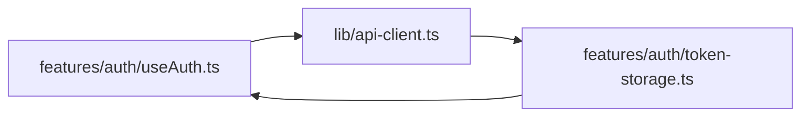

Clean module boundaries prevent spaghetti dependency graphs, circular dependency lockups, and bloated JavaScript bundles. In a 100+ engineer organization, strict discipline around imports and exports is essential for maintainability.

This guide outlines our standards for import ordering, barrel file boundaries, path aliasing, circular dependency detection, and dynamic code splitting.

## Standardized Import Ordering

We enforce deterministic import ordering using `@trivago/prettier-plugin-sort-imports` and `eslint-plugin-import`. Imports must be partitioned into four distinct groups separated by a single newline:

```tsx
// 1. React & Framework Core Dependencies
import React, { useState, useEffect, useId } from "react";
import Image from "next/image";
import Link from "next/link";

// 2. Third-Party Library Packages
import { useQuery } from "@tanstack/react-query";
import { z } from "zod";
import { clsx } from "clsx";

// 3. Internal Absolute Modules (Path Aliases `@/...`)
import { Button } from "@/components/ui/Button";
import { useAuth } from "@/hooks/useAuth";
import { apiClient } from "@/lib/api-client";
import type { UserProfile } from "@/types/user";

// 4. Relative / Sibling Modules & Styles
import { CampaignMetricCard } from "./CampaignMetricCard";
import { calculateVelocity } from "./helpers/calculate-velocity";
import styles from "./CampaignDetails.module.css";
```

<Callout type="tip">
Configure your VS Code to automatically organize imports on save by adding `"source.organizeImports": "explicit"` to your workspace `.vscode/settings.json`.
</Callout>

## Barrel Files (`index.ts`): Use with Discipline

A **barrel file** is an `index.ts` file that re-exports multiple modules from a folder to provide a single public entry point:

```typescript
// features/billing/index.ts (Approved Public API Surface)
export { BillingOverview } from "./components/BillingOverview";
export { InvoiceDownloadButton } from "./components/InvoiceDownloadButton";
export { useBillingStatus } from "./hooks/useBillingStatus";
export type { Invoice, SubscriptionTier } from "./types/billing-types";
```

### The Pitfalls of Barrel Files
Indiscriminate barrel files can cause:
1. **Broken Tree-Shaking**: Importing one small utility from a barrel can cause bundlers to pull the entire barrel and its dependencies into the client chunk.
2. **Circular Dependencies**: When two modules in different folders re-export each other through index files, modules evaluate to `undefined` during bundle initialization.
3. **Slow Cold Compilations**: Next.js development server compile times degrade when large directories with hundreds of re-exports are parsed on every request.

### Barrel File Rules
- **Permitted**: At the root of a feature module (`features/billing/index.ts`) to declare the public interface of that feature.
- **Prohibited**: Inside internal feature folders (do **not** create `features/billing/components/index.ts` or `components/ui/index.ts`). Always import directly from the specific component file: `import { Button } from "@/components/ui/Button"`.

## Path Aliasing with `@/*`

All Nexium projects configure root path aliasing in `tsconfig.json`:

```json
{
  "compilerOptions": {
    "baseUrl": ".",
    "paths": {
      "@/*": ["./*"]
    }
  }
}
```

### Absolute vs. Relative Imports Policy
- Use `@/...` for anything located in top-level shared directories (`@/components/ui/Button`, `@/lib/db`, `@/types/common`).
- Use relative imports (`./` or `../`) **only** when referencing adjacent files within the same feature or folder hierarchy.
- Never use deeply nested relative chains such as `../../../../components/Button`. Replace them with `@/components/ui/Button`.

## Circular Dependency Prevention & Detection

A circular dependency occurs when Module A imports Module B, and Module B directly or indirectly imports Module A. In JavaScript, this often results in one of the imports resolving as `undefined` at runtime.



### Automated Detection with Madge
Run `madge` in CI to detect circular dependencies across the project graph:

```bash
# Add to package.json scripts
npx madge --circular --extensions ts,tsx ./app ./components ./features ./lib
```

### How to Break a Cycle
When a cycle appears:
1. Extract the shared type, constant, or utility into a lower-level module (e.g., `types/auth.ts` or `lib/token-storage.ts`).
2. Have both modules import from the shared file, restoring a unidirectional dependency tree.

## Dynamic Imports & Code Splitting

Next.js automatically splits code at route segment boundaries. However, heavy client-only third-party libraries (rich text editors, charting engines, 3D canvases) should be lazy-loaded using `next/dynamic`:

```tsx
"use client";

import dynamic from "next/dynamic";
import { SkeletonChart } from "@/components/ui/Skeletons";

// Heavy charting library (e.g., Chart.js / Recharts) loaded only when needed
const DynamicAnalyticsChart = dynamic(
  () => import("@/features/analytics/components/HeavyChart").then((mod) => mod.HeavyChart),
  {
    loading: () => <SkeletonChart />,
    ssr: false, // Disables server-side pre-render for browser-only canvas libraries
  }
);

export function Dashboard() {
  return (
    <div className="p-6">
      <h2>Performance Summary</h2>
      <DynamicAnalyticsChart />
    </div>
  );
}
```

## Related

- [Project Structure Overview](/docs/development/frontend/project-structure)
- [Folder Conventions](/docs/development/frontend/project-structure/folder-conventions)
- [Naming Conventions](/docs/development/frontend/project-structure/naming-conventions)
- [Performance Optimization](/docs/development/frontend/quality/performance)

