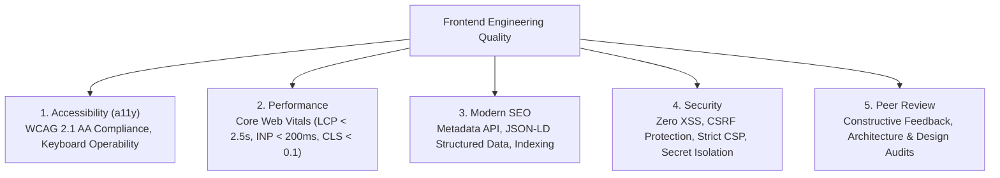
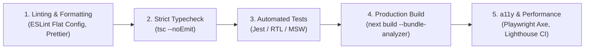

In a distributed agency delivering mission-critical applications to global brands, quality cannot be treated as an afterthought or a final QA pass. Without automated quality enforcement and shared standards, codebases accumulate technical debt, accessibility regressions, performance degradations, and security vulnerabilities.

This section defines our five pillars of engineering quality, automated CI verification pipelines, and peer review standards.

## The Five Pillars of Frontend Quality

| Quality Area | Core Objective | Primary Tooling | Standard / SLA |
| :--- | :--- | :--- | :--- |
| [Accessibility (a11y)](/docs/development/frontend/quality/accessibility) | Universal usability across diverse abilities and assistive devices. | `axe-core`, `eslint-plugin-jsx-a11y`, VoiceOver/NVDA | **WCAG 2.1 AA Compliance** |
| [Performance](/docs/development/frontend/quality/performance) | Rapid page loads, zero layout shifts, smooth interactions. | Lighthouse, PageSpeed Insights, Next.js Bundle Analyzer | **LCP < 2.5s, INP < 200ms, CLS < 0.1** |
| [Search Engine Optimization](/docs/development/frontend/quality/seo) | Indexable, structured content with rich social previews. | Next.js Metadata API, OpenGraph, JSON-LD Schemas | **100% Valid Rich Snippets** |
| [Application Security](/docs/development/frontend/quality/security) | Protection against client-side exploits and data leaks. | Snyk, `npm audit`, CSP Headers, DOMPurify | **Zero Critical / High CVEs** |
| [Code Review](/docs/development/frontend/quality/code-review) | Knowledge sharing, code consistency, and architectural alignment. | GitHub PR Templates, CI Verification Matrix | **Minimum 1 Senior Approval** |

## Automated Quality Gates in CI

Every pull request pushed to a Nexium Media repository must pass five automated gates in sequence before a merge is permitted:

1. **Linting & Code Style**: Validates naming conventions, import ordering, and Next.js recommended lint rules.
2. **Type Checking**: Runs `tsc --noEmit` to verify type safety across the entire codebase.
3. **Automated Test Matrix**: Executes unit, component, and integration test suites, verifying code coverage thresholds.
4. **Production Build Compilation**: Confirms the application compiles with zero Webpack/Turbopack asset errors and respects bundle budgets.
5. **Accessibility & Core Web Vitals Scans**: Audits pages against WCAG rules and measures bundle sizes headlessly.

<Callout type="warning">
Bypassing CI quality gates using administrator merge overrides is strictly prohibited. If a quality gate fails, fix the underlying issue before merging.
</Callout>

## Related

- [Accessibility Compliance Guide](/docs/development/frontend/quality/accessibility)
- [Performance Optimization & Web Vitals](/docs/development/frontend/quality/performance)
- [Modern SEO & Metadata](/docs/development/frontend/quality/seo)
- [Frontend Security Architecture](/docs/development/frontend/quality/security)
- [Code Review Checklist & Standards](/docs/development/frontend/quality/code-review)
