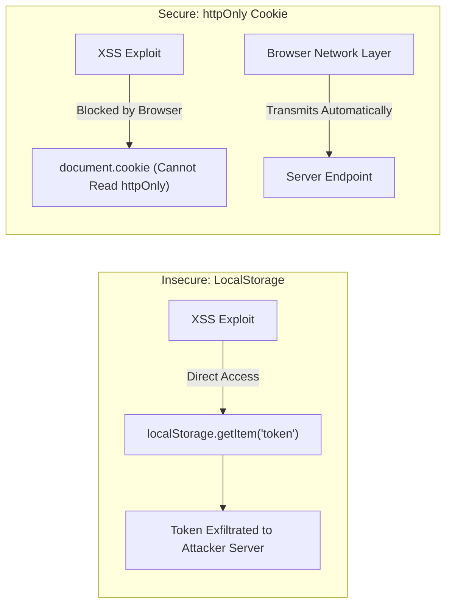

Frontend applications serve as the primary attack surface exposed directly to end-user browsers. In a multi-tenant client ecosystem handling confidential corporate data, customer records, and payment gateways, a single Cross-Site Scripting (XSS) vulnerability or accidental credential exposure can lead to catastrophic data breaches.

This guide provides an exhaustive technical specification for securing Next.js applications, sanitizing untrusted inputs, configuring strict Content Security Policies (CSP), and managing sensitive authentication credentials.

## Cross-Site Scripting (XSS) Prevention

React protects against XSS by automatically escaping strings embedded within JSX expressions (`<div>{userInput}</div>`). However, specific patterns bypass this protection and introduce vulnerabilities:

### 1. The Danger of `dangerouslySetInnerHTML`

Rendering raw HTML from user inputs or untrusted third-party APIs can lead to script injection. If rendering raw HTML is unavoidable (e.g., displaying rich text content from a headless CMS), you must sanitize the input using **DOMPurify**:

```tsx
import DOMPurify from "isomorphic-dompurify";

export function SafeRichText({ contentHtml }: { contentHtml: string }) {
  // Sanitize markup, stripping malicious <script>, <iframe>, and onload handlers
  const cleanHtml = DOMPurify.sanitize(contentHtml, {
    USE_PROFILES: { html: true },
    ALLOWED_TAGS: ["p", "b", "i", "em", "strong", "a", "ul", "ol", "li", "h2", "h3"],
    ALLOWED_ATTR: ["href", "target", "rel"],
  });

  return (
    <div
      className="prose"
      dangerouslySetInnerHTML={{ __html: cleanHtml }}
    />
  );
}
```

### 2. URL Scheme Validation (`javascript:` URI Injections)

Passing user-supplied URLs directly to `<a href={userUrl}>` can trigger arbitrary script execution via `javascript:` links:

```tsx
// Anti-Pattern: Unvalidated href allows XSS
<a href={userWebsite}>Visit Profile</a> // What if userWebsite === "javascript:stealCookies()"?

// Best Practice: Strict protocol validation
export function sanitizeUrl(url: string): string {
  try {
    const parsed = new URL(url);
    if (parsed.protocol === "http:" || parsed.protocol === "https:") {
      return parsed.toString();
    }
  } catch {
    // Malformed URL
  }
  return "#";
}

<a href={sanitizeUrl(userWebsite)} rel="noopener noreferrer" target="_blank">
  Visit Profile
</a>
```

## Authentication: Secure `httpOnly` Cookie Storage

Client-side tokens stored in `localStorage` or `sessionStorage` are readable by any JavaScript code running in the window, making them vulnerable to token theft via XSS vulnerabilities:



### Cookie Security Standards
- **`httpOnly`**: Prohibits client-side scripts from reading the cookie via `document.cookie`.
- **`Secure`**: Enforces transmission strictly over encrypted HTTPS connections.
- **`SameSite=Lax` / `SameSite=Strict`**: Protects against Cross-Site Request Forgery (CSRF).

Nexium Media standardizes on **Auth.js** (NextAuth) or managed session cookies set directly by backend API authentication gateways.

## Authorization: Never Trust Client-Side State

Client-side checks (such as hiding an "Admin Panel" link using `user.role === 'admin'`) are purely cosmetic conveniences to improve user experience. They do not provide real security.

```typescript
// app/api/admin/users/route.ts (Server Route Handler)
import { auth } from "@/lib/auth";
import { NextResponse } from "next/server";

export async function DELETE(request: Request) {
  // 1. Verify authenticated session server-side
  const session = await auth();
  if (!session?.user) {
    return NextResponse.json({ error: "Unauthorized" }, { status: 401 });
  }

  // 2. Verify authorization permissions server-side
  if (session.user.role !== "SUPER_ADMIN") {
    return NextResponse.json({ error: "Forbidden: Super Admin access required" }, { status: 403 });
  }

  // 3. Execute privileged operation
  // ...
}
```

## Content Security Policy (CSP)

A Content Security Policy restricts the domains and resources the browser is allowed to load and execute. Configure strict CSP headers in `next.config.ts`:

```typescript
// next.config.ts
import type { NextConfig } from "next";

const cspHeader = `
  default-src 'self';
  script-src 'self' 'unsafe-eval' 'unsafe-inline' https://www.googletagmanager.com;
  style-src 'self' 'unsafe-inline';
  img-src 'self' blob: data: https://images.unsplash.com https://nexiummedia.com;
  font-src 'self';
  object-src 'none';
  base-uri 'self';
  form-action 'self';
  frame-ancestors 'none';
  connect-src 'self' https://api.nexiummedia.com https://vitals.vercel-insights.com;
  upgrade-insecure-requests;
`;

const nextConfig: NextConfig = {
  async headers() {
    return [
      {
        source: "/(.*)",
        headers: [
          {
            key: "Content-Security-Policy",
            value: cspHeader.replace(/\n/g, ""),
          },
          {
            key: "X-Frame-Options",
            value: "DENY",
          },
          {
            key: "X-Content-Type-Options",
            value: "nosniff",
          },
          {
            key: "Referrer-Policy",
            value: "strict-origin-when-cross-origin",
          },
        ],
      },
    ];
  },
};

export default nextConfig;
```

## Environment Variable Secrets Management

- **Public Client Variables**: Must carry the explicit `NEXT_PUBLIC_` prefix (e.g., `NEXT_PUBLIC_STRIPE_KEY`). These values are embedded into the client bundle at build time and are visible to anyone inspecting the page.
- **Server Secrets**: Omit the prefix (e.g., `DATABASE_URL`, `JWT_SECRET`). These values are only accessible inside Server Components, Route Handlers, and Server Actions.

### Runtime Environment Schema Validation

Validate all environment variables on boot using Zod to catch missing configuration before serving traffic:

```typescript
// env.ts
import { z } from "zod";

const envSchema = z.object({
  DATABASE_URL: z.string().url(),
  NEXT_PUBLIC_API_BASE_URL: z.string().url(),
  NEXT_PUBLIC_APP_ENV: z.enum(["development", "staging", "production"]),
});

export const env = envSchema.parse(process.env);
```

<Callout type="warning">
Never commit `.env.local` or any private credential files to source control. In the event an access token or private key is committed, treat it as immediately compromised: rotate the key, invalidate existing sessions, and rewrite the Git commit history using `git-filter-repo`.
</Callout>

## Dependency Security & Audits

Vulnerable third-party packages in `node_modules` represent a common attack vector. We enforce dependency scanning in our CI pipelines:

```bash
# Fail CI build if any critical or high severity vulnerabilities are found
npm audit --audit-level=high
```

- Enable **GitHub Dependabot Alerts** and automated security patch pull requests.
- Review and pin package versions in `package-lock.json` to prevent malicious upstream supply-chain updates.

## Related

- [Quality Standards Overview](/docs/development/frontend/quality)
- [Typed API Client Integration](/docs/development/frontend/state-and-data/api-integration)
- [Authentication & Form Architecture](/docs/development/frontend/ui-components/forms-and-validation)
- [Code Review Checklist](/docs/development/frontend/quality/code-review)

