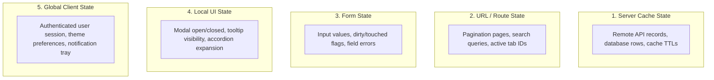
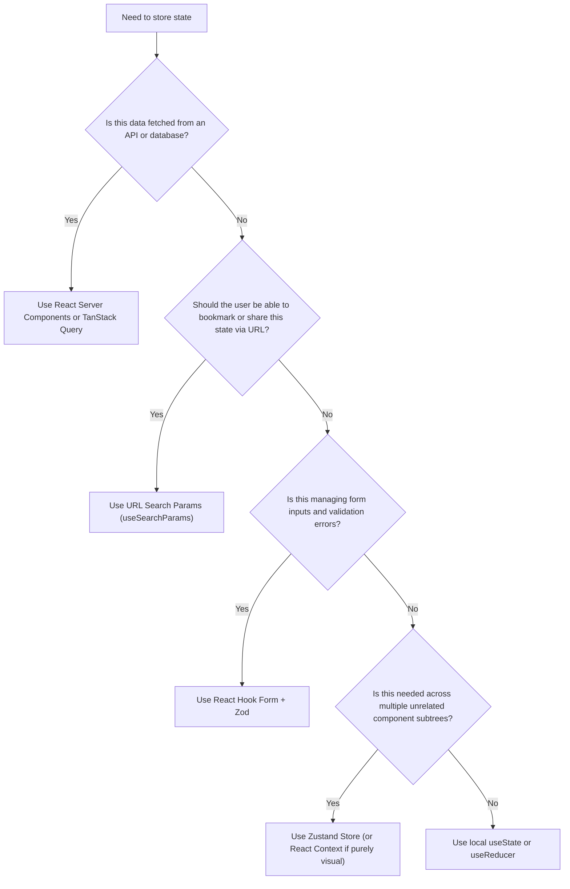

Managing state effectively is the difference between a responsive, predictable frontend and an application plagued by race conditions, desynchronized UIs, and ghost renders. In a large enterprise application, state is rarely monolithic. Treating external server data, URL query filters, and local dropdown toggles with the same state tool creates unnecessary complexity.

This section establishes our state taxonomy, provides an architectural decision tree, and details our standard state and data fetching toolchain.

## The Five Categories of Frontend State

Nexium Media classifies state into five distinct categories:

| State Category | Characteristics | Primary Tool | Anti-Pattern |
| :--- | :--- | :--- | :--- |
| **Server Cache State** | Asynchronous, remote, shared, requires invalidation and revalidation. | **TanStack Query** (or Server Components) | Storing API response payloads manually inside Redux or Zustand. |
| **URL / Route State** | Bookmarkable, shareable, survives page reloads. | **`useSearchParams` / `nuqs`** | Keeping table filters in local `useState` so links cannot be shared. |
| **Form State** | High-frequency input changes, validation rules, dirty tracking. | **React Hook Form + Zod** | Managing controlled inputs with root-level component `useState`. |
| **Local UI State** | Ephemeral, isolated to one or two components, disappears on unmount. | **`useState` / `useReducer`** | Hoisting a simple modal toggle into a global Zustand store. |
| **Global Client State**| Cross-cutting client data needed across distinct routes. | **Zustand** (or React Context) | Creating a sprawling single-store architecture for unrelated state. |

## Architectural Decision Tree

When introducing new state to a feature, follow this decision tree to select the appropriate tool:

## State & Data Toolchain Summary

- **Next.js Server Components**: Direct server-side data fetching without client hydration overhead.
- **TanStack Query (v5)**: Declarative client-side cache management, background refetching, and optimistic updates.
- **Zustand**: Lightweight, boilerplate-free global client state with custom middlewares.
- **React Hook Form**: High-performance, uncontrolled form state.
- **Typed API Client**: Standardized `fetch` wrapper enforcing Zod schema parsing and normalized error structures.

<Callout type="tip">
Default to keeping state as local as possible. State co-located near its point of use simplifies refactoring, minimizes re-renders, and makes code easier to test.
</Callout>

## Related

- [State Management Deep Dive](/docs/development/frontend/state-and-data/state-management)
- [Data Fetching & Caching](/docs/development/frontend/state-and-data/data-fetching)
- [API Integration Standards](/docs/development/frontend/state-and-data/api-integration)
- [Error Handling Architecture](/docs/development/frontend/state-and-data/error-handling)
