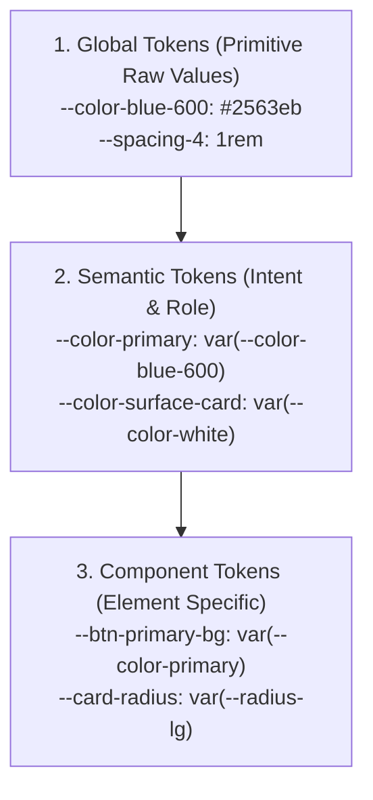

Design tokens are the atomic visual attributes—colors, typography, spacing, elevation shadows, and corner radii—that define a digital design language. By abstracting raw hex values and pixel units into named, platform-agnostic tokens, Nexium Media maintains strict design consistency between Figma design files and production codebases.

This guide details token definitions in CSS variables, semantic abstraction tiers, scale hierarchies, and synchronization workflows with design teams.

## The Three Tiers of Design Tokens

We structure design tokens into three hierarchical tiers:



1. **Global (Primitive) Tokens**: Direct mappings of raw values (e.g., `--color-slate-900: #0f172a`). They have no intrinsic context or intent.
2. **Semantic Tokens**: Represent functional roles and adapt automatically between light and dark themes (e.g., `--color-background`, `--color-destructive`).
3. **Component Tokens**: Bind semantic tokens to specific component properties (e.g., `--button-padding-y`).

## Declaring Tokens as CSS Custom Properties

Define design tokens in `app/globals.css`. By leveraging HSL (Hue, Saturation, Lightness) channels without the `hsl()` wrapper, Tailwind can dynamically apply alpha transparency modifiers (`bg-primary/50`):

```css
/* app/globals.css */
@layer base {
  :root {
    /* Semantic Surfaces & Text (Light Mode) */
    --background: 0 0% 100%;             /* #ffffff */
    --foreground: 222.2 84% 4.9%;        /* #020817 */

    /* Brand & Accent Tokens */
    --primary: 221.2 83.2% 53.3%;        /* #2563eb */
    --primary-foreground: 210 40% 98%;

    --secondary: 210 40% 96.1%;
    --secondary-foreground: 222.2 47.4% 11.2%;

    --muted: 210 40% 96.1%;
    --muted-foreground: 215.4 16.3% 46.9%;

    --destructive: 0 84.2% 60.2%;
    --destructive-foreground: 210 40% 98%;

    --border: 214.3 31.8% 91.4%;
    --input: 214.3 31.8% 91.4%;
    --ring: 221.2 83.2% 53.3%;

    /* Geometry Tokens */
    --radius-sm: 0.25rem;  /* 4px */
    --radius-md: 0.5rem;   /* 8px */
    --radius-lg: 0.75rem;  /* 12px */
  }

  .dark {
    /* Semantic Surfaces & Text (Dark Mode) */
    --background: 222.2 84% 4.9%;        /* #020817 */
    --foreground: 210 40% 98%;           /* #f8fafc */

    --primary: 217.2 91.2% 59.8%;        /* Brighter blue for dark surfaces */
    --primary-foreground: 222.2 47.4% 11.2%;

    --secondary: 217.2 32.6% 17.5%;
    --secondary-foreground: 210 40% 98%;

    --muted: 217.2 32.6% 17.5%;
    --muted-foreground: 215 20.2% 65.1%;

    --destructive: 0 62.8% 30.6%;
    --destructive-foreground: 210 40% 98%;

    --border: 217.2 32.6% 17.5%;
    --input: 217.2 32.6% 17.5%;
    --ring: 224.3 76.3% 48%;
  }
}
```

## Mapping Tokens in `tailwind.config.ts`

Expose your CSS custom properties to Tailwind utility classes by configuring `tailwind.config.ts`:

```typescript
import type { Config } from "tailwindcss";

const config: Config = {
  darkMode: ["class"],
  theme: {
    extend: {
      colors: {
        border: "hsl(var(--border))",
        input: "hsl(var(--input))",
        ring: "hsl(var(--ring))",
        background: "hsl(var(--background))",
        foreground: "hsl(var(--foreground))",
        primary: {
          DEFAULT: "hsl(var(--primary))",
          foreground: "hsl(var(--primary-foreground))",
        },
        muted: {
          DEFAULT: "hsl(var(--muted))",
          foreground: "hsl(var(--muted-foreground))",
        },
      },
      borderRadius: {
        lg: "var(--radius-lg)",
        md: "var(--radius-md)",
        sm: "var(--radius-sm)",
      },
    },
  },
};

export default config;
```

## The Standard Scales

### 1. 4px Spacing Grid
All spacing (padding, margin, gap) follows a strict 4-pixel base grid:

| Token Key | Dimension | Usage Example |
| :--- | :--- | :--- |
| `1` | `0.25rem` (4px) | Tight icon margins, border offsets. |
| `2` | `0.5rem` (8px) | Badge padding, compact form gaps. |
| `3` | `0.75rem` (12px) | Input field internal padding. |
| `4` | `1.0rem` (16px) | Standard card body padding. |
| `6` | `1.5rem` (24px) | Section spacing, container gutters. |
| `8` | `2.0rem` (32px) | Page header separation. |
| `12` | `3.0rem` (48px) | Large landing section separation. |

### 2. Typography Scale
Typography tokens pair font size with appropriate line height to guarantee readability:

```css
/* Typography Scale */
--text-xs: 0.75rem / 1rem;       /* 12px / 16px */
--text-sm: 0.875rem / 1.25rem;   /* 14px / 20px */
--text-base: 1.0rem / 1.5rem;     /* 16px / 24px */
--text-lg: 1.125rem / 1.75rem;   /* 18px / 28px */
--text-xl: 1.25rem / 1.75rem;    /* 20px / 28px */
--text-2xl: 1.5rem / 2rem;       /* 24px / 32px */
--text-3xl: 1.875rem / 2.25rem;  /* 30px / 36px */
```

## Figma Token Synchronization (Token Studio)

Nexium design pods use the **Tokens Studio for Figma** plugin to export design tokens directly as JSON files:

```json
{
  "global": {
    "color": {
      "brand": {
        "primary": { "value": "#2563eb", "type": "color" }
      }
    }
  }
}
```

A GitHub Action transforms this JSON export into CSS variables on the `develop` branch, keeping Figma prototypes and frontend code synchronized automatically.

<Callout type="tip">
When brand redesigns occur, modifying a single semantic token variable (e.g., changing `--primary` from blue to emerald) automatically cascades across hundreds of UI components with zero manual search-and-replace.
</Callout>

## Related

- [Styling Philosophy Overview](/docs/development/frontend/styling)
- [Tailwind CSS Architecture](/docs/development/frontend/styling/tailwind-css)
- [Component Library (shadcn/Radix)](/docs/development/frontend/ui-components/component-library)
- [Accessibility Compliance Guide](/docs/development/frontend/quality/accessibility)

