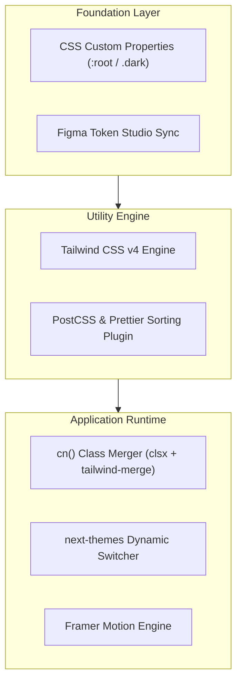

Styling at Nexium Media balances visual expressiveness with engineering discipline. In an agency environment delivering high-polish enterprise portals, marketing sites, and data-dense dashboards, an undisciplined CSS approach leads to bloated stylesheets, specificity wars, and fragmented design inconsistencies.

This section outlines our styling philosophy, core technology choices, token architectures, and animation standards.

## The Styling Philosophy

Our styling architecture rests on three core pillars:

### 1. Utility-First Consistency
We mandate **Tailwind CSS** across all frontend applications. Utility classes colocate styles directly with component markup, eliminating the friction of naming arbitrary wrapper classes and preventing global CSS specificity leaks.

### 2. Design System Alignment
Visual properties—colors, typography scales, spacing units, elevation shadows, and corner radii—must originate from defined design tokens. Engineers must not introduce ad-hoc hex values (`#3498db`) or arbitrary pixel dimensions (`margin: 17px`).

```tsx
// Anti-Pattern: Arbitrary values bypass design tokens
<div className="bg-[#123456] p-[13px] rounded-[7px]">

// Best Practice: Token-backed semantic utilities
<div className="bg-primary p-3 rounded-md">
```

### 3. Progressive Enhancement & Accessibility
Styling must enhance the interface without compromising accessibility. All interactive elements must display visible focus rings, satisfy WCAG 2.1 AA color contrast ratios (minimum 4.5:1 for body text), and respect user operating system motion preferences (`prefers-reduced-motion`).

## Core Technology Stack



| Technology | Role in Stack | Documentation Guide |
| :--- | :--- | :--- |
| **Tailwind CSS v4** | Primary utility framework for layout, spacing, and responsive design. | [Tailwind CSS Guide](/docs/development/frontend/styling/tailwind-css) |
| **CSS Variables** | Runtime dynamic design tokens backing light/dark themes. | [Design Tokens](/docs/development/frontend/styling/design-tokens) |
| **Fluid Layouts & Breakpoints** | Mobile-first responsive grids and container queries. | [Responsive Design](/docs/development/frontend/styling/responsive-design) |
| **Framer Motion & CSS Transitions** | Hardware-accelerated animations and micro-interactions. | [Animations & Transitions](/docs/development/frontend/styling/animations) |

<Callout type="tip">
When authoring components, always leverage the `cn()` utility (`lib/utils.ts`) to merge incoming `className` props safely with the component's internal Tailwind rules.
</Callout>

## Related

- [Tailwind CSS Architecture & Standards](/docs/development/frontend/styling/tailwind-css)
- [Responsive Design & Breakpoints](/docs/development/frontend/styling/responsive-design)
- [Design Tokens & Theming](/docs/development/frontend/styling/design-tokens)
- [Animations & Micro-Interactions](/docs/development/frontend/styling/animations)
