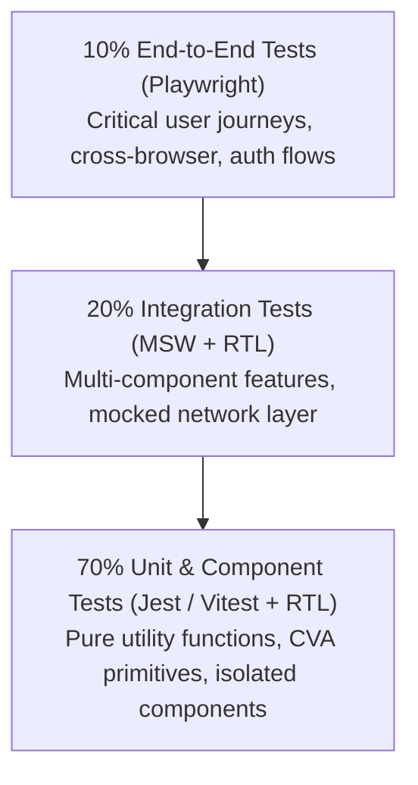

Automated testing is the primary safety net that allows 100+ developers at Nexium Media to deliver code continuously with confidence. High test coverage alone does not guarantee stability; tests that assert internal implementation details (such as component internal state or specific private class methods) create brittle test suites that break during simple refactors without catching actual regressions.

This section defines our testing philosophy, testing pyramid distribution, continuous integration gates, and toolchain standards.

## The Nexium Testing Philosophy: Test Behavior, Not Implementation

Our core testing principle follows the React Testing Library philosophy:

> **"The more your tests resemble the way your software is used, the more confidence they can give you."** — Kent C. Dodds

- **Interact Like a Real User**: Query the DOM through accessible roles, labels, and visible text (`getByRole("button", { name: /save/i })`), rather than arbitrary CSS classes (`.btn-primary`) or internal React component instances.
- **Resilient to Refactoring**: Changing an internal state variable name or switching from `useState` to `useReducer` should not cause tests to fail if the external behavior and markup remain intact.
- **Fail with Clear Diagnostics**: When a test fails, the error message should clearly point to the broken user interaction or missing accessible element.

## The Testing Pyramid

We balance test speed, maintenance cost, and confidence using the classic testing pyramid:



| Layer | Proportion | Tooling | Focus | Execution Speed |
| :--- | :--- | :--- | :--- | :--- |
| **Unit & Component** | ~70% | Jest / RTL, Vitest | Component variants, utility functions, reducer transitions, schema parsing. | Milliseconds per test. |
| **Integration** | ~20% | RTL + Mock Service Worker (MSW) | Form submissions, cache updates, multi-component data flows. | Seconds per test suite. |
| **End-to-End (E2E)** | ~10% | Playwright | Critical checkout journeys, authentication, full cross-browser rendering. | Minutes across CI runners. |

## Pre-Pull Request Verification Checklist

Before pushing a branch or opening a pull request, every engineer must verify that their changes pass all local quality checks:

```bash
# 1. Type verification
npm run typecheck

# 2. Linting & formatting verification
npm run lint

# 3. Unit & component test suites
npm run test

# 4. Critical path integration tests
npm run test:e2e
```

Pull requests with failing tests or reduced code coverage are automatically blocked by GitHub Actions CI branch protection rules.

## Test Co-Location Policy

Unit and component tests must sit directly alongside the code they test:

```text
components/ui/
├── Button.tsx
├── Button.test.tsx       <-- Colocated component test
├── Dialog.tsx
└── Dialog.test.tsx

utils/
├── format-currency.ts
└── format-currency.test.ts  <-- Colocated utility test
```

End-to-End tests and full-page multi-system integration tests reside in the top-level `__tests__/` directory.

<Callout type="tip">
Colocating tests makes it immediately obvious during code review whether a new component or utility includes test coverage. Deleting or renaming a component cleanly removes its tests in the same commit.
</Callout>

## Related

- [Unit & Component Testing Guide](/docs/development/frontend/testing/unit-testing)
- [Integration Testing with MSW](/docs/development/frontend/testing/integration-testing)
- [End-to-End Automation with Playwright](/docs/development/frontend/testing/end-to-end-testing)
- [Code Review Checklist](/docs/development/frontend/quality/code-review)
