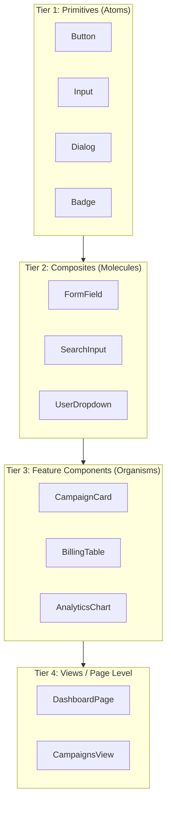
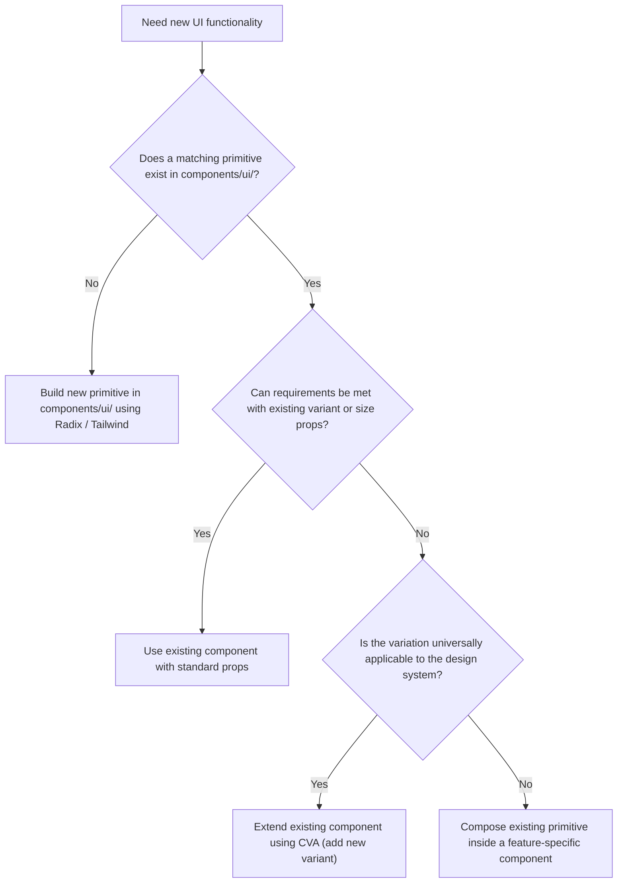

UI components form the core building blocks of every client application at Nexium Media. Delivering consistent, accessible, and high-performance interfaces across a distributed team requires shared conventions for component architecture, prop contracts, and composition patterns.

This section establishes our component philosophy, structural classifications, and component lifecycle workflows.

## Component Philosophy: SOLID Principles in React

We adapt object-oriented SOLID principles to declarative, functional React component design:

### 1. Single Responsibility Principle (SRP)
A component should have one, and only one, reason to change. If a component manages data fetching, complex state, and presentation styling simultaneously, split it into a container/presentational pair or extract the business logic into a custom hook.

### 2. Open/Closed Principle (OCP)
Components should be open for extension (via children composition, render props, or polymorphic `asChild` slots) but closed for modification. You should rarely need to add arbitrary boolean flags to a component to support an edge-case layout.

### 3. Liskov Substitution Principle (LSP)
A specialized primitive (e.g., `<PrimaryButton>`) must be completely substitutable wherever a standard `<Button>` or `<button>` element is expected, preserving all standard HTML attributes (`disabled`, `aria-*`, `onClick`).

### 4. Interface Segregation Principle (ISP)
Do not force a component to depend on props it does not use. Rather than passing an entire `User` domain model with 30 fields into an avatar component, accept only the necessary properties: `name` and `avatarUrl`.

## Component Categories

We classify components into four distinct architectural tiers:



| Category | Location | Responsibilities | Dependencies |
| :--- | :--- | :--- | :--- |
| **Primitives** | `components/ui/` | Purely visual, headless-backed (Radix), accessible atoms. Zero business logic. | None (pure UI). |
| **Composites** | `components/forms/`, `components/layout/` | Combinations of primitives (e.g., Label + Input + Error = FormField). | Primitives. |
| **Feature Components** | `features/<name>/components/` | Domain-aware components backed by feature types, hooks, or Server Actions. | Primitives, Composites, Feature hooks. |
| **Views / Pages** | `app/` | Assembles features into complete route layouts and pages. Handles metadata and server data. | Feature components, Layout chrome. |

## Decision Tree: Extend Existing vs. Create New

Before creating a new component, follow this decision tree to prevent component bloat and duplicate implementations:



## Component Development Lifecycle

Every shared component follows a five-stage maturity lifecycle:

```text
1. Authoring -> 2. Documentation -> 3. Testing -> 4. Review -> 5. Release
```

1. **Authoring**: Build the component using TypeScript, Radix UI primitives, and `class-variance-authority` (CVA).
2. **Documentation**: Provide clear JSDoc descriptions on all prop interfaces and provide usage examples.
3. **Testing**: Write unit tests verifying keyboard accessibility, ARIA compliance, and all variant combinations with React Testing Library.
4. **Code Review**: Audit for accessibility, bundle impact, and compliance with Nexium design tokens.
5. **Release**: Publish to `components/ui/` and communicate updates in the frontend engineering changelog.

## Related

- [Component Design Deep Dive](/docs/development/frontend/ui-components/component-design)
- [Props & Composition Patterns](/docs/development/frontend/ui-components/props-and-composition)
- [Forms & Schema Validation](/docs/development/frontend/ui-components/forms-and-validation)
- [Reusable Component Systems](/docs/development/frontend/ui-components/reusable-components)
- [Component Library (shadcn/Radix)](/docs/development/frontend/ui-components/component-library)
