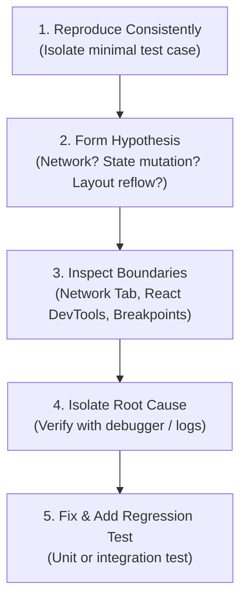

Debugging modern full-stack frontend applications requires a structured methodology. Randomly inserting `console.log` statements throughout component trees often masks root causes and wastes valuable time. A senior engineer approaches debugging with scientific precision: isolating reproductions, inspecting network boundaries, using breakpoints, and measuring performance metrics.

This guide provides technical runbooks for browser inspection suites, React Profiler analysis, VS Code debug configurations, hydration troubleshooting, and memory profiling.

## The Systematic Debugging Process



## Browser DevTools Mastery

Modern browser DevTools provide deep visibility into runtime execution:

### 1. Network Panel: Request Analysis
- **Filter by `Fetch/XHR`**: Isolates client API calls from static asset requests.
- **Inspect Payload and Headers**: Check the `Request Headers` to ensure `Authorization: Bearer <token>` and `Content-Type: application/json` are set correctly.
- **Simulate Network Conditions**: Use throttling presets ("Fast 3G", "Slow 4G", "Offline") to test loading skeletons, error states, and optimistic updates under realistic network constraints.

### 2. Elements & Layout Inspection
- **Inspect Computed Styles**: Use the Computed tab to see the final calculated value of properties like `font-size` or `padding`, and trace which CSS selector took precedence.
- **Flexbox & Grid Overlays**: Click the `flex` or `grid` badges in the DOM tree to display visual alignment lines and gap areas directly over the viewport.

### 3. Application Panel: Client State
- Inspect `Cookies` to verify whether session tokens have `HttpOnly` and `Secure` flags set.
- Check `Local Storage` and `Session Storage` for stale cache objects or malformed JSON strings.

## React Developer Tools

### 1. Component Tree & Props Inspection
The **Components** tab reveals the live React fiber tree:
- Inspect current `props`, `state`, and `hooks` for any rendered component.
- Click the watch icon to monitor specific prop values as you interact with the page.
- Temporarily override prop values directly in DevTools to test how the UI handles unexpected values.

### 2. React Profiler: Finding Render Bottlenecks
Use the **Profiler** tab to identify components causing performance issues:
1. Click the record icon.
2. Perform the user interaction (e.g., typing in a filter input).
3. Stop the recording.
4. Inspect the Flamegraph and Ranked views:
   - Yellow/orange bars represent components that took a long time to render.
   - Hover over a component to read **"Why did this render?"** (e.g., "Props changed: `[onClick]`" indicates an un-memoized anonymous arrow function).

## VS Code Full-Stack Debugging Configuration

Debug both server-side Next.js code and client-side browser code simultaneously within VS Code:

```json
// .vscode/launch.json
{
  "version": "0.2.0",
  "configurations": [
    {
      "name": "Next.js: Debug Server",
      "type": "node-terminal",
      "request": "launch",
      "command": "npm run dev"
    },
    {
      "name": "Next.js: Debug Client",
      "type": "chrome",
      "request": "launch",
      "url": "http://localhost:3000",
      "webRoot": "${workspaceFolder}"
    },
    {
      "name": "Next.js: Full-Stack Debug",
      "type": "node-terminal",
      "request": "launch",
      "command": "npm run dev",
      "serverReadyAction": {
        "pattern": "- Local:.+(http://.+)",
        "uriFormat": "%s",
        "action": "debugWithChrome"
      }
    }
  ]
}
```

Set breakpoints by clicking the margin next to line numbers. When execution pauses:
- Inspect variables in the **Variables** panel.
- Add expressions to the **Watch** panel.
- Step through execution using Step Over (`F10`), Step Into (`F11`), and Continue (`F5`).

## Troubleshooting Hydration Mismatches

A **hydration mismatch** occurs when the HTML generated on the server does not match the initial DOM tree rendered by React in the browser.

```text
Error: Hydration failed because the initial UI does not match what was rendered on the server.
Warning: Expected server HTML to contain a matching <span> in <div>.
```

### Common Causes & Fixes

#### 1. Browser-Only Globals (Dates, Timestamps, Random Values)
```tsx
// Anti-Pattern: Renders different values on server vs browser
<p>Current Time: {new Date().toLocaleTimeString()}</p>

// Best Practice: Render only after mounting on client
export function LiveClock() {
  const [time, setTime] = useState<string | null>(null);

  useEffect(() => {
    setTime(new Date().toLocaleTimeString());
  }, []);

  return <p>Current Time: {time ?? "Loading..."}</p>;
}
```

#### 2. Invalid HTML Nesting
Nesting block elements inside inline tags violates HTML specifications and causes browser engines to alter the DOM tree before React hydraton:
- Placing a `<p>` or `<div>` inside another `<p>`.
- Nesting an `<a>` inside another `<a>`.
- Placing a `<div>` inside a `<span>` or `<table>` outside a `<td>`.

#### 3. Browser Extensions Injecting DOM Nodes
Extensions (password managers, translation tools) often inject elements into the DOM.
- Test in an Incognito window with extensions disabled to verify if an extension is the source of the mismatch.
- Use `suppressHydrationWarning` on elements whose attributes are altered by third-party scripts (e.g., `<html lang="en" suppressHydrationWarning>`).

## Advanced Console Techniques

Move beyond standard `console.log` with structured console APIs:

```typescript
// 1. Tabular data visualization
console.table(users, ["id", "name", "role", "email"]);

// 2. Performance timing benchmarks
console.time("DataProcessingDuration");
const processed = processRawMetrics(largeDataset);
console.timeEnd("DataProcessingDuration"); // Outputs: DataProcessingDuration: 14.28ms

// 3. Grouped hierarchical logs
console.group("User Authentication Flow");
console.log("Token received:", token);
console.log("Permissions resolved:", perms);
console.groupEnd();

// 4. Conditional assertions
console.assert(user.age >= 18, "Validation failure: User must be 18 or older", user);
```

<Callout type="warning">
Strip all `console.log` statements before deploying to production. Our ESLint flat configuration includes `"no-console": ["warn", { "allow": ["warn", "error"] }]` to prevent development logs from leaking sensitive data in production browser consoles.
</Callout>

## Common Debugging Scenarios

### Infinite Re-render Loops
- **Symptom**: "Maximum update depth exceeded" error; browser tab freezes.
- **Cause**: Updating state directly in the body of a component without an event handler or effect guard (`setCount(count + 1)` called during render).
- **Fix**: Move state updates into an event handler (`onClick`) or wrap them in a `useEffect` with appropriate dependencies.

### State Not Updating
- **Symptom**: Calling `setState` does not update the UI.
- **Cause**: In-place mutation of an array or object (`state.items.push(newItem)`). React performs reference equality checks (`Object.is`) and skips re-rendering because the object reference did not change.
- **Fix**: Create a new reference using spread syntax: `setItems([...items, newItem])`.

## Related

- [Engineering Workflows Overview](/docs/development/frontend/workflows)
- [Local Development Workflows](/docs/development/frontend/workflows/local-development)
- [Troubleshooting Runbook](/docs/development/frontend/workflows/troubleshooting)
- [Performance Optimization](/docs/development/frontend/quality/performance)

