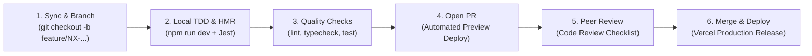

Predictable, frictionless development workflows keep engineering teams productive and focused. When engineers understand the path from checking out a feature branch to deploying code to production, context switching decreases, onboarding accelerates, and production deployments become routine events.

This section details our daily development cadence, advanced debugging techniques, build and deployment pipelines, and runbook solutions for common operational issues.

## The Daily Engineering Cadence

Every frontend engineer at Nexium Media follows a standardized six-stage delivery workflow:

1. **Synchronize & Branch**: Pull the latest changes from `develop` and create a dedicated feature branch using our branch naming conventions (`feature/NX-1024-description`).
2. **Local TDD & Fast Refresh**: Build features using the Next.js local development server with Hot Module Replacement and colocated test suites.
3. **Pre-Commit Verification**: Run typecheck, linting, and automated unit tests locally before pushing to the remote repository.
4. **Pull Request & Preview**: Open a PR on GitHub. Continuous integration runs the full test matrix while Vercel generates an isolated preview URL for design and product review.
5. **Peer Review**: Reviewers audit the pull request against our code review checklist, verifying accessibility, performance, and type safety.
6. **Merge & Continuous Delivery**: Once approved and all CI checks pass, the branch is squashed and merged into `develop`, triggering automated deployment pipelines.

## Workflow Guides Overview

| Guide | Core Scope | Practical Takeaways |
| :--- | :--- | :--- |
| [Local Development](/docs/development/frontend/workflows/local-development) | Daily development practices, watch modes, Docker auxiliary services, and environment variable synchronization. | Setup and maintain a fast local development workflow. |
| [Debugging Deep Dive](/docs/development/frontend/workflows/debugging) | Chrome DevTools, React Component Profiler, VS Code full-stack debugging, and hydration mismatch resolution. | Diagnose and resolve elusive bugs and render loops. |
| [Build & Deployment](/docs/development/frontend/workflows/build-and-deployment) | Production build pipelines, Vercel deployments, CI/CD automation, and rollback runbooks. | Zero-downtime production deployments. |
| [Troubleshooting Runbook](/docs/development/frontend/workflows/troubleshooting) | Step-by-step solutions for hydration mismatches, module resolution failures, port collisions, and CI build failures. | Rapid recovery from common development hurdles. |

<Callout type="tip">
When switching between projects or pulling substantial changes from colleagues, run `npm ci` rather than `npm install` to keep your local dependencies completely synchronized with the committed lockfile.
</Callout>

## Related

- [Local Development Cadence](/docs/development/frontend/workflows/local-development)
- [Debugging Workflows Deep Dive](/docs/development/frontend/workflows/debugging)
- [Build & Deployment Pipelines](/docs/development/frontend/workflows/build-and-deployment)
- [Troubleshooting Runbook](/docs/development/frontend/workflows/troubleshooting)
