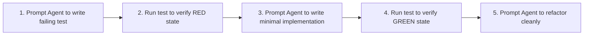

# Coding & Bug Fixing Prompt Engineering

AI coding tools have transitioned from inline auto-completions into **autonomous agents** capable of reading multi-file repositories, executing shell commands, diagnosing test failures, and editing complex codebases (e.g. Cursor Composer, Claude Code, GitHub Copilot Workspace, Aider).

In this environment, prompt engineering is no longer about writing conversational prose—it is **task design, context boundary pinning, and automated verification**.

---

## The 5-Part Agentic Bug-Fix Anatomy

When sending a bug report to an AI agent, unstructured queries (*"The checkout modal is broken, fix it"*) lead to uncontrolled file modifications and hallucinated dependencies. Every bug-fixing prompt must contain five explicit blocks:

```text
1. The Trigger / Symptom: Exact runtime error, stack trace, or unintended state mutation.
2. The Scope Boundary: Explicit files to inspect (@file), and strict "do not touch" constraints.
3. The Workflow Sequence: Phased execution (Analyze -> Hypothesize -> Propose -> Implement).
4. The Verification Command: The deterministic CLI command to prove the bug is resolved.
5. The Success Receipt: The exact expected outcome (e.g. green test suite, clean linter).
```

---

## Production Prompt Templates

### Template 1: Autonomous Bug Diagnosis & Fix (Claude Code / Terminal Agents)

This template leverages the agent's ability to run terminal commands to autonomously reproduce, diagnose, and verify the patch:

```markdown
# INCIDENT: Concurrent Webhook Race Condition in Wallet Service

## 1. Symptom & Stack Trace
When simultaneous Razorpay payment webhooks hit `/api/webhooks/razorpay` with the same `payment_id`, duplicate ledger entries are created and user balance is incremented twice.
Stack trace excerpt:
```text
PrismaClientKnownRequestError: Unique constraint failed on the fields: (`idempotency_key`)
    at WebhookService.processPayment (src/services/webhook.ts:42:15)
```

## 2. File Scope
- Target implementation: `@src/services/webhook.ts`
- Database repository: `@src/repositories/ledger.repository.ts`
- Boundary: Do NOT modify `@src/controllers/webhook.controller.ts` or database migration files.

## 3. Workflow Protocol
Step 1: Read the target files. Do NOT write any code yet.
Step 2: Formulate an exact hypothesis explaining why the current transaction boundary permits the race condition.
Step 3: Propose a solution utilizing either PostgreSQL row-level locks (`SELECT ... FOR UPDATE`) or an interactive Prisma transaction with serializable isolation.
Step 4: Once proposed, wait for confirmation or implement directly if confidence is high.
Step 5: Write a reproducible concurrency test in `@tests/integration/webhook.concurrency.test.ts`.

## 4. Verification Command
Run the test suite:
`npm test -- tests/integration/webhook.concurrency.test.ts`
Ensure all tests pass and `npm run lint` reports 0 warnings.
```

---

### Template 2: Surgical UI Component Refactoring (Cursor Composer)

When working inside Cursor Composer, context pinning (`@`) and negative constraints prevent the agent from inadvertently rewriting adjacent CSS or business logic:

```markdown
Refactor `@src/components/CheckoutModal.tsx` to extract the payment method selection list into a standalone compound component.

<context>
Currently, `CheckoutModal.tsx` contains 450 lines of code coupling dialog lifecycle, form submission, and individual payment gateway UI state.
</context>

<instructions>
1. Create a new file `@src/components/PaymentMethodSelector.tsx`.
2. Move the radio group selection logic, icon rendering, and fee calculation into this new component.
3. Retain the exact same TypeScript prop types and Tailwind styling.
4. Import and render `PaymentMethodSelector` inside `CheckoutModal.tsx`.
</instructions>

<constraints>
- Strict constraint: Do NOT alter the visual layout, spacing, or animation transitions.
- Do NOT modify `@src/hooks/usePaymentGateway.ts`.
- Ensure all event handlers (`onSelect`, `onError`) remain backwards-compatible.
- Run `npm run typecheck` to verify no broken exports.
</constraints>
```

---

## Test-Driven Prompting (TDD with AI)

One of the most reliable engineering workflows is **Test-Driven Prompting**:



### The TDD Prompt Pattern
```markdown
We are adding a new business rule: Users with subscription tier `ENTERPRISE` must receive a 20% discount on add-on seat purchases if quantity > 50.

Phase 1:
Write a comprehensive unit test suite in `@tests/unit/pricing.service.test.ts` covering:
- Regular user with 10 seats (0% discount)
- Enterprise user with 49 seats (0% discount)
- Enterprise user with 50 seats (0% discount - boundary condition)
- Enterprise user with 51 seats (20% discount applied)

Do not implement the business logic yet. Run `npm test -- pricing.service.test.ts` to confirm the new test cases fail with `NotImplementedError`.
```

---

## Configuring Persistent Repository Rules (`.cursorrules` & `CLAUDE.md`)

Avoid repeating project-wide architectural constraints in every prompt by codifying them into persistent repository configuration files:

```markdown title=".cursorrules or CLAUDE.md"
# Nexium Media Engineering Standards

## Architecture & Conventions
- Framework: Next.js App Router (RSC by default). Mark components with `'use client'` only when state or browser APIs are required.
- TypeScript: Enforce strict mode. Never use `any`. Use `unknown` and narrow with Zod schemas.
- Styling: Tailwind CSS v4 utility classes only. Do not create raw `.css` files or use CSS modules.
- Imports: Always use absolute path alias `@/...`.
- Icons: Standardize on `lucide-react`.

## Code Modification Rules
- Do not add new npm dependencies without explicit instruction.
- Every new service function must include input validation via Zod or Pydantic.
- Always run `npm run typecheck` and `npm test` before declaring a task complete.
```

---

## Anti-Patterns to Avoid

| Anti-Pattern | Description | Engineering Fix |
| :--- | :--- | :--- |
| **The "Vibe" Prompt** | *"Fix the login bug."* (No stack trace, no files, no criteria). | Provide the exact error message, file pointers (`@auth.service.ts`), and reproduction steps. |
| **Blind Autonomous Execution** | Allowing an agent to rewrite multi-file architectures without an initial plan. | Force a two-step prompt: *"First, inspect the code and generate a 4-bullet architectural plan. Wait for approval."* |
| **Style Over-Prompting** | Spending tokens instructing the model to *"write clean, elegant code"*. | Let ESLint, Prettier, and Biome enforce formatting automatically via prompt verification commands (`npm run lint -- --fix`). |
| **Unbounded File Dives** | Letting agents inspect the entire repo when a bug is localized. | Explicitly pin files: *"Only examine `@src/utils/date.ts` and `@src/utils/date.test.ts`."* |

---

## Related Guides

- [Frontend Engineering Standards](/docs/development/frontend)
- [Backend Layered Architecture](/docs/development/backend/architecture)
- [GitHub PR & Code Review Standards](/docs/development/github/code-review)
- [Automated Testing Strategy](/docs/development/frontend/testing)

