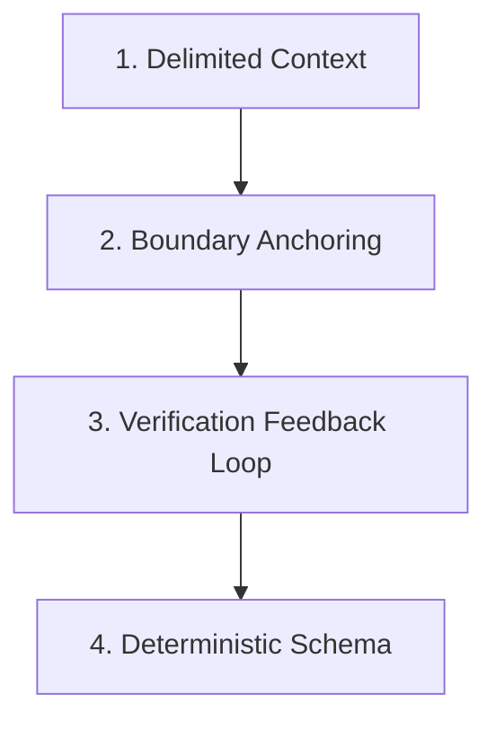

# Prompt Engineering Handbook

Welcome to the **Nexium Media Prompt Engineering Handbook**. As generative AI transitions from simple conversational completions to autonomous agents and native reasoning models (OpenAI o1/o3, DeepSeek-R1, Claude 3.7 Sonnet Extended Thinking, Gemini Thinking), the practice of prompt engineering has fundamentally transformed.

The era of superficial "prompt hacks"—such as appending *"Let's think step by step"* or opening with *"Act as a world-class senior engineer"*—is obsolete. Modern frontier models compute internal chains of thought natively via test-time reasoning compute. Over-prompting or micro-managing reasoning actually degrades output quality.

Today, prompt engineering is **Context Engineering and Task Architecture**: structuring boundaries, pinning exact file scopes, specifying deterministic verification commands, and calibrating multimodal generators with cinematic and technical precision.

---

## The Paradigm Shift: Standard LLMs vs. Reasoning Models

Understanding the architectural difference between standard autoregressive models and modern reasoning models dictates how prompts must be engineered:

| Dimension | Standard Autoregressive (e.g. GPT-4o, Claude 3.5 Sonnet) | Native Reasoning Models (e.g. o1/o3, DeepSeek-R1, Claude 3.7 Thinking) |
| :--- | :--- | :--- |
| **Reasoning Mechanism** | Token-by-token pattern continuation. Needs explicit few-shot examples and Chain-of-Thought prompts. | **Hidden test-time compute** via reinforcement learning. Generates private internal scratchpads (`<think>`). |
| **Prompt Length** | Benefits from rich step-by-step instructions and contextual guardrails. | **Minimalist and direct**. Excessive narrative introduces noise and forces redundant reasoning loops. |
| **"Think Step-by-Step"** | Highly effective prompt booster. | **Counter-productive**. Interferes with the model's native reasoning trajectory. |
| **Primary Control Lever** | Temperature, top_p, system prompt persona framing. | `reasoning_effort` (Low / Medium / High) and token budget limits. |
| **Failure Modes** | Hallucination under pressure, shallow surface logic. | Over-thinking simple problems, excessive token consumption on trivial tasks. |

<Callout type="tip">
**The Golden Rule for Modern Models**: Be direct about **what** needs to be accomplished, define **where** the boundaries lie, and specify **how** success will be verified. Let the reasoning model determine the optimal solution path.
</Callout>

---

## The 4 Pillars of Production Prompt Architecture

Every enterprise prompt authored at Nexium Media follows a standardized 4-pillar structure:



### 1. Delimited Context (XML / Markdown Separation)
Frontier models parse structured delimiters cleanly. Separating raw data payloads from instructional rules prevents prompt injection and ambiguity:

```markdown
<context>
The user is authenticating via OAuth2 PKCE on a mobile client.
</context>

<instructions>
Evaluate whether the token refresh handler handles clock skew correctly.
</instructions>
```

### 2. Boundary Anchoring (Negative Constraints)
LLMs default to eager expansion unless explicitly restrained. High-performing prompts establish rigid negative constraints:
- *"Do NOT modify existing public API signatures."*
- *"Do NOT refactor unrelated styling in `@src/components/Header.tsx`."*
- *"Do NOT use generic marketing cliches such as 'game-changer' or 'unleash'."*

### 3. Verification Feedback Loops
Modern AI agents (Cursor Composer, Claude Code) operate within execution environments. Every complex prompt must specify a concrete command for self-verification:
- *"Run `npm test -- -t 'payment race condition'` to prove the bug is resolved."*
- *"Execute `ruff check .` and `mypy app` before reporting success."*

### 4. Deterministic Output Schemas
Never request unstructured prose when structured data is required. Mandate Markdown comparison tables, typed JSON schemas, or explicit section headings.

---

## Handbook Navigation by Domain

Explore the specialized prompt engineering handbooks tailored for each core discipline across Nexium Media:

<Cards>
  <Card 
    title="Coding & Bug Fixing" 
    href="/docs/prompt-engineering/coding-and-debugging" 
    description="Agentic debugging workflows, Cursor Composer rules, Claude Code execution, and test-driven prompt architecture." 
  />
  <Card 
    title="Marketing & Performance Copywriting" 
    href="/docs/prompt-engineering/marketing-and-cro" 
    description="High-ROAS ad angles, CRO landing page hero frameworks, Few-Shot brand voice calibration, and negative constraint filters." 
  />
  <Card 
    title="Research & Deep Synthesis" 
    href="/docs/prompt-engineering/research-and-synthesis" 
    description="The RAISE-C framework, Recursive Tree-of-Thoughts, literature reviews, epistemic confidence tags, and anti-hallucination guardrails." 
  />
  <Card 
    title="Image Generation" 
    href="/docs/prompt-engineering/image-generation" 
    description="Midjourney v6.1 and FLUX.1 Pro prompt structures, technical camera optics, volumetric lighting, and parameter references." 
  />
  <Card 
    title="Video Generation" 
    href="/docs/prompt-engineering/video-generation" 
    description="Cinematic choreography in OpenAI Sora, Runway Gen-3 Alpha, Kling 1.5, and multi-model First-Frame production pipelines." 
  />
</Cards>

---

## Related Engineering Resources

- [Frontend Engineering Handbook](/docs/development/frontend)
- [Backend Engineering Architecture](/docs/development/backend/architecture)
- [GitHub Workflow & Pull Requests](/docs/development/github)
- [Quality Assurance & Testing Standards](/docs/development/frontend/testing)

